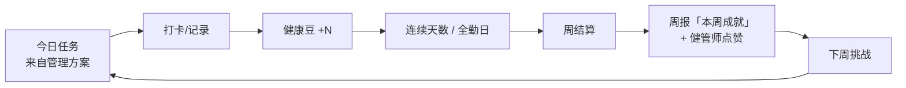
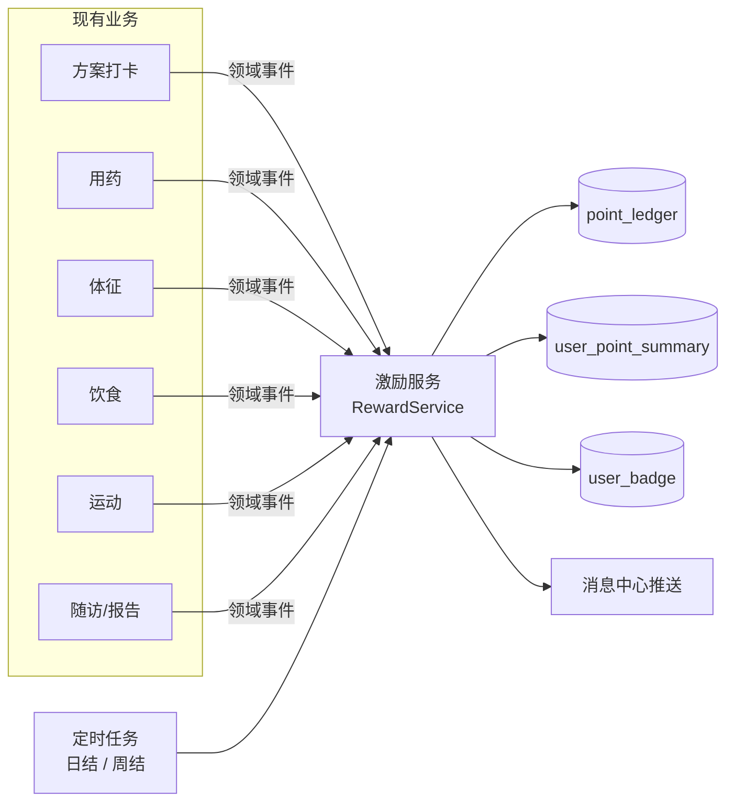

# C 端激励体系 产品与技术方案

| 项 | 内容 |
|---|---|
| 版本 | **v1.0（Grill 4 轮完成）** |
| 日期 | 2026-10-12 |
| 状态 | P1 已实现；P2 已实现（周挑战 / 百分位 / 驾驶舱 / 火苗中断跟进）；兑换商城暂缓 |
| 依据 | `健康管理方案-Agent技术方案.md`、`依从性看板-产品与技术方案.md`、`管理报告-产品与技术方案.md`、`饮食记录-产品与技术方案.md`、`运动记录-产品与技术方案.md` |
| 范围 | C 端患者的**行为激励**：健康豆（积分）→ 连续打卡 → 等级/徽章 → 周挑战 → 克制的同伴对比 → 机构配置的奖励兑换；B 端查看、点赞与配置 |
| 非范围 | 现金/红包、药品及医疗服务折扣、抽奖、跨机构公开排行榜、社交广场 |

---

## 0. 决策

### 0.1 已定

| # | 主题 | 结论 |
|---|------|------|
| G1 | 目标 | 提升**方案完成率、用药达标率、记录活跃度**与留存；激励是手段，不是独立玩法 |
| G2 | 奖励对象 | **只奖励行为，不奖励结果**；结果类成就（血压在范围内、体重下降）只发荣誉徽章，不给健康豆 |
| G3 | 体系归属 | **机构功能为主、平台兜底虚拟奖励**：平台提供能力与虚拟奖励（徽章/头像框/皮肤）；实物与服务权益由机构配置、出资、履约 |
| G4 | 同伴对比 | **MVP 不做任何对比**；P2 上同期百分位（匿名、可关闭、池 < 10 人不展示）；P3 团队 PK；**永不做名次榜** |
| G5 | MVP 奖励 | **纯虚拟**（健康豆、火苗、等级、徽章）；兑换商城放 P2 |
| G10 | 积分归属 | 挂在**患者（people）**上，每张就诊卡独立计算；账号层"家庭合计"放 P3 |
| G11 | 效果验证 | 当前用户量不足以做对照实验：MVP 看**上线前后**打卡率变化 + **3–5 位种子用户访谈**（是否看得懂玩法） |
| G12 | 用药计分口径 | 用药打卡只有「日期 + 时段 + 状态」，无实际服药时刻 → **不区分按时/补服**，按时段 `TAKEN` 计分 |
| G14 | 打卡日（火苗 +1） | **宽松**：当日完成任意 1 项方案任务 / 1 次服药 / 1 次测量即算；全勤另由 +20 与徽章激励 |
| G15 | 代录 | 健管师代录（`recordedByStaffId` 非空等）**不计健康豆、不算打卡日**；只认患者/家属在 C 端完成 |
| G13 | 保护卡 | 每连续满 7 天 +1 张，上限 2 张；漏打日在终结算（G25）时**自动消耗**并推送"已用 1 张保护卡保住 N 天火苗"；24h 内可补打 |
| G16 | 分值结构 | **统一 +5**（全勤日 +20、阅读报告/回复随访 +10、周挑战 +50）；不按行为加权，重点行为靠周挑战引导 |
| G17 | 上线回溯 | **积分不回溯**；**火苗按上线前真实连续打卡天数初始化**；上线首周全员发「开拓者」徽章 |
| G19 | 命名 | 积分叫**健康豆**（避免"健康值"被误解为身体评分，P2 接兑换语义自然） |
| G20 | 首页呈现 | **并入"今日待办"标题区**：右侧火苗天数 + "今日 3/5 · +25 豆"；点击进入「我的成就」；不新增卡片 |
| G8 | 开关粒度 | **租户级**复用 `feature_flag`（`REWARD_ENABLED`）+ **B 端可对单个患者关闭**（晚期、认知障碍等）；机构级开关暂不做 |
| G21 | 周报"本周成就" | 生成报告时写入 `content_json.rewards`（本周豆数、火苗、新徽章、全勤天数）；刷新快照重算，发布后冻结 |
| G22 | 徽章（MVP） | 行为徽章约 8 枚（开拓者、首个全勤日/周、火苗 7/21/60/100、测量 50 次、拍照 30 餐）+ **结果荣誉徽章由周报 `milestones` 转换**（不给豆） |
| G23 | 推送节奏 | 点赞/徽章/保护卡即时推；20:00 "还差 1 项保住 N 天火苗"仅在当日 0 次行为且火苗 ≥ 3 天时发；**除点赞外每日最多 1 条** |
| G24 | 计分接入 | **读时同步 + 夜间对账**：不在业务服务埋事件；C/B 读激励数据时按源表重算今天、昨天的应得流水并与已记流水做差（差额写增量/冲正行，唯一键幂等），每晚终结算前再同步一次；激励失败不影响主流程 |
| G25 | 日结时点 | 北京时间自然日；**第 D 天于 D+2 00:10 终结算**（火苗、保护卡、全勤日）；D+1 当天若昨天无打卡，首页提示"补录一次昨天的测量即可续上火苗"，火苗暂不熄 |
| G26 | 补录 | 豆记在业务日期（`recordedAt` 等）；**录入时间 − 业务时间 ≤ 24h** 才给豆、算打卡日；更早的补录只存数据不计分 |
| G27 | 冲正 | 源记录删除/撤回 → 写**负值冲正流水**，余额与累计同步扣减；**等级取历史最高不降**；已终结算的火苗不追溯 |
| G28 | 我的成就页 | 火苗 + 保护卡 → 等级与进度条 → 豆余额与本周获得 → 徽章墙（未得置灰并写获得条件）→ 按天分组流水；不放"即将上线"占位 |
| G18 | B 端 MVP | 患者列表显示火苗天数；患者详情显示健康豆/徽章/流水；**一键点赞/鼓励**（复用消息中心推送）；中断自动生成任务暂不做 |
| G6 | 积分与等级 | 两套数：**累计健康豆定等级（取历史最高，不降）**；**可用余额**留给 P2 兑换 |
| G9 | MVP 范围 | 健康豆流水 + 连续打卡/保护卡 + 全勤日 + 徽章 + 首页今日进度 + 我的成就页 + 周报"本周成就" + B 端火苗/详情/点赞 + 租户与单患者开关 |

### 0.2 待定（P2 前再定）

| # | 主题 | 建议 |
|---|------|------|
| G7 | 中断跟进 | 火苗中断 ≥ 3 天自动生成工作台跟进任务（需与依从性看板、工作台任务现有规则对齐，避免重复派单） |
| G29 | 周挑战细则 | 见 §6 建议值；P2 实施前单独 Grill |
| G30 | 兑换与百分位细则 | 见 §7、§8 建议值；P2 实施前单独 Grill |

---

## 1. 设计原则（医疗场景的底线）

1. **行为而非结果**：按结果给分会诱导改数据、隐瞒异常，直接伤害管理质量。结果类成就只发荣誉徽章，不进积分。
2. **克制的比较**：健康结果永不排名；行为对比只用百分位，限同机构同期，默认匿名。
3. **容错优先**：用户以中老年慢病人群为主，"断一天清零"会直接劝退。保护卡 + 补打 + 不惩罚。
4. **合规**：不送药、不给医疗折扣、不做抽奖与现金激励，避免"诱导医疗消费"与营销合规风险。
5. **复用现有数据**：只消费已有业务事件（方案打卡、用药、体征、饮食、运动、随访、报告），不新造打卡入口。

---

## 2. 核心循环

---

## 3. 健康豆规则

### 3.1 行为与分值（v1）

| 行为 | 来源 | 健康豆 | 约束 |
|------|------|-------|------|
| 完成方案任务 | 方案打卡 `DONE` | +5 / 项 | `SKIPPED`/`MISSED` 不计 |
| 服药 | 用药打卡 `TAKEN` | +5 / 时段 | 不区分按时/补服（G12） |
| 测量体征 | 血压/血糖/心率/体重 | +5 / 次 | 每日最多计 3 次；合理性校验不通过不计 |
| 饮食记录 | 饮食记录（含拍照识别） | +5 / 餐 | 每日最多 3 餐 |
| 运动记录 | 运动记录 | +5 | 每日最多 1 次 |
| 全勤日 | 当日应打任务全部 `DONE` | +20 | 当日无应打任务不计 |
| 阅读管理报告 | C 端首次打开报告详情（`health_report.patient_read_at`） | +10 | 每份一次；不算打卡日 |
| 回复随访（暂缓） | C 端尚无随访回复功能 | +10 | 每条一次 |
| 完成周挑战（P2） | 挑战结算 | +50 | 每周 |
| 获得行为徽章 | 徽章发放 | +30 | 每枚一次 |

**每日上限**：80（全勤日、徽章、周挑战奖励不计入上限）。

**计分前提**：患者/家属在 C 端完成（G15）；录入时间 − 业务时间 ≤ 24h（G26）；豆记在业务日期。

### 3.2 撤销（G27）

源记录被删除或打卡被撤回 → 写一条**冲正流水**（负值），不改原流水；余额与累计同步扣减，等级不降，已终结算的火苗不追溯。

### 3.3 防作弊

| 风险 | 对策 |
|------|------|
| 重复记录刷分 | 流水按 `(biz_type, biz_id)` 唯一，幂等 |
| 编造测量值 | 生理合理范围校验；同类测量 10 分钟内只计 1 次 |
| 饮食乱拍 | 必须经 AI 识别出至少 1 种食物 |
| 集中补录 | 24h 外的补录不计分；近 7 天补录（隔天录入，或测量 12h 后才录入）≥ 5 条时，B 端激励卡提示健管师复核 |

---

## 4. 连续打卡与容错

- **打卡日**：当日至少完成 1 项方案任务或 1 次用药/测量（G14）；健管师代录不算（G15）。
- **上线初始化**：按上线前真实连续打卡天数初始化火苗（G17）。
- **连续天数**：火苗展示；7 / 21 / 60 / 100 天发徽章。
- **结算时点**（G25）：第 D 天在 D+2 00:10 终结算；D+1 当天若昨天无打卡，首页提示"补录一次昨天的测量即可续上火苗"，火苗暂不熄。
- **保护卡**：每连续满 7 天 +1 张，最多持有 2 张；终结算时若 D 不是打卡日则自动消耗 1 张，连续不断；无卡则火苗归零。
- **补打**：漏掉的任务 24h 内可补，补打计连续，不计"全勤日"。

---

## 5. 等级与徽章

### 5.1 等级（累计健康豆，只升不降）

| 等级 | 名称 | 累计健康豆 |
|------|------|-----------|
| Lv1 | 萌芽 | 0 |
| Lv2 | 扎根 | 300 |
| Lv3 | 繁茂 | 1000 |
| Lv4 | 硕果 | 3000 |
| Lv5 | 参天 | 8000 |

### 5.2 徽章

| 类型 | 示例 | 是否给健康豆 |
|------|------|-------------|
| 行为（MVP 约 8 枚） | 开拓者、首个全勤日、首个全勤周、火苗 7/21/60/100 天、累计测量 50 次、拍照记录 30 餐 | 是（一次性 +30） |
| 结果（荣誉） | 由周报 `milestones` 转换：血压连续一周在范围内、体重较入组下降 5% 等 | **否**，只发徽章 |

---

## 6. 周挑战（P2 起，见 G29）

- 每周一 0 点生成 1–2 个，周日 24 点结算。
- 来源优先级：**健管师指派** > 上期报告"下期关注" > 最弱指标自动推荐。
- 难度："跳一跳够得着"，以上周实际量 × 1.2 为目标，最低不低于方案应打量的 60%。
- 示例：本周测压 ≥ 10 次；拍照记录 5 次早餐；全勤 4 天。

---

## 7. 同伴对比（克制版，P2 起，见 G4）

| 维度 | 设计 |
|------|------|
| 对比池 | 同机构、同期入组（±30 天）患者；池子 < 10 人时不展示 |
| 对比指标 | 本周打卡天数、方案完成率（只有行为） |
| 展示 | "超过 72% 的同期病友"，不展示名次、他人昵称与数据 |
| 隐私 | 默认参与匿名计算；用户可关闭，关闭后也不再看到对比 |
| P2 | 健管组团队 PK（比组内平均依从率，合作导向） |

---

## 8. 奖励兑换（P2 起，见 G3 / G5）

- **平台内置（虚拟）**：徽章、头像框、报告主题皮肤。
- **机构配置**（B 端奖励目录）：服务权益（健管师一对一解读、优先回复、复查预约）、实物（体重秤、计步器等），由机构自行履约。
- 兑换扣**可用余额**，不影响等级；兑换记录可在 B 端核销。
- 禁止项：药品、医疗服务折扣、现金/红包、抽奖。

---

## 9. B 端联动

| 位置 | 能力 | 期 |
|------|------|----|
| 患者列表 | 火苗天数（0 显示"已熄灭"）+ 今日打卡项数 / N 天未打卡 | P1 |
| 患者详情 | 健康豆流水、徽章；一键「点赞/鼓励」→ 推送患者；**单患者关闭激励**（G8） | P1 |
| 管理报告 | "本周成就"模块（`content_json.rewards`，G21） | P1 |
| 租户设置 | 激励总开关（`feature_flag.REWARD_ENABLED`） | P1 |
| 驾驶舱 | 本周健康豆、本周是否全勤 | P2 |
| 工作台任务 | 火苗中断 ≥ 3 天自动跟进（G7） | P2 |
| 机构设置 | 奖励目录、兑换核销、挑战模板 | P2 |

---

## 10. 技术方案

### 10.1 架构

- **读时同步**（G24）：`RewardService.syncDay` 从源表（方案打卡、用药 intake、体征、饮食、运动）按规则算出当日"应得流水"，与已记流水按 `(biz_type, biz_ref)` 净额做差，差额以 `seq+1` 追加（正为补记、负为冲正）；C 端 summary、B 端详情读取时同步今天与昨天。业务服务零改动。
- **终结算**（G25）：每日 00:10 处理 D-2：先 `syncDay(D)` 对账，再做打卡日判定、全勤日 +20、保护卡发放/消耗、火苗更新、行为徽章发放。
- **晚间提醒**（G23）：每日 20:05 扫描当日 0 次行为且火苗 ≥ 3 天的患者，经消息中心推送（与 20:00 健康待办提醒错开）。
- 阅读报告 +10 由 C 端报告详情接口写 `patient_read_at`，读时同步计分；"回复随访 +10"待 C 端随访回复上线后再做。
- 体征计分前做生理合理范围校验（如收缩压 60–260、血糖 1–35 mmol/L），同组任一值不合理整组不计。
- C 端方案页支持切到"昨天"补打（后端限制患者只能打卡今天或昨天），首页补救提示可直达。
- 定时任务复用 `定时任务基础组件`；时区固定 `Asia/Shanghai`。
- **开关**：租户 `REWARD_ENABLED` 关闭或患者 `reward_disabled = 1` 时，事件直接丢弃、不推送、C 端不展示入口。

### 10.2 数据模型

| 表 | 关键字段 | 说明 |
|----|---------|------|
| `point_ledger` | tenant_id, org_id, people_id, biz_type, biz_id, points, reason, occurred_at | 唯一键 `(people_id, biz_type, biz_id)`；冲正为负值 |
| `user_point_summary` | people_id, balance, lifetime, level, streak_days, streak_best, freeze_cards, last_settled_date, reward_disabled | 汇总，可由流水重算；`level` 存历史最高；`reward_disabled` 为单患者开关 |
| `reward_day` | people_id, biz_date, active, full_attendance, due_count, done_count, settled | 每人每天一行，支撑火苗与补录提示 |
| `badge_def` / `user_badge` | code, name, kind(BEHAVIOR/OUTCOME), points, rule / people_id, badge_code, earned_at, source_ref | 结果徽章 `source_ref` 指向报告 ID |
| `reward_kudos` | people_id, staff_id, message, created_at | 健管师点赞记录 |
| `challenge` / `user_challenge`（P2） | template, target, period / people_id, progress, status | |
| `reward_item` / `reward_redemption`（P2） | org_id, name, cost, stock, kind / people_id, item_id, status(待核销/已核销/已取消) | 机构维度 |

### 10.3 接口（C 端）

| 方法 | 路径 | 说明 |
|------|------|------|
| GET | `/api/c/v1/rewards/summary` | 是否启用、余额、本周获得、等级与进度、火苗、保护卡、今日进度、昨日待补 |
| GET | `/api/c/v1/rewards/ledger` | 流水分页（按天分组） |
| GET | `/api/c/v1/rewards/badges` | 徽章墙（含未获得及条件） |
| GET | `/api/c/v1/rewards/peer`（P2） | 同期百分位 |
| GET/POST | `/api/c/v1/rewards/items`、`/redemptions`（P2） | 奖励目录与兑换 |

### 10.4 接口（B 端，P1）

| 方法 | 路径 | 说明 |
|------|------|------|
| GET | `/api/b/v1/patients/{peopleId}/rewards` | 汇总、徽章、流水 |
| POST | `/api/b/v1/patients/{peopleId}/rewards/kudos` | 点赞/鼓励（可带一句话），经消息中心推送 |
| PUT | `/api/b/v1/patients/{peopleId}/rewards/enabled` | 单患者开/关 |

患者列表接口增加 `streakDays` 字段。

---

## 11. 分期

| 期 | 内容 | 预估 |
|----|------|------|
| P1（MVP） | 健康豆流水、连续打卡/保护卡、全勤日、徽章（复用里程碑）、C 端首页"今日进度"、周报"本周成就"、B 端火苗/详情查看 + 一键点赞 | 2 周 |
| P2 | 周挑战、同期百分位、驾驶舱本周豆/全勤、火苗中断跟进（复用 PLAN_NUDGE）；**兑换商城暂缓** | 2–3 周 |
| P3 | 团队 PK、家属可见与代鼓励、更多徽章 | 待定 |

## 12. 效果衡量

- MVP（G11）：上线前后各 4 周对比 + 3–5 位种子用户访谈；用户量起来后再做机构/健管组开关对照。
- 指标：D7 / D30 留存、周打卡天数、方案完成率、用药达标率、饮食记录餐数。
- 护栏：异常值上报率不下降（防止"为分数少报异常"）、补录占比。

## 13. 风险

| 风险 | 应对 |
|------|------|
| 为分数造假数据 | 只奖行为 + 合理性校验 + 护栏指标监控 |
| 老年用户看不懂玩法 | 首页只露"今日进度 + 火苗"两样；其余收进"我的成就" |
| 比较带来挫败感 | 不显示名次；低于 30% 百分位时不展示对比，改为鼓励文案 |
| 机构奖励不履约 | 兑换需机构核销；超 7 天未核销提醒机构 |
| 合规 | 奖励目录白名单类别，禁止药品/折扣/现金/抽奖 |
