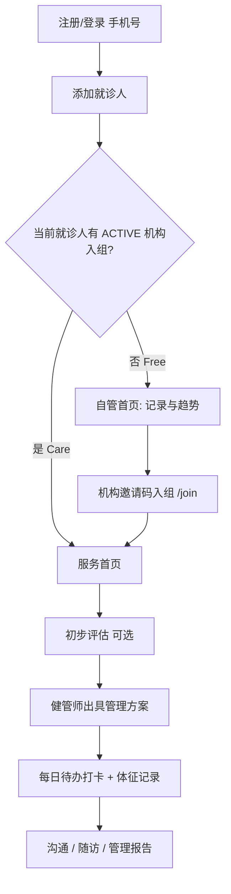

# Healix C 端首页 · 双态产品设计简报（给 UI 模型）

> 用途：交给其他模型重做 C 端首页 UI。只讲业务、价值、双态差异、现网能力与信息架构。不规定配色、字体、圆角、插画风格。
>
> 对照代码：`frontend-user/src/views/HomeView.vue`、`frontend-user/src/App.vue`、`GET /api/c/v1/membership/status`（2026-11-24）。
>
> 和旧稿的关键更正：现网**已经**按 `inCare` 分 Free / Care，**不是**「有就诊人就当服务态」。重构目标是砍服务态层级、换首屏叙事，不是从零发明双态，也不是再加模块。

---

## 1. 产品是什么

**Healix** 是「个人健康管理 + 机构健管服务」一体的平台。

- **C 端**：患者/家属手机端。登录账号本身无租户，**界面不要出现租户选择、机构切换**。
- **B 端**：机构健管师工作台（出方案、跟进、沟通）。本简报不设计 B 端。
- C 与 B 通过就诊人（`people`）对齐。添加就诊人必须短信验证本人手机号。**自动绑档**须 **本人手机号 + 姓名 + 出生日期** 一致；仅同号同名、生日对不上时不静默绑档，交给健管核对。同号异名视为不同人，可新建家庭成员。

一个登录账号下可以有多张就诊人卡片（本人、父母、子女）。首页跟随**当前就诊人**切换，换人等于可能换态。

C 端不是纯记录工具，也不是纯医患 IM。当前就诊人是否已有有效机构入组，决定首页是两种完整体验之一。无就诊人是第三种引导空态，不算双态之一。

---

## 2. 核心价值主张

| 对象 | 价值 |
|------|------|
| **未入组用户（Free）** | 像主流健康 App：方便记体重、血压、血糖、用药、饮食等，形成自管习惯，降低流失 |
| **已入组用户（Care）** | 不是再堆一个记录工具，而是：看见方案目标 → 看清今日状态 → 很短路径完成记录或打卡 → 提升依从性，并随时联系专属健管师 |
| **机构侧** | C 端依从性数据回流，支撑随访、报告与干预 |

一句话：

**自用时像 Keep / 薄荷类健康工具；入组后像「有人带着走的管理方案执行台」。**

---

## 3. 用户主路径

设计首页时必须兼容的分支：

- **B 先建档，C 后加入**：用同一手机号 + 同一姓名添加就诊人，自动挂上已有档案。若该档案已有有效入组，首页立刻是服务态，不必先过一遍自用态。
- **C 先自用，后入组**：首页从工具感切到方案执行感。入组动作是机构邀请码（`/join`），成功后回到首页并重新判定。
- **家庭账号**：切换就诊人会整页重进首页，按新人重新判定。未读消息只计当前就诊人，不能串到其他家人。
- **两种码不要做成同一个入口、同一句文案**：
  - **患者激活码**（`/activate`）：把 B 端已经建好的档案挂到这个登录账号上。空态和「我的」里使用。
  - **机构邀请码**（`/join`）：当前就诊人加入机构、变成服务态。自用态的弱转化用这个。

入组成功只保证「已在机构名下」。此时可能还没有具名健管师、没有已发布方案、没有今日任务、评估也还没做。服务态要能单独成立，不能假设方案和健管师姓名一定已经齐了。

---

## 4. 首页判定（以现网信号为准）

接口：`GET /api/c/v1/membership/status`  
返回：`inCare`、`homeTenantId`。  
`inCare === true` 当且仅当当前就诊人存在至少一条 **ACTIVE 且未退出** 的机构入组。`homeTenantId` 由服务端解析（有效入组优先），**不要在界面上让用户选**。

| 模式 | 条件 | 是不是双态 |
|------|------|------------|
| **loading** | 档案与入组还没返回 | 否，骨架 |
| **error** | 加载失败，且不是「没有就诊人」 | 否，可重试 |
| **empty** | 当前账号没有就诊人 | 否，引导空态 |
| **Free** | 有就诊人，且 `inCare === false` | 是 |
| **Care** | 有就诊人，且 `inCare === true` | 是 |

禁止用「有没有就诊人」近似服务态。无就诊人只走 empty。

### 空态（无就诊人）

- 不假装已有健管师或方案。
- 主按钮：添加就诊人。
- 次按钮：使用激活码（关联机构已建档案，不是邀请码入组）。
- 文案承诺：添加后可以自己记；若机构已建档且手机号+姓名+生日一致，会自动关联。

### 服务态不等于「方案已就绪」

下面几种都仍然是 Care，首页要各自有说法，不能退回 Free，也不能堆空壳：

| 服务态子情况 | 用户看到的事实 | 首页该怎么说 |
|--------------|----------------|--------------|
| 刚入组，方案未出 | 有机构关系，今日任务为 0 | 「方案准备中 / 暂无今日任务」+ 看方案或等健管师，不要展示假进度 |
| 有方案、有今日任务 | 待办 x/y | 今日还差什么，优先露出未完成项 |
| 任务做完 | done = total | 今日完成，而不是再催一条待办 |
| 健管师姓名还解析不到 | 关系在，名字没有 | 用「专属健管师」，不要留空白或写成就诊人自己的名字 |
| 评估未做，或健管师另发了问卷 | 两个入口可能同时存在 | 最多一个评估提醒，文案不要和健管师条重复 |

健管师展示名来源（设计时当成不完整数据，不要假设必有）：方案版本上的健管师姓名 → 否则当前就诊人会话里最近一条健管师消息的署名 → 否则「专属健管师」。机构名来自当前就诊人的会话。

**「在线」不是实时在线。** 现网无未读时显示「在线」，有未读时显示「未读」。设计可以表达「找得到人 / 有新消息」，不要做成真实 presence（绿点在线）。

---

## 5. 两态的首页目标

视觉皮肤自由。下面是信息优先级，不是现网排版的复述。

### A. 自用态 Free —— 像市面健康管理 App

**用户心智**：我自己管身体。  
**首页目标**：降低记录摩擦、建立每日回访、适时引导入组（不要销售感）。

**应突出**

1. 问候 + 一句轻激励（现网按上午/中午/下午/晚上，周末晚上用不同一句；称呼优先「王先生/王女士」，性别不明用档案姓名）。
2. **体征速记四项：体重、血压、血糖、用药。** 空值写「点击记录 / 未记录」，不要用 0 冒充已记录。体重、血压、血糖在首页用底部 Sheet 记完即走；用药进入用药页（今日日程：已服/应服、下一顿）。
3. **快捷生活记录**：饮食、喝水、睡眠、日记。这四项是自用态首页的生活入口。运动在底部「记录 +」里，不在这四个里。
4. 简单自激励：连续打卡天数。这是习惯，不是方案任务。没有天数时鼓励「今天记一笔」。
5. 健康趋势次级入口。现网只保证体重近几次折线；没有两次以上体重时说明「记下后这里会出现趋势」。不要设计成首页就要有血压、血糖、饮食热量的完整图表（那些在「健康」页）。
6. 弱转化：机构邀请码入组 /「获取专业管理」。不占首屏英雄位，文案用邀请码，不要写成激活码。

**应弱化或隐藏**

- 专属健管师大卡、「去沟通」强按钮、顶栏耳机。
- 「今日方案待办」空壳、方案名、第 N 天。
- 初步评估、健管师问卷的强打扰（没有机构时没有意义；「我的」里可以仍有入口）。
- 管理报告、随访、检验异常徽章。

**情绪**：清爽、工具感、可完成、低压力。

### B. 服务态 Care —— 方案驱动的依从工具台

**用户心智**：有人按方案带着我管。  
**首页目标**：目标清楚、状态可见、记录极短、健管师找得到。

用户打开 3 秒内要能回答三句话：

1. 我的目标是什么？
2. 今天还差什么？
3. 下一步点哪里？

**应突出（建议首屏顺序）**

1. **专属健管师一条**：姓名（或「专属健管师」）、机构名若有、未读则显示条数和「查看消息」，否则「去沟通」。点了就进当前就诊人的健管会话。这是信任锚点，只出现一次。
2. **目标与当前状态，只讲一个主叙事**（可以附一行辅助，不要两个英雄）：
   - 有可解释的方案目标时：减重进度、增重进度、体重稳定、控糖达标，四选一。必须同时能读出「当前值」和「目标/区间」，不要只丢一个百分比。
   - 目标数据还不够（没有体重、也没有可用血糖）时：不要编一个减重环。改显示「今日待办 x/y」，或在完全没有任务时明确写「方案准备中」。
3. **今日待办**（管理方案任务）：未完成优先，默认少露几条，其余折叠。状态用「待打卡 / 待记录 / 已打卡」。
4. **记录工具**：同一套体重 / 血压 / 血糖 / 用药。它们是执行方案的手，不是第二套首页。
5. **一个**完善入口：未做初步评估，或健管师邀请的评估问卷。悬浮或一张卡即可。两件都未完成时也只突出一件，另一件留在「我的」或档案入口。
6. 次级：档案、检验、管理报告、成就、随访。检验异常放在检验入口上，不要压在健管师姓名旁边。

**应弱化**

- 功能导航墙（档案、检验、评估、报告、方案摘要、打卡环、健管师、提示条同时争首屏）。
- 与健管师条重复的「去沟通 / 去评估」提示。
- 让用户猜今天该干什么。
- 把「在线」画成真实值班状态。
- AI 管家。它在「我的」里，文案仍是「近期开放」，不要做成首页主角。

**情绪**：被陪伴、有目标、今天做得完、专业但不冷。不要医疗冷仪表盘，也不要纯社交。

---

## 6. 两态对照（决策表）

| 维度 | 自用态 Free | 服务态 Care |
|------|-------------|-------------|
| 首屏英雄 | 今日记录 / 轻进度 | 健管师 + **一个**目标或今日状态 |
| 主任务 | 记一笔 | 完成方案待办 |
| 人际 | 无专属的人。通知顶栏可以有，不主推健管师 | 专属健管师一条强入口 |
| 进度语义 | 连续打卡 | 方案目标，或今日任务完成率。二者不要并列成两个英雄 |
| 空数据 | 「点此记录」 | 「暂无今日任务」+ 看方案 / 等健管师。禁止假环、假百分比 |
| 转化 | 邀请码入组，弱 | 评估完善、回消息。各只留一个主入口 |
| 成功标准 | 当天有记录 | 当日待办完成率上升、未读被看到 |
| 本态不拉的数据 | 不拉方案、会话、评估、检验、管理报告 | 这些都可以用，但首屏只留上面的顺序 |

共享外壳（两态一致，空态除外）：

- 顶栏：品牌 Healix、切换就诊人、通知。
- 通知进沟通页（健管会话 + 系统通知），不是单独做一套消息产品。服务态未读点在健管师条上表达；顶栏不要再做一颗重复的「联系健管师」。
- 底栏顺序固定：**首页 · 健康 · 记录 + · 沟通 · 我的**。中间「记录 +」是上浮按钮，打开 8 格：体重、血压、血糖、用药、饮食、运动、睡眠、心情。没有喝水（喝水只在自用态首页快捷，以及方案任务跳转）。
- 空态、加载中、加载失败时可以没有这套顶栏；失败态给「重新加载」。

---

## 7. 信息架构约束（不要设计成做不到的）

已有、首页可以链到的能力：

| 能力 | 现网落点 | 首页怎么用 |
|------|----------|------------|
| 就诊人切换 | `/patient-cards`，返回首页会按新人重判 | 顶栏 |
| 体重 / 血压 / 血糖 | 首页底部 Sheet（身高+体重算 BMI；血压分家庭自测/诊室；血糖分空腹/餐后/随机） | 四项速记的前三项 |
| 心率 | Sheet 技术上能记，**不是**首页四项，也不是「记录 +」 | 不要新做成首页宫格 |
| 用药日程 | `/medications` | 四项的第四项；展示已服/应服，不在首页勾药 |
| 饮食 / 喝水 / 睡眠 / 心情 / 运动 | 各自子页 | Free 快捷含前四项；运动走「记录 +」或待办跳转 |
| 今日方案任务 | `care-plan/today`：标题、目标摘要、total/done/pending、任务列表 | 仅 Care |
| 任务完成方式 | 见下节交互 | 仅 Care |
| 方案全文 | `/care-plan`（饮食原则、运动周计划等） | Care 次级，「查看完整方案」 |
| 健管会话 | `care-chat/contact` 打开当前人的线程 | 仅 Care 的那一条 |
| 初步评估 | `/intake`，未提交才需要 | Care，一个提醒 |
| 健管师问卷 | `/assessment-questionnaire`，有未完成邀请才需要 | Care，与初步评估合并成一个提醒 |
| 档案 | `/archive` | 次级 |
| 检验 / 检查 | `/health` 或检验详情；异常项数来自最近一份检验 | 次级徽章，不占健管师卡 |
| 健康趋势总页 | `/health` | Free 的「全部」、趋势卡 |
| 管理报告 | `/management-reports` | 有更新时可做次级一条，不要和待办抢首屏。现网首页算了最新周报但没有画出来 |
| 随访 | `/followups` | 「我的」已有，首页不必再做一块 |
| 成就 / 连续天数 | `/achievements`，激励接口的 streak | Free 的打卡卡 |
| 入组 | `/join` 邀请码 | Free 弱入口 |
| 激活码 | `/activate` | 空态、「我的」 |
| 科普弹层 | 打卡成功后可能弹出一条科普 | 当作一次性叠层，不要设计成首页常驻模块 |
| AI 管家 | `/ai` | 不要进首页主结构 |

交互约束：

- 记录优先底部 Sheet 或一次跳转，不要「首页 → 列表 → 再点添加」三层。
- 服务态文案围绕「方案 / 今日 / 健管师」。自用态围绕「记录 / 趋势 / 习惯」。
- 待办圆圈不要一律画成「勾选即完成」：
  - **能靠记录完成的任务**（血糖、血压等指标，以及饮食、饮水、睡眠、心情、用药、运动）：点圆圈进入对应记录页，记完由数据完成，不是在首页假装打勾。
  - **不能对应到记录页的任务**：点圆圈即打卡成功。
  - 已完成不可再点。数据里有「跳过」，首页目前没有跳过按钮；若要做跳过，作为次操作，不要替代主按钮。
- 饮食热量、运动消耗现网会请求，但首页没有展示。不要假设已有「今日 kcal」卡；若设计它，标成新增，并且不能挤掉目标或待办。

---

## 8. 现网首页实际长什么样（避免照抄，也避免发明没有的数据）

### Free 现网顺序

问候 → 体重/血压/血糖/用药横滑卡（含未记录、该更新、异常角标）→ 连续打卡 → 饮食/喝水/睡眠/日记 → 体重趋势或空说明 → 底部弱入口「获取专业健康管理」（邀请码）。

顶栏：品牌、就诊人、通知。没有健管师按钮。

### Care 现网顺序（层级偏满，这是要改的）

1. 顶栏品牌、就诊人、**另一颗耳机「联系健管师」**、通知（通知点进沟通，红点用健管未读）。
2. 健管师卡：姓名、未读或「在线」、机构或「随时咨询」、按钮「查看消息/去沟通」。检验异常枚数会叠在姓名旁。
3. 圆环：优先「减重 / 增重 / 体重稳定 / 控糖」；没有可画的目标时，退成打卡或今日完成率或连续天数。点圆环会去记体重/血糖，或滚到待办。
4. 今日待办：右上 x/y；里面再夹一块可折叠的「当前干预方案 · 第 N 天」；默认先露 3 条，未完成排前。
5. 四枚记录图标（体重、血压、血糖、用药）。
6. 档案条：我的档案 | 检验报告（可带异常数）| 评估/评估报告。
7. 若未做初步评估，底部一张「去评估」；若同时有健管师问卷，**再叠一张**。两张文案接近。

已写但未出现在页面上、设计时不要当成「用户已经能看到」：关怀提示条（未读、报告、评估、血压血糖波动、待办催办）、今日饮食热量、今日运动消耗、心情 emoji、徽章墙、最新管理报告卡。

### 现网与本简报的差距（重构就改这些）

- 双态和空态已经有了，不要再设计第三套「有就诊人 = 服务」的首页。
- Care 同时在讲：健管师、目标环、今日 x/y、方案摘要、四工具、档案三条、最多两张评估。首屏叙事超过一个英雄。
- 联系健管师出现了两次（顶栏耳机 + 健管师卡）。
- 「在线」是无未读时的占位，不是值班状态。
- 检验异常抢了健管师卡。
- 没有目标数据时，圆环会退化成连续打卡，服务态看起来又像自用工具。
- 初步评估和问卷可以叠两条。
- Free 已经是记录优先，方向对；不要为了「更丰富」把方案、健管师、评估加回去。

---

## 9. 给 UI 模型的设计指令（可直接粘贴）

请为 Healix C 端设计 **同一套组件体系下的两种首页**（Free / Care），并附无就诊人空态、加载骨架、加载失败。手机宽约 375，底部有固定导航。

1. **Free**：对标主流健康管理 App。记录优先、轻进度（连续打卡）、弱的邀请码入组。没有健管师，没有方案待办，没有评估强打扰。
2. **Care**：对标慢病/减重管理执行台。一条健管师信任入口 + **一个**目标或今日状态 + 今日待办 + 极短记录路径。3 秒内能回答：我的目标是什么？今天还差什么？下一步点哪里？
3. 两态共享：顶栏品牌与就诊人切换、通知、底栏 **首页 / 健康 / 记录+ / 沟通 / 我的**。差异在首页中部层级，不在底栏，不在租户选择（C 端没有租户选择）。
4. 必须另画这些状态，不能只画「数据很满」的一张：
   - Free：四项都未记录；四项已有数且有一条异常；还没有体重趋势。
   - Care：刚入组、无方案无姓名；有目标环 + 未完成待办；今日已全部完成；有未读消息；评估未做（只允许一张提醒）。
   - empty / loading / error。
5. 关键交互要画出来：点体重血压血糖出底部 Sheet；点用药进用药页；待办里「待记录」进记录页、「待打卡」原地完成；点健管师进会话。不要把「在线」画成实时在线。检验异常不要放在健管师名字上。
6. 不要做成冷冰冰医疗仪表盘，也不要做成纯社交。不要新增首页模块来填空。饮食热量和运动消耗如果出现，只能是待办或记录的附属信息，不能变成第三个英雄。
7. 激活码（关联已有档案）和邀请码（入组）是两件不同的事，按钮文案不要混用。

---

## 10. 不在本次首页设计范围

- B 端工作台、方案编辑器、问卷题目本身。
- 底栏其他四个 Tab 的内部改版（健康、沟通、我的只作为首页的去向）。
- 新的后端字段。目标四态、待办、未读、入组都用现有数据；数据不够时用空状态文案，不要假设会多一个「目标百分比」接口。
