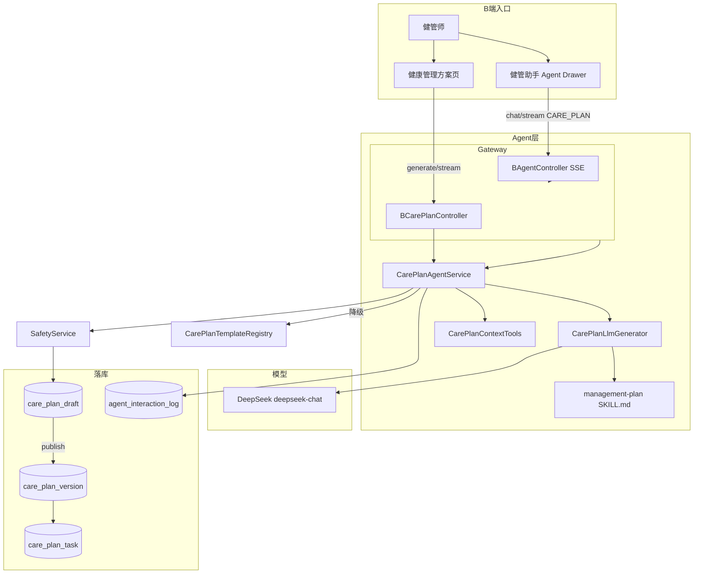
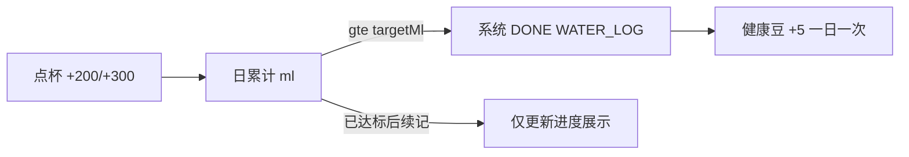

# 健康管理方案技术方案（Agent + Skills）

| 项 | 内容 |
|---|---|
| 版本 | **v1.3** |
| 日期 | 2026-10-13 |
| 状态 | **P1～P2.2 已落地**（饮水 + sampleDay/Week + 睡眠/心情日志 + 食谱库 + 预填 + Admin 签署） |
| 依据 | `SaaS架构.md`、`患者档案-字典与元数据.md`、`患者观测数据-指标检验检查.md`、`C端激励体系-产品与技术方案.md` |
| 范围 | B 端患者级管理方案：运动 / 饮食 / 执行计划；CARE_COPILOT 主智能体 + Skills；C 端打卡、饮水、睡眠、心情与饮食预填 |
| 阶段 | **P1** ✅；**P1.5** ✅；**P2** ✅；**P2.1** ✅ 饮水 + sampleDay；**P2.2** ✅ 睡眠/心情/`sampleWeek`/食谱库/预填/签署 UI |

> **重定位（待落地）**：方案类型五档（综合 / 糖 / 压 / 肥 / 健康管理）、综合始终可选、生成理由 B 见 C 不见 → 见 [`健康管理方案-重定位与生成理由.md`](./健康管理方案-重定位与生成理由.md)。

---

## Grill 决策摘要（仍有效 + 增量）

### 产品与责任

| # | 结论 |
|---|---|
| G1 | 发布前必须人工审阅；**P1.5 已接 LLM**，健管助手路径 **requireLlm=true**（失败报错，不静默降级模板） |
| G2 | 同一患者 **至多 1 个 ACTIVE** |
| G3 | **仅员工 publish** 可生效 |
| G4 | 健管干预建议；`care_plan_version` 预留签署列 |
| G5 | 上下文残缺仍可生成；`safetyFlags` + UI 告警 |

### 生命周期与存储

| # | 结论 |
|---|---|
| G6～G17 | 同 v1.0（draft / version / task 投影、单 draft、乐观锁等） |
| G18 | ERROR / WARN 规则不变 |
| G27 | B 端方案页：**「生成方案」**；健管助手：**「制定健康管理方案」**（走 LLM） |
| G29 | `source`：`TEMPLATE` / `MANUAL` / `TEMPLATE_THEN_EDIT` / **`LLM`** / `LLM_THEN_EDIT`；列表展示 **AI / 人工** |
| G30 | 丢弃草稿；列表支持删除草稿 / 非生效历史版本 |

### P1.5 增量决策

| # | 结论 |
|---|---|
| G31 | LLM：**DeepSeek**（Spring AI OpenAI 兼容，`api.deepseek.com`） |
| G32 | Skill 文档合并为 **`management-plan`**（运动/饮食/总结/执行）；编排仍经 `CarePlanAgentService` |
| G33 | 生成支持 **SSE 流式**：progress / tool / skill / token / result / done |
| G34 | 健管助手（Agent Drawer）与方案页 **共用** `CarePlanAgentService.generateStream` |
| G35 | 开发环境默认 **`dev` profile** + `application-local.yml` 配 API Key；`healix.agent.enabled=true` |
| G36 | 方案页双 TAB：**管理方案列表**（分页）+ **制定新的方案**（编辑区） |
| G37 | Agent 生成完成后可 **预览方案详情**（弹窗，只读） |

### P2.1 Grill 决策（2026-10-13，饮水 + 示例日打磨）

> 主目标：**客户依从**。不建独立顶层 `lifestyle` 方案块；饮水目标挂在执行任务上。

| # | 结论 |
|---|---|
| G40 | **不做**独立 `lifestyle` 顶层方案块；饮水目标挂在执行任务上 |
| G41 | 新增任务类别 **`WATER`**；稳定编码建议 `WATER_LOG`；`frequency=QD` |
| G42 | **`targetMl`** 写入任务扩展（发布投影到 `care_plan_task`）：有体重 → `round(kg×30)` 夹紧 `[1200,2000]`；无体重 → `1600`；健管师可改 |
| G43 | 心衰 / 慢性肾病等**限水相关**诊断或医嘱：默认**不生成**饮水任务；健管师可手动添加并自填目标 |
| G44 | C 端饮水：主路径 **小杯 +200 / 大杯 +300**；可藏自定义毫升；按日累计 |
| G45 | 累计 ≥ `targetMl` → 系统自动完成当日饮水打卡（**一日一次**）；达标后仍可续记，**不再发第二份健康豆** |
| G46 | 激励：饮水任务完成计**活跃日** + **健康豆 +5**（按任务完成，不按每次点击；仍受每日豆上限约束）；代录不计 |
| G47 | 旧任务 `category=DIET` 且标题为饮水类：读写**展示兼容**为饮水；下次编辑/发布再迁为 `WATER`（不跑批） |
| G48 | **打磨 `sampleDay`**：兼容旧「每餐字符串」；新结构每餐可带至多 **1** 个 `swapHint`；过敏校验覆盖正文与替换 |
| G49 | C **饮食记录页**展示「今日参考」；**P2.2** 支持一键预填到添加页（仍须用户确认后保存） |
| G50 | **P2.2 已开放**：睡眠/心情独立日志与趋势、`sampleWeek`、机构食谱库、按谱/示例预填饮食；**仍不做**可穿戴同步 |
| G51 | schema：**V3** = WATER + sampleDay 对象；**V4** = SLEEP/MOOD 任务 + `sampleWeek` + 食谱库应用 |

### P2.2 增量（2026-10-13）

| # | 结论 |
|---|---|
| G52 | 任务类别 **`SLEEP` / `MOOD`**（`SLEEP_LOG` / `MOOD_LOG`）；C 端独立日志表 + 14 日趋势；记一笔即系统完成当日打卡（计激励，代录不计） |
| G53 | `diet.sampleWeek`：`MON..SUN` → 同 `sampleDay` 餐次结构；过敏清洗覆盖；B 可「用示例日填充整周」；C/预览只读展示 |
| G54 | 机构食谱库 `org_recipe`：CRUD + 应用到草稿 `sampleDay`（可选 `sampleWeek`）；工作台「食谱库」菜单 |
| G55 | 医学签署：Admin 方案页医生角色可签；意见写入修订留痕；仍不阻断 publish 生效（与 Staff 复核同源 API） |

---

## 0. 产品定位

| 项 | 口径 |
|----|------|
| 主场景 | 健管师在患者详情生成、审阅、发布管理方案；客户在 C 端执行打卡与轻量记录 |
| 内容三块 | 运动方案、饮食方案（含示例日）、执行计划 + **方案总结**（LLM JSON 含 `summary` / `goalSummary`） |
| 生成 | 主智能体 + `management-plan` Skill；**LLM 优先**，失败时方案页可降级模板，健管助手强制 LLM |
| 消费方 | B 制定/发布；C 只读方案 + 打卡（P2.1 含水饮记录） |
| Agent 隔离 | `CARE_COPILOT`（B 健管助手） vs C 端 `PATIENT` |



---

## 1. 领域与边界

| 模块 | 状态 |
|------|------|
| Care Plan 头 / Draft / Version / Task 投影 | ✅ |
| 运动 / 饮食 / 执行 Spec | ✅ |
| 模板四套 + LLM 结构化 JSON | ✅ |
| Safety ERROR/WARN + publish ack | ✅ |
| 方案列表分页 + 删除 | ✅ |
| 健管助手 SSE + 预览 | ✅ |
| 执行打卡 / C 只读方案 | ✅ P2 |
| 饮水任务 `WATER` + C 端杯数记录 | ✅ P2.1（需发布含 WATER 的新方案后生效） |
| `sampleDay` 可替换 + 饮食页今日参考 / 预填 | ✅ P2.1 / P2.2 |
| 睡眠 / 心情日志与趋势 + 任务联动 | ✅ P2.2 |
| 血糖 / 血压监测任务：按 `relatedRef`（或模板编码 `GLUCOSE_CHECK` / `BP_HOME`）识别；当日录入对应指标 → 系统完成，当日记录全删 → 撤销系统打卡；C 端按钮为「去测」 | ✅ |
| `sampleWeek` + 机构食谱库 | ✅ P2.2 |
| 医学签署 UI（Admin + Staff 复核） | ✅ P2.2（非 CA；医生角色 + 修订留痕） |

档案 lifestyle、观测、用药 = **只读上下文**（`CarePlanContextService`），方案不写回档案。

---

## 2. B 端信息架构

顶栏：`患者档案 | 用药管理 | 健康数据 | **健康管理方案** | 修订历史`

**健康管理方案** 内两个主 TAB：

| TAB | 内容 |
|-----|------|
| **管理方案列表** | 分页表格：标题、制定方式（AI/人工）、版本、制定人、时间、状态；操作：详情、删除 |
| **制定新的方案** | 生成方案、新建空白草稿、保存/丢弃/发布；二级：总览 / 运动 / 饮食 / 执行 |

**健管助手**（患者详情右侧 Drawer）：

- 快捷能力：`CARE_PLAN` / `GENERAL_CHAT`
- 制定方案时展示：**进度时间线**（progress / tool / skill）、**AI 流式 JSON**、完成后 **预览方案详情** + **查看方案草稿**

路由：

- `/workspace/patients/:peopleId/care-plan`

---

## 3. Agent 架构

### 3.1 模块划分

| 模块 | 职责 |
|------|------|
| `StaffAgentGateway` | B 端对话路由：`CARE_PLAN` → `CarePlanAgentService`；其余 → `GeneralChatSkill` |
| `CarePlanAgentService` | 方案编排：加载上下文 → Skill → LLM/模板 → Safety → 落 draft |
| `CarePlanLlmGenerator` | 读 `management-plan` SKILL，调 `LlmClient.streamChat`，解析 JSON |
| `CarePlanTemplateRegistry` | LLM 不可用或方案页降级时的模板生成 |
| `LlmClient` | Spring AI `ChatModel` 封装；chat / streamChat |
| `CarePlanContextTools` | `@Tool` 包装 `CarePlanContextService.load` |

C 端聊天 **`HealthAgentService`** 与方案生成 **分离**；方案不经过 C 端 Agent。

### 3.2 Skill

路径：`health-agent/src/main/resources/skills/management-plan/SKILL.md`

输出严格 JSON（无 markdown 包裹）：

```json
{
  "summary": "阶段总结",
  "goalSummary": "一句话目标",
  "exercise": { },
  "diet": { },
  "execution": { }
}
```

职责：运动 / 饮食 / 执行 / 总结文案；Safety 与 publish 仍由 **业务服务** 负责。

### 3.3 Context Tools（加载时逐步 SSE 展示）

`CarePlanContextService.load(tenantId, peopleId, tracer)` 逐步回调：

| Tool 名 | 数据 |
|---------|------|
| `loadCarePlanContext` | 编排入口 |
| `PeopleBasicArchive` | 基础档案 / 现病史 |
| `PeopleDiseaseArchive` | 病种专病档案 |
| `peopleAllergens` | 过敏原 |
| `PeopleMedication` | 在用药 |
| `VitalRecord` | 最新体征 |
| `LabReport` | 近期检验 |

### 3.4 LLM 配置

| 配置项 | 说明 |
|--------|------|
| `spring.profiles.active` | 默认 `dev`（本地） |
| `healix.agent.enabled` | `dev` 下 `true` |
| `spring.ai.openai.api-key` | `application-local.yml`（gitignore） |
| `spring.ai.openai.base-url` | `https://api.deepseek.com` |
| `spring.ai.openai.chat.options.model` | `deepseek-chat` |

启动日志：`AgentLlmStartupLogger` 输出 `[Agent] startup llmEnabled=... apiKeyConfigured=...`

运行时日志：`[LLM]` / `[CarePlan]`（start / success / failed / 降级原因）

### 3.5 生成路径差异

| 入口 | LLM | 失败行为 |
|------|-----|----------|
| 健管助手 `CARE_PLAN` | 必须 | `BusinessException`，SSE error 事件 |
| 方案页「生成方案」 | 优先 | 降级 `CarePlanTemplateRegistry`，`source=TEMPLATE` |

### 3.6 SSE 事件协议

统一 envelope：`{ "type": "...", "data": { ... } }`

| type | 用途 |
|------|------|
| `progress` | 阶段文案 |
| `tool` | `{ name, status, detail }` |
| `skill` | `{ name, detail }` |
| `token` | LLM 流式文本 |
| `result` | 最终 payload（Agent 为 `AgentResponse`；方案页为 `CarePlanBundleDto`） |
| `error` / `done` | 结束 |

实现要点：

- 后端 `AgentSseSupport`：`no-cache`、`flushBuffer`、连接 comment 心跳
- 前端 dev 直连 `http://127.0.0.1:8080` 避免 Vite 代理缓冲 SSE
- `JsonUtils` 注册 `JavaTimeModule`（`LocalDateTime` 序列化）

### 3.7 Safety（不变）

| 级别 | Code | 行为 |
|------|------|------|
| ERROR | `DIET_ALLERGEN_CONFLICT` | 不可 publish |
| ERROR | Schema / 最低非空 | 不可 publish |
| WARN | `CONTEXT_INCOMPLETE` / `NO_DISEASE_TAG` / `HYPOGLYCEMIA_RISK` | ack 后可发 |

---

## 4. 数据模型

与 v1.0 一致，补充：

- 列表行来源：**当前 draft**（`recordType=DRAFT`）+ **全部 `care_plan_version`**
- 列表 `sourceMode`：`LLM` → **AI**；其余 → **人工**
- 版本状态：当前 `current_version_id` → **ACTIVE**；其余 → **ARCHIVED**
- 删除：草稿 soft delete；历史版本 soft delete（**不可删当前生效版**）

---

## 5. API（B）

包：`com.healix.web.b.careplan`、`com.healix.web.b.agent`

### 5.1 方案 CRUD / 生命周期

| 方法 | 路径 | 说明 |
|------|------|------|
| GET | `/patients/{peopleId}/care-plan` | 头 + ACTIVE + draft |
| GET | `/patients/{peopleId}/care-plan/items?page&pageSize` | **方案列表（分页）** |
| DELETE | `/patients/{peopleId}/care-plan/items/{itemId}?recordType=DRAFT\|VERSION` | 删除列表项 |
| POST | `/patients/{peopleId}/care-plan/draft` | 手工空草稿 |
| POST | `/patients/{peopleId}/care-plan/generate` | 同步生成（可模板降级） |
| POST | `/patients/{peopleId}/care-plan/generate/stream` | **SSE 流式生成** |
| PUT | `/patients/{peopleId}/care-plan/draft` | 编辑；乐观锁 `version` |
| DELETE | `/patients/{peopleId}/care-plan/draft` | 丢弃草稿 |
| POST | `/patients/{peopleId}/care-plan/publish` | 发布 + 投影 tasks |
| POST | `/patients/{peopleId}/care-plan/edit` | 基于 ACTIVE clone draft |
| GET | `/patients/{peopleId}/care-plan/versions` | 历史版本 ID 列表 |
| GET | `/patients/{peopleId}/care-plan/versions/{versionId}` | 版本详情 |

### 5.2 健管助手（Agent）

| 方法 | 路径 | 说明 |
|------|------|------|
| GET | `/agent/capabilities` | 能力列表 |
| POST | `/agent/chat` | 同步对话 |
| POST | `/agent/chat/stream` | **SSE 对话/制定方案** |

`AgentResponse` 流式 result **不含**完整 `extracted`（避免 SSE 过大）；日志 `toolCallsJson` 仅存 planId/draftId 摘要。

---

## 6. 前端（B）

| 组件 | 路径 | 说明 |
|------|------|------|
| `PatientCarePlanView.vue` | 方案页双 TAB + 编辑表单 | |
| `AgentDrawer.vue` | 健管助手 | 挂载于 `PatientDetailLayout` |
| `CarePlanPreviewDialog.vue` | 方案只读预览 | 列表详情 / Agent 预览共用 |
| `agent-stream.ts` | SSE 客户端 | progress/tool/skill/token/result |

---

## 7. 修订与审计

- `bizType=CARE_PLAN`：生成 / 发布 / 丢弃 / 编辑
- `agent_interaction_log`：`CARE_PLAN_GENERATE` intent；`draft_reply=LLM|TEMPLATE|TEMPLATE_FALLBACK`

---

## 8. 实现状态

| 步骤 | 状态 |
|------|------|
| Schema + SchemaEnsure | ✅ |
| CarePlanService（draft/publish/投影/修订） | ✅ |
| CarePlanAgentService + 模板 + LLM | ✅ |
| management-plan SKILL | ✅ |
| B API + SSE | ✅ |
| 方案页 + 列表分页 | ✅ |
| 健管助手 + 流式 + 预览 | ✅ |
| DeepSeek 本地配置 + 启动/运行日志 | ✅ |
| P2 打卡 / C 只读 | ✅ |
| P2.1 饮水 `WATER` + 杯数记录 + 激励联动 | ✅ |
| P2.1 `sampleDay` 可替换 + 饮食页今日参考 | ✅ |
| P2.2 睡眠/心情日志 + SLEEP/MOOD 任务 | ✅ |
| P2.2 `sampleWeek` + 食谱库 CRUD/应用 | ✅ |
| P2.2 饮食一键预填 + Admin 医生签署 | ✅ |

---

## 9. 非目标（当前）

- 独立顶层 `lifestyle` 方案 JSON 块（睡眠/心情走任务 + 独立日志表）  
- 可穿戴同步睡眠/活动  
- 电子签章 / CA / 执业资格证核验网关（签署仅为医生角色 + 修订留痕）  
- 随访工单自动创建  
- OCR 报告入方案（Skill 预留，UI 未开）  
- 异步 Job 队列  
- 多 ACTIVE、PATIENT Agent 写方案  

---

## 10. 原则

1. **人机闭环**：仅 publish 生效  
2. **编辑真相**：draft JSON；`care_plan_task` = 发布投影  
3. **可降级**：方案页无 LLM 仍可用模板；健管助手方案能力要求 LLM  
4. **可观测**：SSE 时间线 + `[LLM]`/`[CarePlan]` 日志 + interaction_log  
5. **租户患者归属**；org 仅审计  
6. **依从优先（P2.1）**：少而清晰的待办；限水场景宁可不生成饮水任务，也不给危险默认目标  

---

## 11. P2.1 饮水与示例日（已落地）

### 11.1 执行任务：`WATER`

`execution.tasks[]` 类别扩展为：`EXERCISE` / `DIET` / **`WATER`** / `OTHER`。

| 字段 | 约定 |
|------|------|
| `code` | `WATER_LOG` |
| `title` | 如「今日饮水达标」或「足量饮水，每日约 {targetMl} ml」 |
| `category` | `WATER` |
| `frequency` | `QD` |
| `timeSlot` | 建议 `ALL` 或 `EVENING` |
| `targetMl` | 整数；任务扩展字段，随 publish 投影 |

**生成规则**（模板 + `management-plan` Skill 同步）：

1. 无限水禁忌 → 默认编入一条 `WATER_LOG`，写入 `targetMl`（G42）  
2. 限水相关 → **不生成**；健管师可手加  
3. 编制原则中原「饮食任务含足量饮水」改为独立 `WATER` 任务，饮食任务保留「记录三餐」等  

**兼容**：展示层识别旧 `DIET` + 饮水标题 → 当作饮水；下次 publish 迁类别（G47）。

### 11.2 C 端饮水记录

- 表（建议）：`water_intake_log`（`people_id`, `biz_date`, `amount_ml`, 累计或按次明细 + 日汇总）  
- API：C 端记一笔 / 查当日累计与目标  
- 达标联动：`CarePlanCheckinService` 系统完成（类比饮食满三餐）  
- 激励：走现有任务完成 → 健康豆 / 活跃日（见激励方案 G14/G16）  



### 11.3 `sampleDay` 结构（V3）

兼容旧版每餐字符串；新版每餐可为对象：

```json
"sampleDay": {
  "breakfast": { "text": "燕麦粥 + 鸡蛋 + 蔬菜", "swapHint": "鸡蛋可换成豆腐" },
  "lunch": "杂粮饭 + 清炒时蔬 + 瘦肉",
  "dinner": { "text": "蒜蓉西兰花 + 蒸鱼 + 少量主食" },
  "snacks": { "text": "无糖酸奶", "swapHint": null }
}
```

| 规则 | 说明 |
|------|------|
| `swapHint` | 每餐至多 1 条；可空 |
| 过敏 | `CarePlanAllergenGuard` 扫描 `text` 与 `swapHint` |
| 热量 | 仍不在示例日写死千卡；份量与 `energyTarget` 大致匹配 |
| C 展示 | 饮食记录页「今日参考」只读；方案内容页同步展示 |

### 11.4 改动面清单

| 层 | 项 |
|----|-----|
| Agent | `management-plan/SKILL.md`：WATER 编制、`sampleDay` 对象形、限水不生成 |
| Core | `CarePlanSchemaVersions`→3；任务投影/`targetMl`；饮水 log；自动打卡；过敏 guard |
| 模板 | `CarePlanTemplateRegistry` 默认饮水任务 |
| C 前端 | 待办去记录、杯数 UI、饮食页今日参考、category 文案 |
| B 前端 | 任务类别/`targetMl` 编辑与预览；`sampleDay` text+swapHint；旧饮水展示 |
| 激励 | 确认 `WATER` 完成计入活跃与 +5 |

---

## 12. 本地开发

```bash
# 后端（dev profile 默认开启 agent）
cd backend && mvn -pl health-app -am spring-boot:run

# 配置 DeepSeek Key：health-app/src/main/resources/application-local.yml（勿提交）
# spring.ai.openai.api-key: sk-...

# 前端
./scripts/start-dev.sh   # 仅启动 5174；SSE dev 直连 8080
```

验证：

1. 启动日志 `[Agent] llmEnabled=true apiKeyConfigured=true`  
2. 健管助手制定方案 → 时间线含 Tool/Skill/DeepSeek 流式 → **生成方式：AI 生成**  
3. 方案页「管理方案列表」可见草稿/历史版本  

---

**文档版本 v1.3** — P2.1（G40–G51）+ P2.2（G52–G55：睡眠/心情、`sampleWeek`、食谱库、预填、Admin 签署）已落地；schema **V4**。
