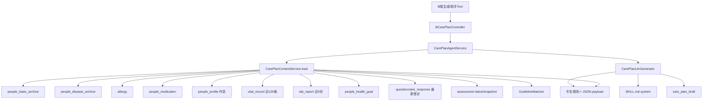

# 健康管理方案：LLM 提示词与上下文数据说明

| 项 | 内容 |
|---|---|
| 目的 | 供外部模型 / 评审核对：**生成管理方案时，模型实际看到什么、数据从哪来、是否合理** |
| 范围 | **生成**（`generate` / `generate/stream`）与 **修订**（`revise/stream`） |
| 不含 | 发布后 Safety 校验细节、C 端打卡投影（另有方案文档） |
| 代码锚点 | 见文末「关键类路径」 |
| 整理日期 | 2026-11-12 |

---

## 1. 一句话结论

生成管理方案时，模型收到两段内容：

1. **System**：Skill 文档 `management-plan/SKILL.md`（职责边界、输出 JSON schema、运动/饮食/执行硬规则）
2. **User**：一段中文硬性规则 + **一个 JSON payload**（患者上下文 + 可选指南条目 / 过敏守卫 / 管理侧重等）

患者事实**全部由服务端组装**，不让模型自行查库。组装入口是 `CarePlanContextService.load`，**不是** `AssessmentContextBuilder`（后者只服务疾病评估引擎）。

---

## 2. 调用链

```
B 端 UI / 健管助手 Tool
  → POST /api/b/v1/patients/{peopleId}/care-plan/generate[/stream]
     或 revise/stream
  → CarePlanAgentService.generateInternal / reviseAndPersist
       → CarePlanContextTools.loadCarePlanContext
            → CarePlanContextService.load(...)   // 拼 patientContext snapshot
       → CarePlanLlmGenerator.tryGenerate / tryRevise
            system = SKILL.md
            user   = 中文规则 + JSON payload
       →（可选失败降级）CarePlanTemplateRegistry.generate
       → CarePlanAllergenGuard 服务端兜底
       → CarePlanService.persistGenerated / updateDraft
```

请求体可带：

| 字段 | 作用 |
|------|------|
| `instruction` | 健管师本次自由说明（可选） |
| `templateKey` | 方案类型：`COMPREHENSIVE` / `DIABETES` / `HYPERTENSION` / `OBESITY` / `WELLNESS` |
| `diseaseCodes` | 本次覆盖病种（可选；空则沿用档案） |
| `replaceDraft` | 是否覆盖当前草稿（生成默认 true） |

修订另带：当前草稿 JSON + `revisionInstruction`。

---

## 3. System Prompt（Skill）

**文件**：`backend/health-agent/src/main/resources/skills/management-plan/SKILL.md`  
**加载**：`CarePlanLlmGenerator.loadSkillMarkdown()` → 去掉 YAML frontmatter 后作为 system。

Skill 主要内容（摘要）：

| 块 | 告诉模型什么 |
|----|----------------|
| 职责边界 | 档案/过敏/指标等由上下文工具提供；文案由 LLM 写；禁止自动发布 |
| `assessments` | 只用于决定干预强度；**患者可见正文禁止写「高危/分层」等**；`rationale` 可点明等级给健管师 |
| `guidelineRecs` | 可引用指南条目；`SAFETY` 硬约束；`refs` 只能用给定 code |
| `templateKey` 五类 | 综合 / 糖 / 压 / 肥 / 健康管理 |
| 输出 JSON | 必须 `exercise → diet → execution → summary → goalSummary`（+ `rationale`） |
| 运动/饮食/执行细则 | 禁忌、示例餐禁粥（糖尿病）、过敏、饮水、任务类别等 |

修订模式会在 Skill 后再追加一段「修订模式补充（硬性）」：局部改、安全约束累积保留等。

---

## 4. User Prompt 结构

### 4.1 生成（`buildUserMessage`）

结构：

```text
请根据以下输入生成完整管理方案 JSON。
（约 15 行中文硬规则：字段顺序、goalSummary 数字自洽、过敏/糖尿病禁粥、
 diet.notes 患者可见、作息/药餐/打鼾转介等）
仅输出 JSON，不要 markdown。

{payload JSON}
```

**Payload 顶层字段**：

| 字段 | 何时出现 | 含义 |
|------|----------|------|
| `templateKey` | 总是 | 方案类型枚举名 |
| `instruction` | 健管师填写时 | 本次自由说明 |
| `diseaseCodes` | 有 meaningful 码时 | 本次病种覆盖 |
| `patientContext` | 总是 | **主上下文**（见第 5 节）；已去掉 snapshot 内的 `guideline` |
| `foodAllergyGuard` | 有食物过敏时 | 服务端过敏守卫给模型的结构化约束 |
| `guidelineRecs` | 指南匹配启用且有结果时 | 可引用指南条目（code/kind/block/recommendation/…） |
| `careFocus` | goals 有赛道/诉求时 | `careTracksLabels` / `primaryAppeal*` / `emphasizeWeightLoss` |
| `highlightConstraint` | 有 `highlightGuidance` 时 | 要求落实 `mustApply` 的提示 |

### 4.2 修订（`buildReviseUserMessage`）

在生成 payload 基础上增加：

| 字段 | 含义 |
|------|------|
| `mode` | `REVISE` |
| `revisionInstruction` | 修订意见 |
| `currentDraft` | 当前草稿（exercise/diet/execution/goalSummary 等） |
| `mustPreserveConstraints` | 可选，必须保留的安全约束 |
| `revisionHint` | 可选提示 |

---

## 5. `patientContext` 字段清单与数据来源

组装类：`CarePlanContextService.load`  
清洗/截断：`CarePlanPromptContextSupport`

| Snapshot 字段 | 内容概要 | 数据来源 | 存储 / API |
|---------------|----------|----------|------------|
| `basicArchive` | 基础档案摘要；缺失为字面量 `"MISSING"` | `PeopleBasicArchiveMapper.findByTenantAndPeople` → `summarizeBasicArchive` | 表 `people_basic_archive.content_json` |
| `diseaseArchives[]` | `{code,label}` | `PeopleDiseaseArchiveMapper.listByTenantAndPeople` | 表 `people_disease_archive` |
| `diseaseLabels[]` | 中文病种标签 | 同上 + `DiseaseCodeLabels` | — |
| `allergyStatus` | 过敏状态文案 | `AllergyQueryService.status` | `people_allergy` / `people_allergy_profile` |
| `allergens[]` | 可读过敏描述（含药/环境） | `AllergyQueryService.describeForContext` | 同上 |
| `activeMedications[]` | 药名列表 | `PeopleMedicationMapper` ACTIVE + 未过期 | 表 `people_medication` |
| `activeMedicationDetails[]` | `{name, timingNote?, frequency?, dose?}` | 同上 | 同上 |
| `lifestyleProfile?` | `{workSchedule, workScheduleLabel, scheduleHint}` | `PeopleProfileMapper.findById` | 表 `people_profile.work_schedule` |
| `latestMetrics[]` | `{metricType, metricLabel, value, unit}` 最多 12 类 | `VitalRecordMapper.listRecentForLatest(limit=120)`，按类型取最新 + 合理性过滤 | 表 `vital_record` |
| `skippedMetrics[]?` | 被剔除的异常指标说明 | 同上，`MetricPlausibility` / `isMetricUsefulForPrompt` | — |
| `recentLabs[]` | 最近 **3** 份报告，每份 **≤8** 项摘要 | `LabReportMapper.listByPeople` + `LabResultItemMapper.listByReportId` | `lab_report` / `lab_result_item` |
| `energyTarget` | 热量目标或 `{available:false, missing[]}` | `CarePlanEnergyTargetService.promptContext`（饮食目标 / 估算） | 饮食目标相关表 + 档案 |
| `assessments[]` | 已生效评估摘要：`disease,type,result,tier,keyFactors[≤6]` | `AssessmentPromptContext.summarize` | `people_assessment_latest` + `people_assessment_snapshot` |
| `diabetesClinical?` | 糖尿病首诊/字段摘要 | `PeopleFieldService.readPrefix("disease.diabetes.")` | people field 存储 |
| `hypertensionClinical?` | 高血压字段摘要 | `readPrefix("disease.hypertension.")` | 同上 |
| `contextIncomplete` | 档案残缺标志 | 基础档案缺失或现病史无 meaningful 数组 | — |
| `hypoglycemiaRisk` | 低血糖风险 | 糖尿病专病档案字段（近月次数 / 反应 / 急症） | `people_disease_archive.content_json` |
| `goals` | 健康目标（mode、careTracks、appeal、称重频率、lossBlocked 等） | `PeopleHealthGoalMapper.findLatestByPeople` + 高亮副作用 | 表 `people_health_goal` |
| `intakeBrief?` | 最近一次首诊/待补简报 | `QuestionnaireResponseMapper.listByPeople`，取 `SUBMITTED` 且 purpose∈`INTAKE`/`SUPPLEMENT` 最新一条 | 表 `questionnaire_response` |
| `highlights?` / `highlightGuidance?` | 首诊高亮与模型可读 `mustApply` | 从该次答卷解析 | 同上 |
| `guideline?` | 指南匹配快照 | `GuidelineMatcher.match(...)` | **进 snapshot，但喂模型前从 patientContext 删除**；改走顶层 `guidelineRecs` |

### `intakeBrief` 内常见子字段

`responseId`, `purpose`, `submittedAt`, `questionnaireCode/Version`, `programCode`, `depth`/`depthLabel`, `preliminaryDisclaimer?`（MINIMAL/QUICK 深度）, `aiSummary?`, `keyAnswers?`（白名单字段）, `highlights?`

### `assessments[]` 规则

- 仅 `effective && COMPLETE` 的最新评估
- `keyFactors` 最多 6 条
- **不重跑**评估引擎；只读已落库结论

---

## 6. 过滤 / 截断 / 时效规则（方案生成专用）

| 规则 | 行为 |
|------|------|
| 基础档案缺失 | `basicArchive="MISSING"`，`contextIncomplete=true` |
| 现病史无 meaningful 数组 | `contextIncomplete=true` |
| 病种占位码 | `isMeaningfulDiseaseCode` 剔除 |
| 用药过期 | `MedicationService.isPastEndDate` 跳过 |
| 体征窗口 | **无日历天数窗**；取最近 120 条 vital，再按 `metricType` 保留最新；最多 12 类 |
| 指标合理性 | 不合格进 `skippedMetrics`，不进 `latestMetrics`（含腰围 vs BMI 一致性） |
| 检验 | 最近 3 报告 × ≤8 项；**无「超过 N 天作废」** |
| 文本截断 | 单段文本 `MAX_TEXT_CHARS=400`；数组 `MAX_ARRAY_ITEMS=24`；首诊 AI 总结约 2000 字上限 |
| intake `keyAnswers` | 仅白名单；空值 omit |
| basicArchive 子块 | 空对象/空数组/NONE 项 omit |
| 高亮 BLOCK | 可改写 goals：`lossBlocked`、称重频率、减重模式降级等 |
| 无数据的顶层可选字段 | 不写（`guidelineRecs` / `foodAllergyGuard` / `careFocus` / `highlightConstraint`） |

### 重要对比：`AssessmentContextBuilder` 的时效口径

评估引擎（`AssessmentContextBuilder`）有明确日历窗，例如：

- 血压 / 心率：28 天  
- 点测血糖 / HbA1c：90 天  
- 低血糖计数：14 天  
- 体重 / 腰围 / 体脂：180 天  
- 身高：5 年  
- 血脂 / 肾功等：365 天  

**这些规则不用于管理方案生成上下文。**  
方案生成的体征是「最近 120 条里各类型最新值 + 合理性过滤」，检验是「最近 3 份报告」，**过期数年的读数理论上仍可能进入 prompt**（除非被合理性过滤掉）。

---

## 7. 明确未进入生成 Prompt 的数据

评审时重点关注「缺什么」：

| 数据 | 是否进生成 Prompt | 说明 |
|------|-------------------|------|
| 方案任务打卡 / 依从率 / 近 7 日完成率 | **否** | 列表页展示用；生成链路不注入 adherence |
| 沟通历史 / 上次沟通结果全文 | **否**（修订可带 instruction） | 退回重做依赖健管师填 `instruction` 或修订流 |
| 实时重算的评估分层 | **否** | 只用已落库 `assessments` 摘要 |
| C 端饮食/运动原始日志明细 | **否** | 不直接进 context |
| 完整检验报告 PDF / 原始长列表 | **否** | 仅 3×8 摘要字符串 |
| 指南全库 | **否** | 仅匹配后的 `guidelineRecs` |
| `AssessmentContextBuilder` 批量事实 | **否** | 评估专用 |

> 产品文案若写「基于近 7 日打卡与最新体征生成」，与**当前代码注入内容并不完全一致**：体征有「最新槽位」，但**没有**近 7 日打卡序列进入 LLM。

---

## 8. 喂给模型的数据流简图



---

## 9. 供评审的观察点（非结论，供外部模型判断）

以下供分析「是否合理」，本文不做产品裁决：

1. **时效不一致**：评估有 28/90/365 天窗；方案生成体征/检验几乎无日历过期策略 → 是否应复用评估时效或单独定义？
2. **缺少依从/打卡趋势**：UI 宣传「近 7 日打卡」时，prompt 侧是否应注入执行率、漏打任务、血压血糖近几日序列？
3. **信息量上下限**：基础档案截断 400 字、检验 3×8、指标 12 类 —— 是否够用 / 是否过噪？
4. **双重约束通道**：Skill 硬规则 + user 中文规则 + `guidelineRecs` SAFETY + `foodAllergyGuard` + `highlightGuidance` —— 是否冲突或重复？
5. **评估摘要用法**：只给 tier/keyFactors 且禁止正文写分层 —— 是否足以驱动个性化强度？
6. **修订 vs 全量生成**：修订带 `currentDraft`；全量生成不带上一版 ACTIVE 方案对比 —— 基于生效版「重新生成」是否缺少 diff 输入？
7. **`instruction` 依赖人工**：沟通退回要点是否应结构化自动带入，而非仅靠手工粘贴？

---

## 10. 关键类路径

| 角色 | 路径 |
|------|------|
| API | `backend/health-app/.../web/b/careplan/BCarePlanController.java` |
| 编排 | `backend/health-agent/.../careplan/CarePlanAgentService.java` |
| Prompt / LLM | `backend/health-agent/.../careplan/CarePlanLlmGenerator.java` |
| Skill | `backend/health-agent/src/main/resources/skills/management-plan/SKILL.md` |
| 上下文加载 | `backend/health-core/.../careplan/support/CarePlanContextService.java` |
| 清洗截断 | `backend/health-core/.../careplan/support/CarePlanPromptContextSupport.java` |
| 评估摘要（只读） | `backend/health-core/.../assessment/service/AssessmentPromptContext.java` |
| 评估事实构建（**不用于方案生成**） | `backend/health-core/.../assessment/support/AssessmentContextBuilder.java` |
| 过敏守卫 | `CarePlanAllergenGuard`（prompt + 落库兜底） |
| 既有方案总览 | `docs/健康管理方案-Agent技术方案.md` |

---

## 11. 最小复现：看一次真实 Payload

1. B 端对某患者点「重新用 AI 生成」（走 `/care-plan/generate/stream`）
2. 后端日志 / Agent trace 中查找 `loadCarePlanContext` 各 step
3. 或在调试环境临时打印 `CarePlanLlmGenerator.buildUserMessage` 的 JSON（注意脱敏：姓名手机等）

评审建议同时附带：**一份脱敏后的真实 `patientContext` JSON 样例** + 对应 Skill 版本，效果优于只看本说明。
