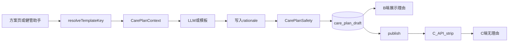

# 健康管理方案：重定位与生成理由

| 项 | 内容 |
|---|---|
| 版本 | **v0.2**（Grill 收束） |
| 日期 | 2026-10-15 |
| 状态 | **Grill 定稿，代码已一次性落地（待联调）** |
| 依据 | `健康管理方案-Agent技术方案.md`（生命周期 / SSE / Safety 骨架不变）；`疾病评估-重构产品与技术方案.md` D17 |
| 范围 | 五类方案类型；综合始终可选；schema V5 生成理由；体重监测自动打卡；B 展示 / C strip |
| 非目标（本期） | 多 ACTIVE；「营养方案」独立产品 / `focus=NUTRITION` 字段；C 端展示理由；未患病自动升综合；评估驱动自动荐综合 |

---

## 0. Grill 定稿

| # | 结论 |
|---|---|
| R1 | 仍是**一份**方案（至多 1 个 ACTIVE）；内容三块不变：运动 / 饮食 / 执行 |
| R2 | 五类：`COMPREHENSIVE` / `DIABETES` / `HYPERTENSION` / `OBESITY` / `WELLNESS` |
| R3 | **综合管理始终可选**：不论是否患病、不论病种多少 |
| R4 | **未患病 ≠ 营养方案**：展示名「健康管理」；营养仅用 instruction，**不做** `focus` 字段 |
| R5 | 专项 = 叙事焦点；`diseaseTags` = 监测与安全真相；**任务按标签叠加** |
| R6 | 自动推荐可覆盖；健管师手动选择优先 |
| R7 | 生成须带 rationale；B 可见；**C API strip** |
| R8 | 旧键：`GENERAL`→`WELLNESS`；`DIABETES_HYPERTENSION`→`COMPREHENSIVE`（读兼容，新写新键） |
| R9 | schema **V5**；生命周期 / publish / 打卡 / 激励 / 管理报告 due 口径不变 |
| R10 | 多病可选手选专项；监测仍按标签叠加（不强迫只能综合） |
| R11 | 病种 tags / 专项识别：**仅疾病档案确诊**；评估不单独当成「有肥胖」 |
| R12 | 缺 rationale → **WARN**，ack 后可发（非 ERROR） |
| R13 | 未患病自动推荐**永远** `WELLNESS`；综合只靠手选（本期不做评估升综合） |
| R14 | 有病也可手选 `WELLNESS`；监测仍按标签叠加 |
| R15 | 肥胖默认任务：`WEIGHT_LOG`，`relatedRef=WEIGHT`，**`frequency=QD`**（复用按日自动打卡；腰围手加） |
| R16 | 扩 `MetricTaskRules`：录入体重 → 系统完成当日体重监测任务 |
| R17 | 人工改正文 → **清空**该项 rationale（overview 保留，除非改类型总述） |
| R18 | B 端 rationale **允许**写高危/分层等评估用语；患者可见字段仍禁（D17） |
| R19 | `NO_DISEASE_TAG`：WELLNESS / 无病综合**不** WARN；仅「选了糖/压/肥专项但档案无对应病」WARN |
| R20 | 默认标题：`{类型展示名} · {goalSummary 截断}`，可改 |
| R21 | **一次性落地**：类型 + 理由 + 体重自动打卡 + Safety/标题/前端同批完成，不分期发版 |

---

## 1. 产品定位

### 1.1 一句话

为糖尿病、高血压、肥胖与未患病客户生成可执行阶段管理方案；支持专项或综合叙事；AI/模板产出附生成依据供健管师审阅。

### 1.2 方案类型

| `templateKey` | 展示名 | 含义 |
|---|---|---|
| `COMPREHENSIVE` | 综合管理方案 | 全维度共管；**任何人均可选用** |
| `DIABETES` | 糖尿病管理方案 | 以控糖为主叙事 |
| `HYPERTENSION` | 高血压管理方案 | 以控压为主叙事 |
| `OBESITY` | 肥胖管理方案 | 以减重 / 体成分为主叙事 |
| `WELLNESS` | 健康管理方案 | 未确诊糖/压/肥时的生活方式管理（**不叫营养方案**） |

| 旧键 | 处理 |
|---|---|
| `GENERAL` | 展示→健康管理；新生成写 `WELLNESS` |
| `DIABETES_HYPERTENSION` | 展示→综合管理；新生成写 `COMPREHENSIVE` |

### 1.3 自动推荐（可改）

```text
健管师手动 templateKey 优先（入参旧键映射到新键）

否则（仅看档案确诊糖/压/肥）：
  确诊数 ≥ 2  → COMPREHENSIVE
  仅糖尿病   → DIABETES
  仅高血压   → HYPERTENSION
  仅肥胖     → OBESITY
  均无       → WELLNESS
```

`diseaseTags` 始终来自档案确诊（可多选），与 `templateKey` 解耦。  
执行监测按 tags 叠加（有糖→血糖，有压→血压，有肥→体重），**不**依赖必须是综合类型。

### 1.4 「营养」

本期不用顶层类型、不做 `focus`；需要时写在 `instruction`。

---

## 2. 生成理由（rationale）

### 2.1 Schema V5（节选）

块级 / 任务级 / 示例餐可带 `rationale` 字符串；整份：

```json
"rationale": {
  "templateKey": "COMPREHENSIVE",
  "overview": "…",
  "sources": ["diseaseArchive", "assessment", "allergens", "meds", "vitals"]
}
```

### 2.2 粒度

| 层级 | 要求 | B 展示 |
|---|---|---|
| `rationale.overview` | 应有；缺 → WARN | 方案头 |
| exercise / diet / execution 块级 | 应有；缺 → WARN | 折叠 |
| 任务、示例餐 | 建议有 | ⓘ / 小字 |
| 每周同质步行 | 一块即可 | 不按天复制 |

### 2.3 约定

| 路径 | 行为 |
|---|---|
| LLM | 必出 rationale；可引用评估等级（仅理由）；患者字段禁等级词 |
| 模板 | 规则短理由，保证非空优先 |
| 缺理由 publish | WARN，须 ack |
| 人工改正文 | 清空该项 rationale |
| C | **服务端 strip** `rationale*`，不依赖前端藏 |

---

## 3. 内容与监测

| 类型 | 运动 | 饮食 | 标签叠加监测 |
|---|---|---|---|
| `DIABETES` | 餐后步行；防低血糖 | 控糖、规律、纤维 | 糖 |
| `HYPERTENSION` | 有氧；避免憋气 | 低盐 | 压 |
| `OBESITY` | 循序有氧 | 热量目标（有则写清） | **体重 QD** |
| `WELLNESS` | 一般活跃 | 均衡 | 无强制糖压肥监测 |
| `COMPREHENSIVE` | 保守合并 | 合并原则 | 按 tags 全叠 |

体重任务：`code=WEIGHT_LOG`，`relatedRef=WEIGHT`，`frequency=QD`；`MetricTaskRules` 支持 `WEIGHT` → 录入体重自动完成当日任务。腰围不默认生成。

---

## 4. Safety

| 原 WARN | 新口径 |
|---|---|
| `NO_DISEASE_TAG` | 仅当 `templateKey ∈ {DIABETES,HYPERTENSION,OBESITY}` 且档案无对应确诊时触发；文案如「已选糖尿病管理但档案未见糖尿病确诊」 |
| 新增 `MISSING_RATIONALE` | overview 或任一块级 rationale 缺失 → WARN |

---

## 5. 标题

默认：`{类型展示名} · {goalSummary 截断}`；健管师可改。列表旧键映射新展示名。

---

## 6. 技术方案（一次性改动面）

| 组件 | 改动 |
|---|---|
| `CarePlanTemplateKeyEnum` | 五类 + 旧键兼容 / deprecate |
| `CarePlanTemplateRegistry` | resolve；五类内容；tags 叠任务；模板 rationale |
| `MetricTaskRules` + checkin sync | `WEIGHT` 自动打卡 |
| `CarePlanSafetyService` | NO_DISEASE 新口径；MISSING_RATIONALE |
| `CarePlanSchemaVersions` | `CURRENT = 5` |
| `management-plan/SKILL.md` | 五类 + rationale + 综合可选 |
| Agent / Service 落库 | 保留 rationale；标题规则 |
| C care-plan API | strip rationale |
| B admin/staff 方案页、预览、生成弹窗 | 五类选项 + 理由 UI + 旧键文案 |
| 单测 | resolve 矩阵；叠任务；体重打卡；C 无 rationale；WARN |



---

## 7. 落地方式

**单迭代一次做完**（不分期发版）：类型重定位 + V5 理由 + 体重自动打卡 + Safety/标题/B·C 前端与 Skill。

本期不做：评估自动升综合、`focus=NUTRITION`、C 展示理由、多 ACTIVE。

---

## 8. 验收（摘）

| # | 用例 | 期望 |
|---|---|---|
| 1 | 未患病 | 荐 `WELLNESS`，无 `NO_DISEASE` WARN，标题含「健康管理」 |
| 2 | 未患病手选综合 | `COMPREHENSIVE`，可无糖压肥监测 |
| 3 | 仅糖 | 荐 `DIABETES` + 血糖任务 |
| 4 | 糖+压 | 荐综合；血糖+血压 |
| 5 | 仅肥 | 荐 `OBESITY` + 体重 QD；录入体重自动完成 |
| 6 | 糖+压手选糖尿病 | 叙事糖尿病，任务仍含血压 |
| 7 | AI 草稿 | B 见理由；缺理由 WARN |
| 8 | 改运动 goal | 该项 rationale 清空 |
| 9 | C 拉方案 | JSON 无 rationale |
| 10 | 旧 `GENERAL` 历史 | 展示「健康管理」 |

---

## 9. 交叉引用

- `健康管理方案-Agent技术方案.md`
- `疾病评估-重构产品与技术方案.md` D17
