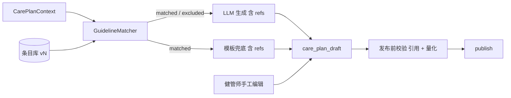

# 指南推荐条目库：产品与技术方案

| 项 | 内容 |
|---|---|
| 版本 | **v0.3**（P0 实现对齐） |
| 日期 | 2026-10-29 |
| 状态 | **Grill 定稿，未写代码；条目待临床顾问审定** |
| 依据 | `management-plan/SKILL.md`；`CarePlanSafetyService`；`CarePlanRationaleSupport`；`CarePlanTemplateRegistry`；`CarePlanAllergenGuard`；`健康管理方案-重定位与生成理由.md` R7 / R12 / R17；`患病风险与确诊严重度评估-技术方案.md` §合规 |
| 范围 | 健康管理方案（运动 / 饮食 / 执行）生成与发布时引用、校验的指南推荐条目；B 端依据展示；「依据来源」页；条目维护与审定；对外口径 |
| 非目标 | 向量检索 / RAG；机构上传自有规范（P2 后单独议）；C 端展示依据；改造疾病评估引擎；菜谱与动作库；条目库驱动方案类型选择 |

---

## 0. Grill 定稿

| # | 结论 |
|---|---|
| G1 | 要解决的是「看不出依据」为主、「建议太泛」为辅。首版要说服的是**健管师**和**签单时的机构方** |
| G2 | 做**结构化推荐条目**，不做指南 PDF 向量检索。机构上传自有规范是 P2 后的独立议题 |
| G3 | 只服务**方案**。评估侧只把每条命中项的出处细化到章节，并核对指南版本（§10） |
| G4 | 条目由临床顾问**署名审定**。审定人只在「依据来源」页展示，**不出现在单份方案上**；个案医生签字走 `DOCTOR_PLAN_REVIEW`，开关仍由机构自定 |
| G5 | 条目**按人群分档**（年龄 / BMI / 低血糖风险 / 合并症），总量 ≤ 100 条；不收菜谱与具体动作（由食谱库与 `SKILL.md` 负责） |
| G6 | 条目分 **安全类 `SAFETY`** 与 **达标类 `TARGET`**：安全类越界 → ERROR；达标类越界 → WARN，ack 后可发并留痕 |
| G7 | **发布时一律跑量化校验**，不论内容来自 AI、模板还是手工编辑；健管师 `instruction` 不能绕过安全类 ERROR |
| G8 | 过敏、限水、制动三类**继续由代码硬拦截**，另挂安全类条目作出处；低血糖期运动上限由 WARN（`HYPOGLYCEMIA_RISK`）**升为安全类 ERROR**，上线说明单列 |
| G9 | 无任何匹配条目时照常生成，出 WARN `GUIDELINE_KB_EMPTY`，B 端显著提示「关键建议无指南条目覆盖」 |
| G10 | 存量方案**不回填**引用；B 端标「生成于依据库上线前」，续期复评重新生成时自然更新 |
| G11 | 顾问在**固定模板表格**中维护条目（审定原件），开发用脚本转 JSON 入库并校验；Ops 编辑页放 P1 |
| G12 | 做只读「依据来源」页；同步销售材料；对外口径按 §9，并补充敏感词检查 |
| G13 | C 端不展示依据（守 R7） |
| G14 | 排期：退组 / 结案先行；条目库代码与条目整理并行，**审定完成后才上线**；阶段评估在其后或并行 |
| G15 | 未患病（`WELLNESS`）纳入首批，仅用通用膳食与身体活动条目 |

---

## 1. 要解决的问题

- 方案由大模型按 `SKILL.md` 生成。运动 / 饮食建议（如每周运动时长、低盐、控精制糖）写在提示词里或由模型发挥，**没有出处**。
- `rationale` 只引用档案 / 评估 / 过敏等**患者事实**，回答了「为什么是这个人」，没回答「为什么这么建议」。
- 健管师不敢直接用；签单演示时讲不出「凭什么」。

目标：每份方案的关键建议都能回答「依据哪本指南、哪一章、哪个版本」，条目库整体能回答「谁审定过、何时审定」，并且服务端能校验方案没有越出依据。

---

## 2. 为什么不用 RAG

| 方式 | 问题 |
|---|---|
| 指南 PDF 切块 + 向量检索 | 段落是否适用不可控；模型可能改写数值；引用「看着像真的」但张冠李戴，比无引用更伤权威 |
| 合规 | 现有口径「避免大段转载指南原文，引用出处即可」；切块入库即转载 |
| 规模 | 三病种 + 未患病，≤ 100 条，人工整理可控，检索无必要 |

条目库与现有 `energyTarget` 同一思路：**数字和依据由系统给定，模型只负责组织语言与个性化**。

---

## 3. 条目结构

### 3.1 指南来源 `GuidelineSource`

| 字段 | 说明 |
|---|---|
| `code` | 稳定编码，如 `CN_HTN`、`CN_DIET` |
| `name` / `edition` / `publisher` | 指南全名、版本年份、发布机构 |
| `status` | `ACTIVE` / `SUPERSEDED` |
| `supersededBy` | 升版后指向新来源 |

### 3.2 推荐条目 `GuidelineRec`

| 字段 | 说明 |
|---|---|
| `code` / `rev` | 稳定编码（如 `HTN.DIET.SALT`）与修订号；升版不改 code，改 rev |
| `sourceCode` / `section` | 出处与章节 |
| `kind` | `SAFETY` / `TARGET`（G6） |
| `block` | `EXERCISE` / `DIET` / `MONITOR` / `LIFESTYLE` |
| `appliesWhen` | 适用条件（§3.3），全部满足才匹配 |
| `contraindicatedWhen` | 禁忌条件；命中则进入 `excluded`，被引用即 ERROR |
| `staffText` | 给健管师的转述（可含指南术语，不转载原文） |
| `patientHint` | 给模型的患者侧行动化表述参考（须过 `ComplianceText`，不含等级 / 医疗用语） |
| `quant` | 可选量化约束（§3.4） |
| `evidence` | 指南原有证据等级 / 推荐强度，无则空 |
| `priority` | 同 block 多条命中时排序 |
| `reviewer` / `reviewedAt` | 审定人与日期；缺失则**拒绝加载** |

### 3.3 适用条件

只用已有上下文字段，不新增采集；表达式只支持 AND 与集合包含，不做嵌套 OR：

| 条件键 | 来源 |
|---|---|
| `diseaseTags` | `CarePlanDiseaseTags`（档案确诊，R11）；空集合表示未患病 |
| `assessmentTier` | `assessments`（引擎 + 统一等级） |
| `ageRange` / `sex` | 基础档案 |
| `bmiRange` | 体征 / 档案 |
| `hypoglycemiaRisk` | 现有低血糖风险判定 |
| `fluidRestricted` | 现有限水判定（心衰 / 慢性肾病 / 医嘱限水） |
| `immobilized` | 骨折 / 卧床 / 制动约束 |
| `medClasses` | 在用药物分类（如胰岛素 / 磺脲类） |

### 3.4 量化约束

```json
{ "metric": "EXERCISE_MODERATE_MIN_PER_WEEK", "op": ">=", "value": 150, "unit": "min/week" }
```

只支持服务端能从方案 JSON 算出来的指标：

| `metric` | 取值方式 | 典型 `kind` |
|---|---|---|
| `EXERCISE_MODERATE_MIN_PER_WEEK` | `weeklyPlan[].items[]` 的 `durationMin` 求和：MODERATE 按 1 倍、VIGOROUS 按 2 倍、LIGHT 不计 | TARGET |
| `EXERCISE_SESSION_MAX_MIN` | 单次 `durationMin` 最大值 | SAFETY（低血糖期） |
| `EXERCISE_INTENSITY_MAX` | `items[].intensity` 最高档 | SAFETY（低血糖期 / 制动） |
| `MONITOR_TASK_PRESENT` | `execution.tasks[]` 存在指定 `relatedRef` | TARGET |
| `WATER_ML_RANGE` | `WATER_LOG.targetMl` | TARGET |

食盐克数等只在文案中出现的数字不做数值校验，只校验「引用了对应条目」。

---

## 4. 首批条目范围（待临床顾问核对）

下表只列**主题与候选来源**。具体数值、章节、版本一律由审定人核对后填入；本文不作数值依据。

| 人群 | 主题 | 候选来源（版本待核对） |
|---|---|---|
| 通用 / 未患病 | 身体活动量、久坐、抗阻频次 | 《中国人群身体活动指南》 |
| 通用 / 未患病 | 膳食结构、盐 / 油 / 添加糖上限、饮水 | 《中国居民膳食指南》 |
| 高血压 | 限盐、限酒、减重、有氧与抗阻、家庭血压监测 | 《中国高血压防治指南》（引擎现用 2018 修订版，待确认升版） |
| 糖尿病 | 餐后活动、运动前后血糖、低血糖防范、碳水分配、血糖监测 | 《中国糖尿病防治指南》（引擎现用 2020 版，待确认升版） |
| 肥胖 | 能量缺口与减重速度、体重监测、饮食模式 | 《肥胖症诊疗指南（2024 年版）》 |
| 安全 | 低血糖期运动上限、制动期活动、限水人群、食物过敏 | 对应病种指南 |

`SKILL.md` 中现有的硬编码建议（「糖尿病：控精制糖…」「高血压：低盐、限制腌制食品」等）全部迁为条目；提示词只保留格式、安全约束与引用规则。

---

## 5. 生成与发布链路



1. `GuidelineMatcher` 按 §3.3 输出 `matched[]`（code / kind / block / staffText / patientHint / quant）与 `excluded[]`（code + 原因）。
2. `CarePlanLlmGenerator.buildUserMessage` 新增 `guidelineRecs`（仅 matched，按 block 分组、按 priority 截断）。
3. `SKILL.md` 新增要求：每块 `refs` 必填，关键任务 `refs` 选填；量化建议须与所引条目一致；只能引用 `guidelineRecs` 中的 code；患者正文用 `patientHint` 式表述，不写指南名。
4. 模板兜底（`CarePlanTemplateRegistry`）同样按 matched 写入 `refs`。
5. 修订模式保留未改块的 `refs`；被改块重新引用。
6. **发布前**（`assertPublishable` 之前）对最终草稿重新跑 Matcher 与 §6 全部校验，不论草稿来源（G7）。

### 5.1 方案 JSON 变化（schema V6）

在块级 `rationale` 旁新增 `refs`，`rationale` 类型不变，旧数据读兼容：

```json
{
  "exercise": { "rationale": "…", "refs": ["GEN.PA.AEROBIC", "DM.EX.POSTMEAL"] },
  "execution": {
    "rationale": "…",
    "refs": ["HTN.MON.HBPM"],
    "tasks": [{ "code": "BP_LOG", "refs": ["HTN.MON.HBPM"] }]
  },
  "contextSnapshot": {
    "guideline": { "kbVersion": "GREC-2026.11.1", "matched": ["GEN.PA.AEROBIC", "…"], "excluded": ["…"] }
  }
}
```

- `CarePlanRationaleSupport.strip` 同时剥离 `refs` 与 `contextSnapshot.guideline`（G13）。
- `clearIfContentChanged` 同时清空被改块的 `refs`（R17）；量化校验不受影响，照常在发布前执行。
- `contextSnapshot.guideline` 只存 code（不存条目文案与排除原因），避免误触 `WaterIntakeRules` 对快照的限水关键词扫描；发布时按发布那一刻的匹配结果重写。

### 5.2 现有安全规则的归属（G8）

| 规则 | 拦截方 | 条目 |
|---|---|---|
| 食物过敏 | `CarePlanAllergenGuard` + `DIET_ALLERGEN_CONFLICT`（不变） | 挂 SAFETY 条目作出处 |
| 限水 | 不生成 `WATER` 任务（不变） | 挂 SAFETY 条目作出处 |
| 骨折 / 制动 | SKILL 约束 + 修订累积保留（不变） | 挂 SAFETY 条目，`EXERCISE_INTENSITY_MAX` 校验 |
| 低血糖风险 | **由 `HYPOGLYCEMIA_RISK` WARN 改为条目 ERROR** | SAFETY：`EXERCISE_SESSION_MAX_MIN` / `EXERCISE_INTENSITY_MAX` |

---

## 6. 校验码（`CarePlanSafetyService` 新增）

| 码 | 级别 | 触发 |
|---|---|---|
| `GUIDELINE_SAFETY_VIOLATION` | ERROR | SAFETY 条目 `quant` 越界（含手工编辑；`instruction` 不可绕过） |
| `GUIDELINE_REF_EXCLUDED` | ERROR | 引用了 `excluded` 中的条目 |
| `GUIDELINE_TARGET_CONFLICT` | WARN | TARGET 条目 `quant` 不符，提示具体差值 |
| `GUIDELINE_REF_UNKNOWN` | WARN | 引用 code 不在本次 matched；服务端剔除后提示 |
| `GUIDELINE_REF_MISSING` | WARN | 某块无 `refs` 且该块有 matched 条目；只对生成的方案（生成时、带 `templateKey` 的发布）提示，手工空白方案不提示 |
| `GUIDELINE_KB_EMPTY` | WARN | 无任何 matched（G9） |

- 实现在 `GuidelineCheck.apply`，生成（`persistGenerated`）、编辑（`updateDraft`）、发布（`publish`）三处调用；量化校验对全部 matched 条目执行，与是否引用无关。
- 条目库未启用（无可用条目）时整体不校验、不出任何 `GUIDELINE_*` 码，行为与上线前一致。
- 同一校验码的多条越界合并成一条 flag。

WARN 沿用现有 ack；ack 写审计（谁、何时、偏离哪条）。原 `HYPOGLYCEMIA_RISK` WARN 保留为提示，但不再是低血糖期运动越界的唯一防线。

---

## 7. B 端展示

- **方案页 / 预览弹窗 / Agent 方案卡**：每块 rationale 下显示「依据」标签「《指南简称》版本 · 章节」，悬浮看 `staffText` 与证据等级；不显示审定人（G4）。
- **无覆盖**：`GUIDELINE_KB_EMPTY` 时方案头显著提示（G9）。
- **存量方案**：条目库已启用、方案快照无 `guideline`、且来源不是 MANUAL 时，标「生成于依据库上线前」（G10）。
- **B 端打印**（`care-plan-print.ts`）末尾附「参考依据」；C 端打印不附。

### 7.1 「依据来源」页

工作台只读页 `/workspace/guidelines`，数据来自 `GET /api/b/v1/guidelines`（方案页依据标签共用），演示可直接打开（G12）：

| 内容 | 来源 |
|---|---|
| 覆盖的指南：名称、版本、发布机构 | `GuidelineSource` |
| 各病种 / 人群条目数，安全类 / 达标类条目数 | `GuidelineRec` 汇总 |
| 审定人姓名、资质、最近审定日期 | 审定记录 |
| 条目库版本 | `library.json` 的 `version` |

只展示汇总与条目转述，不展示指南原文。

---

## 8. 维护与审定（G11）

### 8.1 P0：表格 → JSON

- 顾问维护固定模板表格（列 = §3.2 字段），作为**审定原件**归档。
- 表格模板：`docs/guidelines/sources.csv` + `recs.csv`（由当前种子导出）。条件列写法 `diseaseTags=DIABETES|HYPERTENSION; hypoglycemiaRisk=true`。
- 脚本 `scripts/guideline-import.mjs`：
  - `export <目录>`：当前 `library.json` → 两张 CSV；
  - `import <目录> --version <版本>`：CSV → `backend/health-core/src/main/resources/guidelines/library.json`（单文件），转换时校验 code 唯一、来源存在、已审定须有 `reviewer` 与 `reviewedAt`、条件键与 `metric` 合法、`quant` 参数配套、总数 ≤ 100。
- 启动加载时再校验一遍，不合格**拒绝启动并报错**，不静默跳过。
- 生效开关 `healix.guideline.allow-draft`：默认 `false`，只用 REVIEWED 条目；dev 配置为 `true`（环境变量 `GUIDELINE_ALLOW_DRAFT`），草稿条目也进匹配，便于联调。当前种子全部为 DRAFT，因此**生产环境在审定版导入前条目库不生效**。
- 单元测试：画像快照（未患病、单纯高血压、糖尿病低血糖风险、肥胖合并高血压、骨折制动、限水、食物过敏）的 matched / excluded 与校验结果。

### 8.2 P1：入库与 Ops 页面

表 `guideline_source` / `guideline_rec`，Ops「指南条目」页：编辑、提交审定、上下线、版本对比。租户级自定义不做。

### 8.3 升版

- 指南升版：新建来源，旧来源 `SUPERSEDED`，条目改 `rev` 并重新审定。
- 已发布方案不回改；`kbVersion` 落后的 ACTIVE 方案在续期复评（renew `PLAN_CREATE`）时提示「依据已升版」。

---

## 9. 对外口径（G12）

| 允许 | 禁止 |
|---|---|
| 「方案建议参考《××指南》等 N 部国家级指南」 | 「专家认证方案」 |
| 「推荐条目经临床顾问审定」 | 「权威医生制定」「医生为您定制」 |
| 「可开启医生复核」 | 「符合指南即有效」「保证效果」 |

- `scripts/check-sensitive-words.mjs` 增加「专家认证」「医生制定」「权威认证」等词。
- 同步更新 `docs/sales` 下产品介绍与演示材料的相关表述。

---

## 10. 评估侧（G3，顺带）

1. `AssessmentResult.Hit.source` 补到章节粒度，评估详情逐项可见。
2. 审定人核对高血压（2018 修订版）、糖尿病（2020 版）是否需升版；升版走引擎 `rule_pack_version`，与本库独立。

---

## 11. 分期与排期（G14）

| 期 | 内容 | 工作量 |
|---|---|---|
| 前置 | 退组 / 结案 | 另立方案 |
| P0 | 条目表格模板 + 导入脚本 + Matcher + 喂模型 + `refs` + §6 校验（含发布前全量校验、低血糖升 ERROR）+ B 端依据展示 + 「依据来源」页 + 模板兜底带 refs + 敏感词 + 画像测试 | 代码约 5–7 人日；条目整理与审定由顾问并行，**审定完成才上线** |
| P1 | 入库 + Ops 条目页 + 升版提示 + 评估 Hit 出处细化 + 销售材料更新（预览弹窗 / Agent 方案卡依据标签、B 端打印附「参考依据」已随 P0 完成） | 约 3.5 人日 |
| P2 后 | 机构上传自有规范（单独议） | — |

上线说明须单列：低血糖期运动越界由可 ack 的 WARN 变为不可发布的 ERROR。

---

## 12. 修订记录

| 版本 | 日期 | 说明 |
|---|---|---|
| v0.1 | 2026-10-29 | 首版草案：结构化条目库替代 RAG；匹配、引用、校验、展示、维护与分期 |
| v0.2 | 2026-10-29 | Grill 定稿 G1–G15：安全类 / 达标类分级、发布前全量校验、低血糖升 ERROR、依据来源页、表格维护、对外口径、存量不回填、未患病纳入首批 |
| v0.3 | 2026-10-29 | 按 P0 实现对齐：匹配结果落 `contextSnapshot.guideline`；单文件 `library.json` + CSV 导入脚本；`allow-draft` 开关；高强度按 2 倍计；`REF_MISSING` 只对生成方案提示；预览弹窗 / Agent 方案卡依据标签、B 端打印附「参考依据」一并完成 |

---

## 修订（2026-10-30 · 首诊与减重重构）

- 适用 / 禁忌条件扩展：`pregnantOrLactating`、`eatingDisorderRisk`、`exerciseRestricted`、`highlights`（首诊高亮命中）。
- 量化指标新增：`ENERGY_DEFICIT_KCAL`、`WEIGHT_LOSS_RATE_KG_PER_WEEK`、`WEIGH_FREQUENCY`。
- 高亮 `BLOCK` → SAFETY ERROR（不可发布）；`CAUTION` / `REFER` → WARN。
- 补入减重相关条目（中国超重/肥胖医学营养治疗指南、肥胖症诊疗指南 2024、身体活动指南等），待临床顾问审定。
