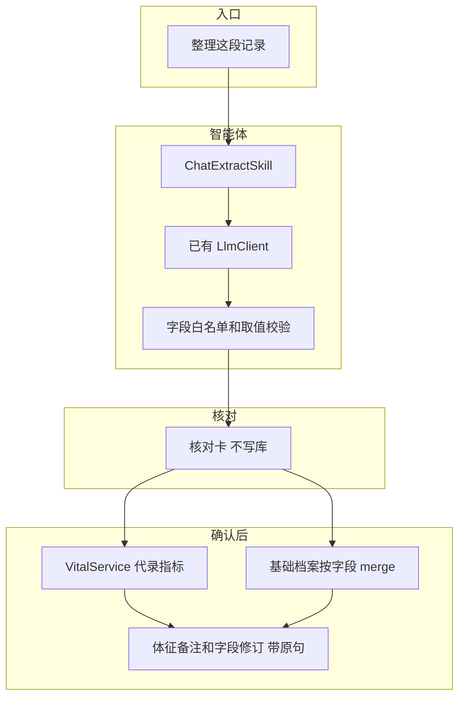

# 聊天文字提取关键数据 · 产品与技术方案

| 项 | 内容 |
|---|---|
| 版本 | **v0.2** |
| 日期 | 2026-10-23 |
| 状态 | 已对齐，待实现 |
| 依据 | 与营养师/健管师的沟通习惯调研；`检验单OCR-Agent技术方案.md`；`患者档案-字典与元数据.md`；`患者观测数据-指标检验检查.md` |
| 范围 | 健管师在电脑端把一段**已经是文字**的对话交给健管智能体 → 抽出指标和档案里已有的字段 → 在核对卡上改完 → 确认后写入当前患者 |
| 非范围 | 接入微信 / 企业微信；读取通话录音；语音消息原文件导出；自动写库；从闲聊里改病种分级、确诊或风险分层；检验单项目（仍走拍照 OCR）；用药清单和饮食克数；健管师手机端 |

---

## 0. 已对齐的决定

| # | 主题 | 结论 |
|---|------|------|
| D1 | 沟通习惯 | 健管师继续用微信、企业微信跟客户说话。本能力不替换聊天工具 |
| D2 | 输入 | 只接收健管师**主动粘贴的文字**。来源可以是聊天记录、语音消息在微信里转出的文字、会议纪要，或通话后自己补的一句 |
| D3 | 通话录音 | 微信和企业微信的普通语音通话、视频通话没有可导出的录音，不做事后提取。会议纪要文字可以粘贴 |
| D4 | 触发 | **只有**点击「整理这段记录」才抽取。粘贴后直接发送，仍按普通提问处理，不自动建档 |
| D5 | 端 | 第一期只做电脑端：智能驾驶舱（已选患者）和患者抽屉里的健管智能体。不新增菜单。手机工作台不做 |
| D6 | 患者 | 必须先选中一位患者。未选患者、输入为空、机构级会话：不调用抽取，也不把这段文字写入机构会话 |
| D7 | 人机闭环 | **禁止自动写库**。核对卡上每一行都要变成可入库或被删除，才能确认。服务端再校验；有一行不通过，整次都不写入。确认成功后这张卡锁定 |
| D8 | 抽取范围 | 指标只抽血压、血糖、心率、体重、腰围。档案只抽饮食、运动、睡眠、吸烟、饮酒里**已经存在**的字段，且只接受在说平时习惯的句子 |
| D9 | 原文 | 全文留在**这位健管师自己的**患者会话里，打开会话可以回看。会话列表的标题和预览不显示原文。日志不记全文和原句。后续提问的模型上下文不带全文。确认写入的字段带不超过 80 字的原句 |

---

## 1. 产品

### 1.1 谁在用、解决什么

健管师、营养师已经在微信里把血压、血糖、体重、饮食和作息说完了。再打开系统逐项填表，信息会漏，也会填错时间。

本能力把「再填一遍」收成三步：粘贴文字、看抽出的结果、确认入库。

### 1.2 入口

| 入口 | 行为 |
|------|------|
| 智能驾驶舱 · 已选患者 | 输入框旁提供「整理这段记录」。点它才抽取 |
| 患者抽屉里的健管智能体 | 同上 |
| 未选患者 / 机构级会话 | 提示先选择患者。不调用抽取，不把文字送进模型 |
| 健管师手机端 | 第一期不做 |

短句按回车仍是普通提问，即使句子里出现「血压」。一段话里有换行，或超过 200 字时，按回车不发送，并提示改点「整理这段记录」。要提问就把文字缩短后再发。

### 1.3 使用路径

1. 健管师在微信里复制一段聊天，或复制语音消息转出的文字，或复制会议纪要，或自己写一句「刚才电话里说 7 点半血压 138/86」。
2. 贴进已打开的该患者会话，点「整理这段记录」。输入框清空。
3. 智能体返回一张核对卡，不写库。打开这条会话能看到刚贴的全文。
4. 健管师改数值、补日期或时刻、去掉不该记的行。每一行都可入库或已删除后，点确认。
5. 指标写入体征，档案字段按字段合并进基础档案。体征备注和档案修订里能看到原句和操作人。这张卡变为已写入，不能再点。

整理失败（超时或返回无法解析）时，不改成普通问答，不写任何数据。提示「这次没整理成功」，并把原文放回输入框。

同一会话里只留一张未确认的卡。再次点整理，上一张未确认的卡作废，不能再确认。已经写入的卡保持不动。

### 1.4 核对卡

标题用「从对话整理的记录」。不出现「熄灭」一类词。

顶部提示：这些记录将写入当前患者，请对照原句确认说的是本人。确认前再提示：内容来自健管师粘贴的文字，请对照原句后再写入。

每条一行：

| 列 | 说明 |
|----|------|
| 去向 | 指标，或档案字段名 |
| 抽出的值 | 可改。档案字段并排显示当前值和新值 |
| 时间 | 指标要有日期和时刻。档案字段不要求测量时间 |
| 原句 | 只读 |
| 状态 | 可入库，或缺日期、缺时刻、缺场景、缺单位、超范围、血压不成对、与已有记录重复 |

同一句里的两个数做成两行。同一档案字段抽出两行时，必须删到只留一行，确认按钮才可用。已忽略的句子列在卡片下方，不占可入库的行，不挡住确认。

可以改数值、单位、血糖场景、血压场景、日期时刻，以及档案里的选项和允许的短文字。不能把这一行改成另一种指标，也不能新加一行。类型抽错或漏了一句，删掉该行，到原来的录入页手填，或改好文字重新整理。

未点确认前的修改停在当前页面。刷新后回到刚抽出的结果。

一句都对不上时，仍给出核对卡，写明「没有可写入的内容」，并列出忽略的原句。确认按钮不可用。

一段话里夹着带参考范围的化验结果时，血压、血糖和习惯照常提取。化验项目进入已忽略，并提示改用拍照识别。

### 1.5 允许抽取的字段

**指标**（`MetricTypeEnum`，来源 `STAFF`）：

| 口语 | 写入 | 附加规则 |
|------|------|----------|
| 血压 | `BLOOD_PRESSURE_SYS` + `BLOOD_PRESSURE_DIA`，成对，共用 `groupId` | 收缩压必须高于舒张压，不自动对调。场景 `bpContext`：默认 `HOME`（家庭自测）；原句有医院、诊室、体检则为 `CLINIC`，可改 |
| 血糖、空腹、餐后 | `BLOOD_GLUCOSE` | 单位只认 mmol/L，合理范围 1–35。场景 `mealContext` 必须是 `FASTING` / `POSTPRANDIAL` / `RANDOM`。说不清则该行不可入库，不默认成随机。餐后两小时记成 `POSTPRANDIAL` |
| 心率 | `HEART_RATE` | 没写单位按次/分 |
| 体重 | `WEIGHT`，单位公斤 | 写明「斤」则除以 2，卡上同时给出原文和公斤。写明公斤或 kg 用原数。没写单位则该行不可入库 |
| 腰围 | `WAIST` | 没写单位按厘米 |

同一患者、同一指标、同一分钟已经有记录时，该行不可入库。健管师改时刻或删掉这行后再确认。

**档案**（只写基础档案里已有的键，按字段合并，不用整份 JSON 覆盖）：

| 口语 | 写入 | 形态 |
|------|------|------|
| 食欲 | `basic.diet.appetite` | 已有选项：好 / 正常 / 一般 / 较差 |
| 饮食规律 | `basic.diet.habit` | 已有选项：好 / 一般 / 差 |
| 饮食类型 | `basic.diet.type` | 已有选项：普通、素食、低盐、低糖、低盐低糖等。对不上不改成「其他」 |
| 口味 | `basic.diet.preference` | 文字，抽出的短值不超过 40 字 |
| 运动频率 | `basic.exercise.frequency` | 已有选项 |
| 运动强度 | `basic.exercise.intensity` | 已有选项：轻度 / 中度 / 重度 |
| 每次运动多久 | `basic.exercise.durationMin` | 习惯里的分钟数，不是某一天走了多久 |
| 运动方式 | `basic.exercise.type` | 文字，不超过 40 字 |
| 睡眠质量 | `basic.sleep.quality` | 已有选项：良好 / 一般 / 较差 |
| 平时睡几小时 | `basic.sleep.hours` | 习惯小时数。不写入体征 `SLEEP_HOURS` |
| 睡眠障碍 | `basic.sleep.disorder` | 已有选项：无 / 失眠 / 打鼾等 |
| 吸烟状态 | `basic.lifestyle.smoking.status` | 已有选项：`NEVER` 从不、`CURRENT` 当前吸烟、`OCCASIONAL` 偶尔、`FORMER` 已戒烟 |
| 每天支数、烟龄 | `cigarettesPerDay`、`years` | 原句里有明确数字才预填 |
| 戒烟年份 | `basic.lifestyle.smoking.quitYear` | 「2020 年戒的」写入 2020。「戒了 N 年」预填为上海时区的今年减 N，卡上标明按这句话推算，可改。只说戒了、没有年数，不填年份 |
| 饮酒状态、频率 | `basic.lifestyle.drinking.status`、`frequency` | 已有选项 |
| 酒的种类、日均量 | `type`、`amountPerDay` | 文字，按原话写入短值，不超过 40 字 |

档案只接受习惯句：平时、一般、每天、已经戒了，以及同等的稳定说法。某一晚、某一顿、某一天（「昨晚只睡了 5 小时」「今天抽了两根」「今天中午吃了很多」）进入已忽略。

选项对不上的句子进入已忽略，不写进各组的 `note`。下面这些备注字段第一期都不写：`basic.diet.note`、`basic.exercise.note`、`basic.sleep.note`、`basic.lifestyle.smoking.note`、`basic.lifestyle.drinking.note`、`basic.lifestyle.note`。

一句里能对上多个字段时，分成多行，可以共用同一条原句。例如「烟已经戒了两年」可以同时产生已戒烟状态和戒烟年份两行。

### 1.6 明确不抽

| 内容 | 原因 |
|------|------|
| 身高、体温、步数、体征里的睡眠时长 | 第一期不代录。睡眠小时只进档案里的平时睡眠 |
| 家族史、既往史、现病史 | 不从闲聊改病史，也不追加到备注 |
| 病种类型、分级、风险分层、确诊日期 | 属于临床判断 |
| 化验单上的项目和参考范围 | 继续走检验单 OCR |
| 药名、剂量、频次 | 用药有单独目录和核对 |
| 某餐吃了什么、克数 | 饮食记录要进食物库 |
| 诊断、用药建议、要不要就医 | 这段文字不交给模型下结论 |
| 对不上的闲聊 | 列入已忽略 |

### 1.7 时间

时区用 `Asia/Shanghai`（与 `JobCronSupport.ZONE` 相同）。

| 原文 | 预填 |
|------|------|
| 今天、昨天、前天 | 只预填日期 |
| 写明的某月某日 | 只预填日期 |
| 7 点半、7:30 这类能落到某一分钟的说法 | 只预填时刻 |
| 今天 7 点半，日期和时刻都有 | 该行在时间上可以入库 |
| 早上、中午、晚上、上周、最近、前几天、七八点 | 不代填。对应的日期或时刻空着 |

系统不把「现在」写成测量时间。缺日期或缺时刻的指标行不可入库。

### 1.8 文案

| 位置 | 文案 |
|------|------|
| 芯片 | 整理这段记录 |
| 核对卡标题 | 从对话整理的记录 |
| 卡片顶部 | 这些记录将写入当前患者，请对照原句确认说的是本人 |
| 确认前 | 内容来自健管师粘贴的文字，请对照原句后再写入 |
| 没有可写内容 | 没有可写入的内容 |
| 夹着化验结果 | 化验项目请改用拍照识别 |
| 长文字按回车 | 请点「整理这段记录」。要提问请缩短文字后再发送 |
| 整理失败 | 这次没整理成功 |
| 超过 4000 字 | 请拆短后再贴 |
| 会话列表预览 | 已整理一段记录，共 N 字 |

---

## 2. 技术方案

### 2.1 总体



不新建业务表。指标仍进现有体征表，档案仍进 `people_basic_archive`。核对卡挂在现有 `agent_message` 的动作载荷上。来源用医护代录 `STAFF`。

血压两条记录共用一个 `groupId`，备注都写同一条原句。血糖场景写入已有 `extraJson.mealContext`，血压场景写入 `extraJson.bpContext`。

档案修订明细 `field_revision_item` 增加 `quote VARCHAR(80)`，每个改动的字段各自带原句。操作人沿用修订批次里的 `operator_id`。体征的原句写在 `vital_record.note`，记录人写在 `recorded_by_staff_id`。

### 2.2 触发

点「整理这段记录」时：

- 没有 `peopleId`，或正文去掉空白后为空：提示先选择患者或先粘贴，到此为止。
- 正文超过 4000 字：整段不抽取，提示拆短后再贴。
- 否则调用抽取。成功后输入框清空。失败则把原文放回输入框。

按回车不走抽取。有换行或超过 200 字时，这一次回车不发送。

### 2.3 模型输出

只要求 JSON，不要求散文。系统提示里带上白名单字段编码、选项编码和单位，不把整份档案 JSON 塞进提示词。档案的当前值由服务端在出卡时填上，供并排显示。

```json
{
  "items": [
    {
      "target": "VITAL",
      "code": "BLOOD_PRESSURE",
      "systolic": 138,
      "diastolic": 86,
      "measuredAt": "2026-10-23T07:30",
      "datePrecision": "DAY",
      "timePrecision": "MINUTE",
      "bpContext": "HOME",
      "quote": "今天7点半血压138/86"
    },
    {
      "target": "VITAL",
      "code": "BLOOD_GLUCOSE",
      "value": 6.2,
      "unit": "mmol/L",
      "measuredAt": "2026-10-23",
      "datePrecision": "DAY",
      "timePrecision": "MISSING",
      "mealContext": "FASTING",
      "quote": "今天早上空腹血糖6.2"
    },
    {
      "target": "ARCHIVE",
      "code": "basic.lifestyle.smoking.status",
      "value": "FORMER",
      "habit": true,
      "quote": "烟已经戒了两年"
    },
    {
      "target": "ARCHIVE",
      "code": "basic.lifestyle.smoking.quitYear",
      "value": "2024",
      "derived": true,
      "habit": true,
      "quote": "烟已经戒了两年"
    }
  ],
  "ignored": [
    { "quote": "医生说问题不大", "reason": "NOT_IN_CATALOG" },
    { "quote": "糖化血红蛋白 6.8% 参考范围 4.0-6.0", "reason": "LAB_PANEL" }
  ]
}
```

`datePrecision` 只允许 `DAY`、`MISSING`。`timePrecision` 只允许 `MINUTE`、`MISSING`。任一为 `MISSING` 的指标行不可入库。

`habit` 不为真的档案项丢进 `ignored`，原因 `NOT_HABIT`。`derived` 为真时，界面标明该值是按原句推算的。

服务端再做一遍：

- 未知 `code` 丢进 `ignored`。
- 数值沿用 `VitalValueRules`。超出范围的行留在卡上，状态为不可入库。
- 血压缺收缩压或舒张压，整条丢弃。收缩压不高于舒张压，该行不可入库。
- 血糖没有 `FASTING` / `POSTPRANDIAL` / `RANDOM`，该行不可入库。
- 体重没有单位，该行不可入库。`sourceUnit` 为斤时，展示值用公斤。
- 选项必须命中已有字典。文字字段超过 40 字则忽略该字段。
- 原句超过 80 字时截断，并在行上标明已截断。
- 抽出超过 20 行时，只保留前 20 行，其余忽略并提示。
- 一次粘贴里同一个档案字段有多行，这些行都标成须删到只留一行。
- `ignored` 里存在 `LAB_PANEL` 时，卡片提示改用拍照识别。

### 2.4 接口

挂在现有 B 端驾驶舱，不另开一套对话。患者抽屉走同一套确认。

| 方法 | 路径 | 作用 |
|------|------|------|
| 现有患者会话 | 智能体接口，由芯片触发 | 回复体里带 `extracted`。用户消息存全文；模型短窗里这条换成「已整理一段记录，共 N 字」 |
| `POST` | `/api/b/v1/cockpit/patients/{peopleId}/chat-extract/confirm` | 提交这张卡上未删除的行 |

确认请求只接受这张卡上的行，不接受重新粘贴的全文，也不接受卡上没有的字段。请求带消息 id。服务端只接受状态为未确认的那一张卡。

再次校验：患者属于当前机构；字段在白名单；指标有日期和时刻；数值、单位、场景在允许范围内；血压成对且收缩压更高；同一患者、同一指标、同一分钟还没有未删除的记录；原句非空且不超过 80 字；同一档案字段只出现一次。

校验在一个事务里完成。有一行不通过，整次都不写入，卡上标出原因。全部通过后写入，并把这张卡标成已确认。再次提交同一张卡直接拒绝。新的一次整理把本会话里上一张未确认的卡标成已作废。

档案写入走现有 `BasicArchiveService` 的按字段 merge。新值与当前值相同则不产生修订。

### 2.5 与检验单 OCR 的分工

| | 检验单 OCR | 本能力 |
|--|--|--|
| 输入 | 化验单图片 | 健管师粘贴的文字 |
| 写入 | 检验报告 | 指标 + 基础档案 |
| 化验项目出现在文字里 | — | 忽略这些行，其余行仍可整理，并提示改用拍照识别 |
| 时间缺失 | 采样或报告时间缺失则整单不能入库 | 缺日期或缺时刻的指标行不可入库；整张卡要全部行可入库或被删除后才能确认 |
| 确认位置 | 驾驶舱核对卡 / 检验页 | 驾驶舱或患者抽屉的核对卡 |

### 2.6 隐私与日志

会话按健管师分开（`agent_session.staff_id` + `peopleId`）。全文只出现在这位健管师打开该患者会话之后。

- 点整理时，用户消息的正文保存全文，供回看漏掉的句子。
- 不因为这次粘贴改会话标题。列表预览固定为「已整理一段记录，共 N 字」，不取原文开头。
- 写入模型短窗、以及之后普通提问带上的历史里，这条换成同一句预览，不带全文。抽取那一次调用本身会把正文送给模型，调用沿用现有健管智能体通道，不把原文用于训练。
- 应用日志不打印全文和原句。失败或成功只记 `peopleId`、文本长度、抽出行数、忽略条数。
- 确认后，不超过 80 字的原句进入体征备注和 `field_revision_item.quote`。

### 2.7 限额

| 项 | 第一期 |
|----|--------|
| 单次文本 | 超过 4000 字整段拒绝 |
| 回车拦截 | 含换行，或超过 200 字，按回车不发送 |
| 单次抽出 | 最多 20 行，超出部分忽略并提示 |
| 原句 | 每条最多 80 字，超长截断并在行上标明 |
| 档案文字字段 | 饮食偏好、运动方式、酒的种类、饮酒日均量，每项最多 40 字 |

---

## 3. 验收

1. 未选患者时点整理，不写任何数据，并提示先选择患者。机构级会话同样不抽取。
2. 含换行或超过 200 字时按回车，消息不发出，不调用问答。
3. 点整理处理「今天 7 点半血压 138/86，今天早上空腹血糖 6.2」：核对卡两行。血糖行缺时刻，确认按钮不可用。补上时刻后，一次写入这对血压和这条血糖。血压为家庭自测，血糖场景为空腹。
4. 「今天早上」不预填成 7:30，也不预填成当前时刻。原文没有日期的体重，确认接口拒绝该行。
5. 「120 斤」在卡上显示为 60 公斤，并保留斤的原文。没写单位的体重不能确认。
6. 收缩压不高于舒张压的行不能入库，系统不对调两个数。
7. 同一分钟已经有血糖记录时，再确认同一条会被拒绝。
8. 「医生说问题不大」不产生档案或指标，出现在已忽略。
9. 「昨晚只睡了 5 小时」「今天抽了两根」不改档案里的平时睡眠和吸烟支数。
10. 「烟已经戒了两年」可以写出已戒烟；戒烟年份预填为今年减 2，并标明是推算。吸烟、饮酒只落在已有生活方式字段上，不写备注。
11. 病种分级、用药、某一餐的克数、身高、家族史不会被写入。
12. 一段话里既有血压又有带参考范围的化验项目：血压可进入核对卡，化验项目被忽略，并提示改用拍照识别。
13. 超过 4000 字整段不抽取。模型无有效 JSON 时不写库，原文回到输入框。
14. 再次点整理后，上一张未确认的卡不能再确认。确认成功的卡不能第二次写入。
15. 打开该患者会话能看到全文。会话列表预览和日志里看不到全文。修订历史里能看到原句和操作人。后续普通提问的模型上下文不带这段全文。

---

## 4. 以后再做

| 项 | 说明 |
|----|------|
| 健管师手机端 | 电脑端跑顺后再做。核对、补时刻、改场景仍以电脑端为准 |
| 用药 | 抽出药名和频次，走现有用药核对，不在本方案里直接写清单 |
| 饮食一句话 | 走饮食记录的「一句话」确认克数，不写进档案备注冒充食谱 |
| 企业微信会议纪要 | 仍由健管师复制纪要文字。不对接企业微信接口 |
| 通话 | 仍不读取微信或企业微信的通话录音 |
