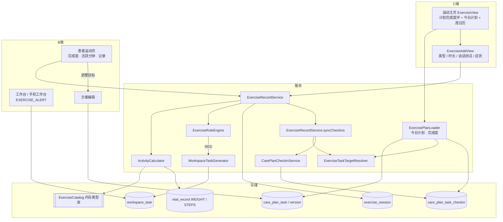

# 运动记录 产品与技术方案

| 项 | 内容 |
|---|---|
| 版本 | **v0.3（P1 已实现，文档已按实现同步）** |
| 日期 | 2026-10-11 |
| 状态 | 主决策已定，可进入开发 |
| 依据 | `饮食记录-产品与技术方案.md`、`健康管理方案-Agent技术方案.md`、`依从性看板-产品与技术方案.md`、`工作台任务-技术方案.md`、`患者观测数据-指标检验检查.md` |
| 范围 | C 端**按计划运动 + 症状安全上报**：今日计划 → 记录运动（手动 / 按方案一键）→ 计划完成度 → 管理方案 `EXERCISE` 任务自动打卡 → 不适症状生成工作台待办 → B 端/手机工作台查看与处理 |
| 非范围 | 实时 GPS 轨迹、运动课程/视频、社交排行、心电/心律分析、智能硬件直连（P2 起再议） |

---

## 0. 决策

| # | 主题 | 结论 |
|---|------|------|
| D0 | 运动消耗与饮食预算 | 沿用饮食 D9：**不抵扣**；饮食页**不展示**运动消耗 |
| E1 | 产品定位 | **慢病运动计划执行 + 安全**，不是健身打卡工具 |
| E2 | 主指标 | C 端主环 = **本周计划完成度**（运动任务 DONE 次数 / 应打次数）；WHO 口径**活跃分钟**为副指标，主要给 B 端与报告 |
| E3 | 活跃分钟口径 | 严格 WHO：MODERATE ×1、VIGOROUS ×2、LIGHT 不计 |
| E4 | 强度录入 | **三档谈话测试**（轻松能唱歌 / 能说话不能唱 / 说不完整句子 → LIGHT / MODERATE / VIGOROUS）；心率只记录，**不参与判定** |
| E5 | 热量 | MET × 体重 × 小时估算，**仅在记录详情小字展示** |
| E6 | P1 录入方式 | 手动 + 按方案一键；截图识别、一句话 → P1.5 |
| E7 | 目标唯一来源 | **管理方案**：执行任务（频率 + `targetMin` + 强度）定义每日计划，`exercise.targets.weeklyActiveMin` 定义周活跃分钟目标；**不建 `exercise_goal` 表**；无生效方案时按病种默认值并提示「暂无运动计划」 |
| E8 | 改目标 | B 端运动页「调整目标」**跳转方案编辑**，走草稿 → 发布 → 安全校验 → 医生签署 |
| E9 | 今日计划 | 以**执行任务**为准（`CarePlanDueSupport` 频率 + 14 天 horizon）；`weeklyPlan` 仅作说明 |
| E10 | 模板修正 | `EX_WALK_30`：QD、`targetMin` 30（低血糖风险 20）、`intensity`；`weeklyPlan` 改为每天，消除与任务/150 分钟目标的矛盾；`CarePlanSchemaVersions` +1 |
| E11 | 自动打卡匹配 | 当日所有 `category=EXERCISE` 的到期任务逐个判定：AEROBIC 任务认所有 AEROBIC 记录，RESISTANCE 任务只认 RESISTANCE；**当日累计时长 ≥ targetMin** → 系统 DONE |
| E12 | 步数 | 只展示不参与打卡、不计活跃分钟；**有步数数据才显示** |
| E13 | 计划到期 | 记录照常；C 端显示「运动计划已到期，请联系健管师更新」，完成度环置灰；**每日扫描补规则**：方案 horizon 结束未发新版本 → 开 `PLAN_CREATE`（摘要「方案执行期已结束，请更新」），对所有任务类型生效 |
| E14 | 症状分级 | RED：胸痛胸闷、晕厥/近似晕厥、严重气短；**糖尿病患者的低血糖症状**也为 RED。YELLOW：头晕、心慌、关节疼痛、非糖尿病者低血糖症状 |
| E15 | RED 触达 | 保存时**实时**开工作台任务 `EXERCISE_ALERT`（HIGH、当日到期、指派主责健管师、置顶）；OPEN 期间同患者再报**合并**；P1 **不建健管师推送通道**，不做超时升级 |
| E16 | 待办关闭 | 仅健管师手动关闭，必选处理方式（已电话联系 / 建议就医 / 已就医 / 误报），写随访记录 |
| E17 | 删除带症状记录 | 允许；待办保留并显示「患者已删除该记录」，待办内存症状快照 |
| E18 | 补录 / 代录 | 补录 ≤7 天；健管师可代录（source=STAFF），同样触发系统打卡（打卡不写记录人以保持可撤销），代录人记在运动记录上；**患者对代录记录只读** |
| E19 | 周口径 | 自然周（周一–周日），东八区；补录窗口同按东八区自然日 |
| E20 | 类型库 | 平台级约 40 种，机构不可自定义；力量训练只记时长 + 备注 |
| E21 | 老方案兼容 | 不迁移：`payloadJson.targetMin` → `weeklyPlan` 同类型 `durationMin` → 默认 30（低血糖风险 20），集中在 `ExerciseTaskTargetResolver` |
| E22 | 手机工作台 | P1 支持 `EXERCISE_ALERT` 查看与处理；运动记录列表 P1.5 |

---

## 1. 市面产品调研与借鉴

| 产品 | 典型做法 | 借鉴 / 取舍 |
|------|---------|------------|
| Apple 健康 / 健身 | 三环（活动卡路里 / 锻炼分钟 / 站立） | **借鉴**环形达成可视化；**舍弃**卡路里主环 |
| Google Fit | 心脏积分：中等 1 分/分钟、高强度 2 分/分钟，周目标 150 | **借鉴**活跃分钟口径（E3） |
| Fitbit | 心率区间活跃分钟 | **暂不借鉴**：H5 拿不到设备心率，且 β 阻滞剂人群失真（E4） |
| 微信运动 | 步数 + 排行 | 步数仅展示；**舍弃**排行 |
| Keep | 今日计划、打卡日历、课程、GPS | **借鉴**今日计划一键记录、周日历；**舍弃**课程与 GPS |
| 华为运动健康 / 小米 | 手表同步、自动识别 | 预留 `DEVICE` 来源与 `external_id` 去重，P2 接入 |
| MyFitnessPal | MET 运动库，消耗加回预算 | **借鉴** MET；**舍弃**加回预算（D0） |
| 糖护士 / 掌上糖医 | 运动前后测血糖 | P1.5 运动前检查 |
| 心脏康复 / 运动计划 FITT | 频率、强度、时间、类型；谈话测试；症状即停 | **借鉴**计划结构、谈话测试（E4）、症状上报（E14） |

---

## 2. 总体架构



**原则**：MET、活跃分钟、热量服务端计算并在保存时快照；计划只来自管理方案，运动模块只读不写方案。

---

## 3. 用户路径

### 3.1 C 端运动主页

```
1. 入口：首页 EXERCISE 任务「去记录」/ 首页快捷入口「运动记录」
2. 主环：本周计划完成度 x/y 次；下方小字「本周活跃 xx 分钟」
   步数：本周有 STEPS 数据才显示
3. 今日计划：今日到期的 EXERCISE 任务（标题、目标时长、强度、已累计 x/30 分钟）
   每条「完成了」→ 预填确认页；展示方案 contraindications / precautions 摘要
   计划到期 → 「运动计划已到期，请联系健管师更新」，环置灰
   无方案 → 「暂无运动计划」，仍可自由记录
4. 今日记录列表 + 本周日历（每天是否完成计划）
```

### 3.2 记录一次运动

```
1. 类型：常用 / 搜索（按方案一键时预填）
2. 开始时间（≤7 天内）、时长（分钟）
3. 强度：三档谈话测试，默认取计划强度
4. 可选：距离、平均心率（只记录）、备注
5. 运动后感受：无不适 / 头晕 / 心慌 / 关节疼痛 / 低血糖症状（出汗手抖）/ 胸痛胸闷 / 晕厥或快晕倒 / 严重气短
6. 保存 → 刷新完成度；命中 RED 弹出固定文案：
   「请立即停止运动并休息；症状持续请拨打 120。已通知您的健管师。」
   糖尿病低血糖症状另加「立即补充 15g 糖（如 3–4 块方糖）」
```

### 3.3 B 端

```
患者详情 → 「运动记录」Tab（/workspace/patients/:id/exercise）
  - 计划摘要：当前运动任务、周活跃分钟目标；「调整目标」→ 方案编辑
  - 周视图：计划完成度、活跃分钟 vs 目标、记录列表
  - 记录详情：类型、时长、强度、症状、来源、代录人、规则提示、估算消耗
  - 代录：电话随访时为患者录入
工作台 / 手机工作台 → EXERCISE_ALERT
  - 症状快照、记录详情（或「患者已删除该记录」）、联系患者
  - 关闭：选择处理方式 + 备注 → 写随访记录
```

---

## 4. 计算口径

### 4.1 计划（`ExerciseTaskTargetResolver`）

对每个 `category=EXERCISE` 的任务解析：

| 字段 | 来源优先级 |
|------|-----------|
| targetMin | `payloadJson.targetMin` → 版本 `exercise.weeklyPlan` 中 `type == relatedRef` 的 `durationMin` → 30（版本快照 `hypoglycemiaRisk=true` 时 20） |
| intensity | `payloadJson.intensity` → `weeklyPlan` 同类型 `intensity` → MODERATE |
| category | `relatedRef` 为类别名时直接取；为类型 code 时取类型库 category → AEROBIC |

### 4.2 指标（`ActivityCalculator`）

| 指标 | 公式 |
|------|------|
| 计划完成度 | 本周（周一至今日）运动任务 DONE 打卡数（含手动）/ 应打次数；SKIPPED 视为未完成 |
| 活跃分钟 | MODERATE `×1`、VIGOROUS `×2`、LIGHT 0 |
| MET | 类型库 `met[intensity]`，缺省取 `met[defaultIntensity]` |
| 热量估算 | `MET × 体重kg × 分钟 / 60`；体重取最近 WEIGHT，缺失按 60kg 并标记 |
| 步数 | 当日 `vital_record STEPS` 最大值 |

### 4.3 默认值（新模板生成 / 无方案时）

| 病种 | 任务 | weeklyActiveMin |
|------|------|-----------------|
| GENERAL | 步行 25 分钟 QD MODERATE | 150 |
| DIABETES / HYPERTENSION / DIABETES_HYPERTENSION | 步行 30 分钟 QD MODERATE | 150 |
| 低血糖风险 | 短时步行 20 分钟 QD LIGHT | 0（主环看计划完成度） |

---

## 5. 数据模型

`exercise_session` 写在 `health-app/src/main/resources/schema.sql`（`CREATE TABLE IF NOT EXISTS`，启动执行），统一字段（`pk_id`/`id`/`tenant_id`/`is_deleted`/`gmt_*`）。

### 5.1 运动类型库（平台级，43 条，**不建表**）

类型库是平台只读常量，实现为 classpath JSON `health-core/src/main/resources/seed/exercise_types.json`，由 `ExerciseCatalog` 启动时加载到内存（`find` / `require` / `search` / `all`）。记录表快照 `type_code / type_name / category`，类型库变更不影响历史记录。后续若需机构自定义类型再落表。

| 字段 | 说明 |
|------|------|
| code / name / aliases | 如 `WALKING` 散步、`BRISK_WALKING` 快走、`SQUARE_DANCE` 广场舞、`TAICHI` 太极拳、`BADUANJIN` 八段锦、`CYCLING`、`SWIMMING`、`STAIRS`、`ELASTIC_BAND` 弹力带、`BODYWEIGHT` 徒手力量、`HOUSEWORK` 家务等 |
| category | AEROBIC / RESISTANCE / FLEXIBILITY / BALANCE / DAILY |
| met.{LIGHT,MODERATE,VIGOROUS} | 来自 2024 Adult Compendium of Physical Activities |
| defaultIntensity | |
| tags | `BREATH_HOLD`（憋气用力）等 |

康复类 `ANKLE_PUMP` 踝泵、`BREATHING` 呼吸训练（FLEXIBILITY）、`SEATED_ACTIVITY` 坐位/床旁活动（DAILY）来自现网 AI 方案中的 `relatedRef`。JSON 另有 `codeAliases`（如 `BREATHING_TRAINING → BREATHING`、`BEDSIDE_ANKLE_PUMP → ANKLE_PUMP`、`STRENGTH → BODYWEIGHT`），`ExerciseCatalog.find` 先查标准编码再查别名，别名指向不存在的编码时启动失败。计划解析返回的 `typeCode` 一律为标准编码，无法识别时为 null（前端不预填类型）。

### 5.2 `exercise_session`

| 字段 | 说明 |
|------|------|
| id / tenant_id / people_id | |
| exercise_date / started_at / duration_min | 1–600 分钟 |
| type_code / type_name / category | 快照 |
| intensity | LIGHT / MODERATE / VIGOROUS（谈话测试） |
| avg_hr / distance_m | 可选，只记录 |
| met_value / active_min / energy_kcal / weight_estimated | 计算快照 |
| symptoms_json / symptom_level | 症状枚举数组；NONE / YELLOW / RED |
| flags_json / level | 规则结果 GREEN / YELLOW / RED |
| alert_task_id | 关联 `EXERCISE_ALERT` |
| care_plan_task_id | 按方案一键时关联 |
| source | MANUAL / PLAN_QUICK / STAFF（预留 SCREENSHOT_AI / TEXT_AI / DEVICE） |
| device_vendor / external_id | 预留 |
| note | |
| recorded_by_people_id / recorded_by_staff_id | 代录人 |

索引：`uk(id)`；`idx(tenant_id, people_id, exercise_date)`；`uk(tenant_id, people_id, source, external_id, gmt_deleted)`。

P1.5 运动前检查新增 `pre_glucose / pre_sbp / pre_dbp / post_glucose`（届时加列）。

### 5.3 方案 JSON 变更（`CarePlanSchemaVersions.CURRENT = 2`）

```json
{
  "exercise": {
    "targets": { "weeklyActiveMin": 150 },
    "weeklyPlan": [{ "day": "MON", "items": [{ "type": "WALKING", "durationMin": 30, "intensity": "MODERATE" }] }]
  },
  "execution": {
    "tasks": [{
      "code": "EX_WALK_30", "title": "步行 30 分钟", "category": "EXERCISE",
      "frequency": "QD", "timeSlot": "AFTER_DINNER", "relatedRef": "WALKING",
      "payload": { "targetMin": 30, "intensity": "MODERATE" }
    }]
  }
}
```

`weeklyPlan` 改为 MON–SUN 每天一条。`CarePlanService.projectTasks` 将任务 JSON 的 `payload` 对象投射到 `care_plan_task.payload_json`（此前该列从未写入）。旧版本无 payload 时按 4.1 回退链解析。

### 5.4 工作台

`WorkspaceTaskType` 新增 `EXERCISE_ALERT`：label「运动不适」、`defaultPriority=HIGH`、`dueDaysInclusive=1`、医生公共池可见。业务键 = peopleId（OPEN 期间合并），payload 为 `{events: [{sessionId, symptoms, symptomLabels, typeName, startedAt, durationMin, intensity, recordedByStaff, reportedAt, deleted}]}`，摘要「运动后不适：…（共 N 次）」。

关闭只能填单（`requiresFormToClose`），走现有 `POST /workspace/tasks/{id}/forms`：随访记录类型 `EXERCISE_REVIEW`（「运动不适处理」），内容 `disposition`（必填：`CONTACTED` / `ADVISED_VISIT` / `VISITED` / `FALSE_ALARM`）、`contactChannel`（选填 PHONE / WECOM / IN_PERSON / OTHER）、`note`（≤500），并复制 payload 中的 `events` 快照。不支持草稿。待办 deepLink 指向 `/workspace/patients/{id}/exercise`。

---

## 6. 规则引擎（`ExerciseRuleEngine`，P1）

| 规则 | 适用 | 触发 | 级别 |
|------|------|------|------|
| SYMPTOM_RED | 全部 | 症状含胸痛胸闷 / 晕厥 / 严重气短 | RED → `EXERCISE_ALERT` |
| HYPO_SYMPTOM | 糖尿病 | 症状含低血糖 | RED → `EXERCISE_ALERT` |
| SYMPTOM_YELLOW | 全部 | 头晕 / 心慌 / 关节疼痛 / 非糖尿病者低血糖症状 | YELLOW |
| OVER_INTENSITY | 有计划 | 记录强度 > 匹配任务计划强度 | YELLOW |
| BREATH_HOLD | 高血压 | 类型含 `BREATH_HOLD` | YELLOW |
| DURATION_ANOMALY | 全部 | 单次 >240 分钟 | INFO；二次确认在前端保存前完成 |
| DUPLICATE_SUSPECT | 全部 | 与已有记录时间重叠 > 较短者一半 | INFO（C 端保存后 toast） |

病种取管理方案 `templateKey`；无方案时取档案疾病。RED/YELLOW 均不阻止保存。

---

## 7. 关键流程

### 7.1 保存 / 修改 / 删除

```
ExerciseRecordService.create / update（@Transactional）
  1. 校验：日期 ≤ 今天且 ≥ 今天-6（东八区）；时长 1–600；患者改/删 STAFF 记录 → 400
  2. ExercisePlanLoader 加载当日计划；ActivityCalculator 计算快照
  3. ExerciseRuleEngine 评估 → flags / level / symptom_level
  4. 落库（source 仅创建时写入，医护编辑不改来源）
  5. RED → WorkspaceTaskGenerator.onExerciseSymptom(...) 开单或合并，回写 alert_task_id
     —— 同事务、不吞异常：开单失败则保存失败，保证 RED 不漏单
  6. afterCommit → 独立事务（REQUIRES_NEW）执行 syncCheckins(date)（改日期时新旧两天都同步）
     —— 失败只打日志；不能在记录事务内 try/catch，否则异常已把事务标为 rollback-only，记录会被一起回滚
```

删除：软删 → 重新 `syncCheckins(date)`；若有 `alert_task_id`，`onExerciseSessionDeleted` 在待办快照中标记 `deleted=true`，待办不关闭。

说明：患者端 HTTP 层将 403 视为登录失效，因此「患者改代录记录」用 400 而非 403。

### 7.2 自动打卡（`ExerciseRecordService.syncCheckins`）

```
for task in 当日到期且 category=EXERCISE 的任务:
    target = TargetResolver.resolve(task)
    minutes = Σ 当日未删除记录.duration_min where 记录.category == target.category
    CarePlanCheckinService.syncSystemCheckin(..., task.taskCode, date, minutes >= target.targetMin)
```

撤销系统打卡为物理删除（`deleteSystemCheckin`，仅限备注为「系统自动完成」且无记录人的行）：打卡表唯一键含 `gmt_deleted`（秒级），软删在同一秒内二次撤销会撞键。该改动同样作用于饮食 `DIET_LOG`。

`syncSystemCheckin` 现按 `taskCode` 查找，当日同一 taskCode 只会有一个任务，可直接复用；系统打卡不写记录人（代录同样），保证删除后可撤销。

### 7.3 计划到期扫描（`WorkspaceTaskGenerator.scanOrg` 增补）

已入组、有 ACTIVE 方案，但 `planStart + horizonDays < scanDay` 且无更新版本 → `openIfAbsent(PLAN_CREATE, summary="方案执行期已结束，请更新")`。发布新版本时由现有 `onPlanPublished` 关闭。

---

## 8. API

### 8.1 C 端（`/api/c/v1/me`）

| 方法 | 路径 | 说明 |
|------|------|------|
| GET | `/exercise/today` | 今日计划（含已累计分钟）、今日记录、计划状态（ACTIVE / EXPIRED / NONE） |
| GET | `/exercise/week?date=` | 本周完成度、活跃分钟、每日完成情况、步数（有则返回） |
| GET | `/exercise/sessions?from&to` | 区间记录 |
| GET | `/exercise/sessions/{id}` | 单条（含 `editable`：代录记录为 false） |
| POST / PUT / DELETE | `/exercise/sessions[/{id}]` | 增改删（STAFF 来源记录 PUT/DELETE 返回 400） |
| GET | `/exercise/types?keyword=&limit=` / `/exercise/types/frequent` | 类型搜索 / 近 60 天常用 |

### 8.2 B 端（`/api/b/v1/patients/{peopleId}`）

| 方法 | 路径 | 说明 |
|------|------|------|
| GET | `/exercise/today` | 今日计划 + 禁忌/注意事项（同 C 端） |
| GET | `/exercise/week?date=` | 周完成度、活跃分钟 vs 目标、每日明细 |
| GET | `/exercise/sessions?from&to` | 区间记录（≤92 天） |
| POST / PUT / DELETE | `/exercise/sessions[/{id}]` | 代录 / 编辑 / 删除（source=STAFF） |
| GET | `/api/b/v1/exercise/types` | 类型库 |

访问校验：`ArchiveAccessService.assertStaffCanAccessPeople`。

`EXERCISE_ALERT` 的查看/关闭走现有工作台任务接口，关闭时校验处理方式必填并写随访记录。

### 8.3 校验

- 时长 1–600；`avgHr` 30–220；距离 0–100km
- `startedAt` 不晚于当前时间、不早于 7 天前自然日
- MET / 活跃分钟 / 热量服务端计算，忽略前端传值
- 同人时间重叠（重叠时长 > 两条中较短者的一半，比对当天与前一天）→ `DUPLICATE_SUSPECT`（INFO）提示可能重复，不拦截

---

## 9. 代码落位

### 后端

| 模块 | 新增 / 修改 |
|------|------------|
| `health-core/.../exercise/` | `domain/ExerciseSession`、`mapper/ExerciseSessionMapper`（+ `resources/mapper` XML）、`enums/`（`ExerciseCategoryEnum`、`IntensityEnum`、`ExerciseSourceEnum`、`ExerciseSymptomEnum`）、`dto/`、`service/ExerciseRecordService`（记录 + 今日计划 + 周视图 + 自动打卡）、`support/`（`ExerciseCatalog`、`ExercisePlanLoader`、`ExerciseTaskTargetResolver`、`ActivityCalculator`、`ExerciseRuleEngine`） |
| `health-core/.../careplan/` | `CarePlanTemplateRegistry`：`targets.weeklyActiveMin`、任务 payload、`weeklyPlan` 每日；`CarePlanSchemaVersions.CURRENT=2`；`CarePlanService.projectTasks` 投射 payload |
| `health-core/.../worktask/` | `WorkspaceTaskType.EXERCISE_ALERT`；`WorkspaceTaskGenerator.onExerciseSymptom / onExerciseSessionDeleted`、计划到期扫描；`WorkspaceTaskService` 关单校验 |
| `health-core/.../followup/` | `FollowupRecordType.EXERCISE_REVIEW` |
| `health-core/src/main/resources/seed/` | `exercise_types.json` |
| `health-app/.../web/c/` | `CExerciseController` |
| `health-app/.../web/b/exercise/` | `BExerciseController` |
| `health-app/src/main/resources/schema.sql` | `exercise_session` |

编译需 JDK 21（`JAVA_HOME` 指向 21，否则 Maven 以 1.8 编译会在既有 record / switch 语法处报错）。

### 前端

| 端 | 改动 |
|----|------|
| `frontend-user` | `ExerciseView`、`ExerciseAddView`、`shared/exercise.ts`（类型、谈话测试文案、症状枚举）；路由 `/exercise`、`/exercise/add`；首页 EXERCISE 任务「去记录」跳 `/exercise`，首页快捷入口「运动记录」 |
| `frontend-admin` | `PatientExerciseView`（患者详情「运动记录」Tab：今日计划 / 周汇总 / 近 30 天记录 / 代录）；`WorkspaceTaskFormDialog` 运动不适关单；任务列表、驾驶舱、沟通页识别 `EXERCISE_ALERT`；`FollowupRecordDetailDialog` 展示 `EXERCISE_REVIEW` |
| `frontend-staff` | `TaskDetailView` 不适快照 + 处理方式关单；任务列表类型与强调色 |

---

## 10. 安全与合规

| 项 | 要求 |
|----|------|
| 鉴权 | C 端仅当前就诊人；B 端 `assertStaffCanAccessPeople` |
| 医疗边界 | 目标仅来自已发布方案；C 端固定提示「系统非急救通道，症状持续请拨打 120」 |
| 安全线索 | 患者删除记录不影响 `EXERCISE_ALERT`；关闭必填处理方式并留随访记录 |
| 免责 | 「运动消耗为估算值，仅供参考，不构成医疗建议」 |
| 审计 | 代录、删除带症状记录、关闭 `EXERCISE_ALERT` 写审计日志 |

---

## 11. 分期

### P1

1. 类型库种子（~40）
2. 模板修正 + 老方案兜底解析
3. C 端运动主页（计划完成度、今日计划、周日历）、手动 / 按方案一键记录、谈话测试、症状上报
4. 规则引擎（§6）
5. `EXERCISE` 任务按当日累计时长自动打卡
6. `EXERCISE_ALERT`（B 端 + 手机工作台处理）；计划到期 `PLAN_CREATE` 扫描
7. B 端运动页 + 代录

### P1.5

- 截图识别、一句话录入（Vision，不存图，`AiUsageGuard` 限流）
- 运动前检查（血糖 / 血压，写回体征）
- 手机工作台运动记录列表、健管师点评
- 用药结构化分类（为心率判定、低血糖分层做准备）

### P2

- 小程序 / App 壳接入设备（步数、体能训练、心率），启用心率判定强度
- 步数参与打卡评估；周级规则（周达标不足、连续不运动）
- `EXERCISE_ALERT` 超时升级；健管师推送通道
- 依从性看板、管理报告「运动」章节、Agent `recentExercise` 工具、运动–血糖联动

---

## 12. 验收标准（P1）

| # | 标准 |
|---|------|
| 1 | 有生效方案的患者，主页展示今日计划，「完成了」2 步内保存 |
| 2 | 早 15 + 晚 15 分钟快走，30 分钟计划任务自动 DONE；删除其中一条后系统打卡撤销；手动打卡不受影响 |
| 3 | 计划为步行，记录骑车 30 分钟同样完成；记录弹力带不完成 |
| 4 | 中等 30 分钟计 30 活跃分钟、高强度 30 分钟计 60、低强度计 0 |
| 5 | 上报胸痛 → 主责健管师工作台出现 HIGH `EXERCISE_ALERT`；再次上报合并；删除记录后待办仍在并标注已删除 |
| 6 | 糖尿病患者上报低血糖症状为 RED，非糖尿病患者为 YELLOW |
| 7 | 关闭 `EXERCISE_ALERT` 必须选处理方式，且生成随访记录 |
| 8 | 计划超过 horizon 后 C 端提示到期；次日扫描开出 `PLAN_CREATE`；发布新版后关闭 |
| 9 | 健管师代录记录患者只读；代录触发的系统打卡可随记录删除撤销 |
| 10 | 补录早于 7 天被拒；热量只在记录详情展示，饮食页无运动消耗 |
| 11 | 老方案（无 `targetMin`）按 weeklyPlan 时长或默认 30/20 分钟判定 |

---

## 13. 代码锚点（现状）

| 用途 | 路径 |
|------|------|
| 运动计划 / `EX_WALK_30` | `health-core/.../careplan/template/CarePlanTemplateRegistry.java`（`buildExercise`、`buildExecution`） |
| 任务频率 / horizon | `health-core/.../careplan/support/CarePlanDueSupport.java` |
| 系统打卡 | `health-core/.../careplan/service/CarePlanCheckinService.java`（`syncSystemCheckin`） |
| 自动打卡参考 | `health-core/.../diet/service/DietRecordService.java`（`DIET_LOG`） |
| 工作台开单 / 扫描 | `health-core/.../worktask/service/WorkspaceTaskGenerator.java`（`onVitalsWritten`、`scanOrg`、`openIfAbsent`） |
| 工作台类型 | `health-core/.../worktask/catalog/WorkspaceTaskType.java` |
| 方案发布 | `health-core/.../careplan/service/CarePlanService.java`（`publish`） |
| 方案版本号 | `health-core/.../careplan/support/CarePlanSchemaVersions.java` |
| 体重 / 步数 | `health-core/.../vitals/`（`MetricTypeEnum.WEIGHT/STEPS`） |
| C 端方案运动展示 | `frontend-user/src/views/CarePlanView.vue` |
| 建表 | `health-app/src/main/resources/schema.sql` |
