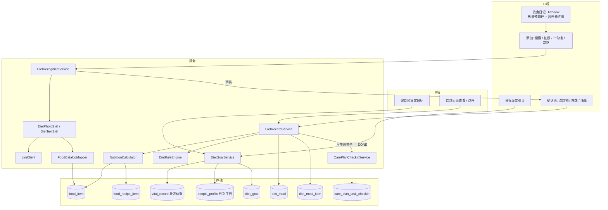

# 饮食记录 产品与技术方案

| 项 | 内容 |
|---|---|
| 版本 | **v0.3（食物库来源、运动不抵扣已定）** |
| 日期 | 2026-10-10 |
| 状态 | 主决策已定，细节待 Grill |
| 依据 | `健康管理方案-Agent技术方案.md`、`检验单OCR-Agent技术方案.md`、`依从性看板-产品与技术方案.md`、`患者观测数据-指标检验检查.md` |
| 范围 | C 端**精准算卡**：热量/营养素目标 → 记录三餐（搜索称重 / 拍照识别 / 一句话）→ 热量预算与营养素达成 → 管理方案 `DIET_LOG` 自动打卡 → B 端/手机工作台查看、设定目标与点评 |
| 非范围 | 医学营养处方（肠内/肠外营养）、智能硬件（智能秤等）对接、条码扫描、餐食照片存储 |

---

## 0. 决策

### 0.1 已定

| # | 主题 | 结论 |
|---|------|------|
| D1 | 产品定位 | **精准算卡**：每日热量预算 + 三大营养素目标为核心；饮食质量提示（红黄绿）为辅 |
| D5 | 照片 | **不存储**；原图仅在识别请求内存活，识别后丢弃，不落盘、不进日志 |
| D6 | `DIET_LOG` 完成口径 | 当日**早餐、午餐、晚餐各至少 1 条记录** → 自动打卡 `DONE`；不足 3 餐**不自动打卡**（打卡状态仅 DONE/SKIPPED/MISSED，无「部分完成」），用户仍可手动打卡 |
| D4 | 食物库来源 | 当前非商用：采用 GitHub 开源整理的《中国食物成分表标准版（第 6 版）》JSON（食材层 1677 条 + GI 表）；家常菜由 LLM 生成菜谱、营养由食材层计算；**不爬取薄荷等商业站点**。详见 §10 |
| D9 | 运动消耗 | **不抵扣热量预算**；步数等运动数据只展示，不参与「剩余热量」计算 |

### 0.2 待定（建议值）

| # | 主题 | 建议 |
|---|------|------|
| D2 | 录入方式 | P1：**食物搜索（克数优先）+ 拍照识别**；P1.5：一句话、包装食品营养成分表识别 |
| D3 | 人机闭环 | 与检验单 OCR 一致：AI 只出草稿，**用户确认克数后才落库** |
| D7 | 评价引擎 | 规则引擎（确定性、可解释），不让 LLM 打分 |
| D8 | 目标设定 | 系统按公式自动计算；**健管师可在 B 端覆盖**（医疗场景以专业设定为准） |

---

## 1. 市面产品调研与借鉴

| 产品 | 典型做法 | 借鉴 / 取舍 |
|------|---------|------------|
| MyFitnessPal / Lose It! | 热量预算（目标 − 已摄入 = 剩余）、搜索、最近/常吃、复制昨日 | **借鉴**：热量预算环、三大营养素进度、最近/常吃/复制 |
| 薄荷健康 | 中式食物库大；「碗/个/勺」与克数并存；菜肴拆为食材 + 烹调油；拍照识别 | **借鉴**：家常单位 ↔ 克换算、**菜谱拆解（含油盐）**、拍照识别 |
| MacroFactor | 根据体重变化反推真实消耗，自适应调整目标 | **借鉴**（P2）：用 `WEIGHT` 体征趋势自适应修正目标 |
| Cronometer | 数据源分级标注（权威库 / 用户自建） | **借鉴**：每条记录标注数据来源与精度等级 |
| Noom | 食物红黄绿 + 教练反馈 | **借鉴**：餐次质量提示 + 健管师点评 |
| 糖护士 / 控糖类 App | 饮食与餐后血糖联动 | **借鉴**（P2）：餐后 2h 血糖提醒 + 曲线叠加餐次 |

**精准算卡的三个关键**（决定方案重点）：

1. **克数准确**：份量是最大误差来源 → 克数优先输入、家常单位有标准克重、拍照估算必须用户确认
2. **食物数据准确**：权威营养库；区分生重/熟重、可食部
3. **中式菜肴的油盐**：家常菜热量大头在烹调油 → 菜肴按「菜谱 = 食材 + 烹调油 + 盐」计算，用户可调「少油/正常/多油」

---

## 2. 总体架构



**原则**：识别只产出草稿；营养值**服务端计算并在保存时快照**，食物库后续修订不影响历史记录。

---

## 3. 用户路径

### 3.1 首次进入：目标设定

```
1. 进入饮食 → 若无 diet_goal，进入引导
2. 自动带出：性别、年龄（people_profile）、身高、最新体重（vital_record）
   缺失项要求补填（体重/身高写回体征）
3. 选择活动水平（久坐 / 轻度 / 中度 / 重度）、目标（维持 / 减重 / 增重）
   减重：选择速度（0.25 / 0.5 kg/周）
4. 展示计算结果：每日热量预算 + 碳水/蛋白/脂肪克数目标 → 确认
5. 若健管师已设定目标：直接展示，患者不可改（显示「由健管师设定」）
```

### 3.2 日常记录

```
1. 首页「今日任务 · 记录三餐」或 健康 Tab「饮食」进入日记
   顶部：热量环（目标 / 已摄入 / 剩余）+ 碳水/蛋白/脂肪进度条
2. 选择餐次 → 添加方式：
   a. 搜索：选食物 → 输入克数（默认）或家常单位（1 碗 = 150g，可切换）
   b. 拍照：→ 识别草稿 → 逐项确认克数
   c. 常吃 / 最近 / 复制昨日同餐
   d. 一句话（P1.5）
3. 菜肴类：显示「烹调油：少 / 正常 / 多」切换
4. 确认页实时显示本餐热量与营养素；估算项高亮
5. 保存 → 刷新预算；早午晚齐全 → DIET_LOG 自动完成
```

### 3.3 B 端（健管师）

```
患者详情 → 健康数据 → 饮食
  - 目标：查看/修改热量与营养素目标（覆盖自动计算）
  - 日历：每日摄入 vs 目标（达成率着色）、三餐是否齐全
  - 餐次详情：食物明细、克数、来源、精度、规则提示
  - 点评（P1.5）→ 消息中心推送
```

---

## 4. 目标计算（`DietGoalService`）

### 4.1 公式

| 步骤 | 公式 |
|------|------|
| BMR（Mifflin-St Jeor） | 男：`10×体重kg + 6.25×身高cm − 5×年龄 + 5`；女：`… − 161` |
| TDEE | `BMR × 活动系数`（久坐 1.2 / 轻度 1.375 / 中度 1.55 / 重度 1.725） |
| 目标热量 | 维持：TDEE；减重：`TDEE − 速度×7700/7`（0.5kg/周 ≈ −550kcal）；增重同理 |
| 安全下限 | 女 ≥1200 kcal、男 ≥1500 kcal；触底时提示并截断（医护指定热量可在 800–5000 kcal 内突破） |

### 4.2 营养素分配（按病种默认，健管师可调）

| 病种（取自管理方案 `templateKey`） | 碳水 | 蛋白 | 脂肪 | 额外目标 |
|-----------------|------|------|------|---------|
| GENERAL | 50–60% | 15–20% | 20–30% | 膳食纤维 25g |
| DIABETES | 45–55% | 15–20% | 25–30% | 各餐碳水分配（早 30% / 午 40% / 晚 30%） |
| HYPERTENSION | 50–60% | 15–20% | 20–30% | 钠 ≤2000mg（≈ 盐 5g） |
| DIABETES_HYPERTENSION | 45–55% | 15–20% | 25–30% | 上述两者 |

> 慢性肾病等需限蛋白的人群，系统无法可靠识别，**必须由健管师手动设定**；目标页固定提示「如有肾病等特殊情况请遵医嘱」。

### 4.3 目标重算

- 新体重录入（`vital_record WEIGHT`）且与计算基准差 ≥1kg → 自动重算（来源为 AUTO 时）
- 来源为 STAFF 时不自动重算，仅在 B 端提示「体重已变化，建议复核目标」

---

## 5. 数据模型

建表沿用 `SchemaEnsureRunner.ensureTable`，统一字段（`pk_id`/`id`/`tenant_id`/`is_deleted`/`gmt_*`）。

### 5.1 `food_item` 食物库

| 字段 | 类型 | 说明 |
|------|------|------|
| id / tenant_id | | tenant_id NULL = 平台级 |
| code | VARCHAR(64) | 唯一编码 |
| name | VARCHAR(64) | |
| aliases_json | JSON | 别名，供搜索与映射 |
| kind | VARCHAR(16) | **INGREDIENT**（食材）/ **DISH**（菜肴，有菜谱）/ **PACKAGED**（包装食品） |
| category | VARCHAR(32) | STAPLE / VEGETABLE / FRUIT / MEAT / AQUATIC / EGG / DAIRY / SOY / NUT / OIL / CONDIMENT / DRINK / SNACK / DISH |
| weight_basis | VARCHAR(8) | RAW（生重）/ COOKED（熟重）/ AS_SOLD |
| edible_ratio | DECIMAL(4,3) | 可食部比例（带骨/带皮） |
| energy_kcal / protein_g / fat_g / carb_g / fiber_g / sugar_g / sodium_mg | DECIMAL | **每 100g 可食部** |
| gi_level | VARCHAR(8) NULL | LOW / MID / HIGH |
| units_json | JSON | `[{"unit":"碗","grams":150,"note":"标准饭碗"}]` |
| tags_json | JSON | `HIGH_SALT` / `SUGARY_DRINK` / `PICKLED` / `FRIED`，对应管理方案 `limited` |
| data_source | VARCHAR(32) | 数据出处（如授权库名称 / SELF_CURATED / LABEL_OCR） |
| precision_level | VARCHAR(8) | A（权威库）/ B（自建复核）/ C（估算） |
| status | VARCHAR(16) | ACTIVE / DISABLED |

### 5.2 `food_recipe_item` 菜谱组成（DISH 专用）

| 字段 | 说明 |
|------|------|
| dish_food_id | 所属菜肴 |
| ingredient_food_id | 食材（含烹调油、盐） |
| grams_per_100g | 每 100g 成品中该食材克数 |
| oil_adjustable | 是否随「少油/正常/多油」缩放（0.5 / 1 / 1.5 倍） |

菜肴营养 = Σ 食材营养；`food_item` 上 DISH 的营养字段为「正常油量」下的预计算缓存。

### 5.3 `diet_goal` 目标

| 字段 | 说明 |
|------|------|
| people_id | 一人一条当前目标（历史目标软删留痕） |
| source | AUTO / STAFF |
| goal_type | MAINTAIN / LOSE / GAIN |
| rate_kg_per_week | 0.25 / 0.5 |
| activity_level | SEDENTARY / LIGHT / MODERATE / ACTIVE |
| basis_weight_kg / basis_height_cm / basis_age / basis_gender | 计算基准快照 |
| bmr_kcal / tdee_kcal / energy_kcal | |
| carb_g / protein_g / fat_g / fiber_g / sodium_mg | 目标值 |
| meal_split_json | 各餐热量/碳水分配比例 |
| set_by_staff_id | |
| effective_from | DATE |

### 5.4 `diet_meal` 餐次

| 字段 | 说明 |
|------|------|
| id / tenant_id / people_id | |
| meal_date / meal_type | BREAKFAST / LUNCH / DINNER / SNACK；同日同餐允许多条 |
| eaten_at | 进餐时间（P2 餐后血糖联动） |
| source | MANUAL / PHOTO_AI / TEXT_AI / LABEL_OCR / STAFF |
| energy_kcal / carb_g / protein_g / fat_g / fiber_g / sodium_mg | 汇总快照 |
| estimated_kcal_ratio | 估算项热量占比（0–1），用于精度展示 |
| quality_level / flags_json | 规则引擎结果 |
| note | |
| staff_comment / comment_staff_id / commented_at | P1.5 |
| recorded_by_people_id / recorded_by_staff_id | |

索引：`idx(tenant_id, people_id, meal_date)`。

### 5.5 `diet_meal_item` 明细

| 字段 | 说明 |
|------|------|
| meal_id / food_id（NULL = 未命中库） / food_name | |
| amount / unit / grams | grams 为**可食部克数**（服务端按 edible_ratio 换算） |
| oil_level | LOW / NORMAL / HIGH（DISH 适用） |
| 各营养素 | 本项快照 |
| precision_level | A / B / C；未命中库 = C |
| confidence | AI 来源的识别置信度 |
| grams_confirmed | 用户是否手动确认/修改过克数 |

> 不建日汇总表：P1 按 `diet_meal` 实时聚合。依从性需要时在 `adherence_daily_snapshot` 增列（P2）。

---

## 6. 识别（拍照 / 文本）

### 6.1 拍照流程

1. 校验：jpg/png/webp，≤5MB，单张
2. `AiUsageGuard` 限流：每就诊人每日 ≤20 次
3. `DietPhotoSkill`：`LlmClient.chatWithImage` → 食物名、估计克数、置信度
4. `FoodCatalogMapper`：精确名 → 别名 → 规范化模糊匹配；命中 DISH 优先于 INGREDIENT
5. 命中：库数据计算；未命中：LLM 估算营养值，`precision_level=C`
6. 返回草稿；原图丢弃

### 6.2 精准算卡下的识别约束

- **克数永远是估计**：确认页每项克数默认标黄，用户点「确认」或修改后才 `grams_confirmed=true`
- 保存时若存在未确认克数的项，弹窗二次确认（不强制拦截，避免流失）
- 日记页展示每餐精度：`estimated_kcal_ratio > 30%` 显示「本餐含较多估算」

### 6.3 输出契约

```json
{
  "mealType": "LUNCH",
  "items": [
    {
      "foodId": "f_rice_cooked",
      "foodName": "米饭",
      "amount": 150,
      "unit": "g",
      "grams": 150,
      "oilLevel": null,
      "energyKcal": 174,
      "carbG": 38.4,
      "proteinG": 3.9,
      "fatG": 0.5,
      "sodiumMg": 3.8,
      "precisionLevel": "A",
      "confidence": 0.86
    },
    {
      "foodId": "f_dish_tomato_egg",
      "foodName": "番茄炒蛋",
      "amount": 200,
      "unit": "g",
      "grams": 200,
      "oilLevel": "NORMAL",
      "energyKcal": 236,
      "precisionLevel": "B",
      "confidence": 0.74
    }
  ],
  "warnings": ["克数为图片估算，请逐项确认"]
}
```

### 6.4 文本解析 / 营养成分表（P1.5）

- `DietTextSkill`：「午饭一碗米饭 150g、番茄炒蛋半盘」→ 同一契约
- `LabelOcrSkill`：拍包装食品营养成分表 → 解析每 100g 数值 → 创建 `kind=PACKAGED`、`data_source=LABEL_OCR` 的个人食物（`tenant_id` + 创建人）→ 精度 A 级（标签数据本身权威）

---

## 7. 规则引擎（`DietRuleEngine`）

输入：餐次/当日明细 + `diet_goal` + 管理方案 `diet_json` + 病种 + 过敏原。

| 规则 | 适用 | 触发 | 级别 |
|------|------|------|------|
| ALLERGEN_HIT | 全部 | 命中 `diet.allergensAvoid` | RED |
| DAILY_ENERGY_OVER | 全部 | 当日热量 > 目标 110% | YELLOW（日级） |
| DAILY_ENERGY_LOW | 全部 | 三餐齐全且当日热量 < 安全下限 × 80% | YELLOW（日级） |
| MEAL_CARB_OVER | 糖尿病 | 单餐碳水 > 目标碳水 × 该餐分配比例 × 120% | YELLOW |
| HIGH_GI_SHARE | 糖尿病 | 高 GI 主食占主食克数 >50% | YELLOW |
| DAILY_SODIUM_HIGH | 全部 | 当日钠 > 2000mg | 高血压 YELLOW，其余 INFO（日级） |
| LIMITED_FOOD | 全部 | 命中 `diet.limited` 映射出的食物标签 | YELLOW |
| NO_VEGETABLE / NO_PROTEIN | 全部 | 正餐缺蔬菜 / 缺蛋白类 | INFO（不影响餐次等级） |

`diet.limited` 的方案编码/名称 → 食物标签映射（`DietContextLoader.foodTagsFor`）：糖/甜 → `SUGARY_DRINK`、`ADDED_SUGAR`；腌/腊/咸菜 → `PICKLED`、`PROCESSED_MEAT`；油炸 → `FRIED`；高脂 → `HIGH_FAT`；酒 → `ALCOHOL`；高盐/钠 → `HIGH_SALT`。

餐次等级：有 RED → RED；有 YELLOW → YELLOW；否则 GREEN。阈值放 `tenant_config` 支持机构自定义。

---

## 8. 与现有模块集成

| 模块 | 集成点 | 分期 |
|------|-------|------|
| 管理方案 `DIET_LOG` | 保存/删除餐次后检查当日 BREAKFAST、LUNCH、DINNER 是否各 ≥1 条：齐全 → 系统打卡 `DONE`（note「饮食记录自动完成」）；删除导致不齐全且该打卡为系统生成 → 撤销；用户手动打卡不受影响 | P1 |
| 管理方案 `diet_json` | 规则引擎读取 `limited` / `allergensAvoid`；日记页展示 `principles` | P1 |
| 体征 `vital_record` | 目标计算读 HEIGHT/WEIGHT；新体重触发目标重算 | P1 |
| 档案 `people_profile` | 性别、生日 | P1 |
| 消息中心 | 健管师点评推送 | P1.5 |
| 体征 STEPS | 日记页展示当日步数（仅展示，**不抵扣热量预算**） | P2 |
| 体重趋势 | 自适应 TDEE（近 2–4 周摄入 vs 体重变化反推真实消耗） | P2 |
| 血糖 | 餐后 2h 提醒、曲线叠加餐次 | P2 |
| 依从性 / 工作台 / 管理报告 / Agent | 记录率、连续未记录任务、报告饮食章节、`recentMeals` 工具 | P2 |

---

## 9. API

### 9.1 C 端（`/api/c/v1/me`，`SecurityUtils.requirePatientId()`）

| 方法 | 路径 | 说明 |
|------|------|------|
| GET | `/diet/goal` | 当前目标（无则返回计算所需字段的缺失清单） |
| POST | `/diet/goal/preview` | 传活动水平/目标类型 → 返回计算结果（不保存） |
| PUT | `/diet/goal` | 保存（source=STAFF 时 403） |
| GET | `/diet/days/{date}` | 当日餐次 + 明细 + 目标 + 剩余 + 提示 |
| GET | `/diet/summary?from&to` | 区间按日汇总 |
| POST / PUT / DELETE | `/diet/meals[/{id}]` | 餐次增改删 |
| POST | `/diet/recognize` | multipart 拍照识别 → 草稿 |
| POST | `/diet/recognize-text` | 文字描述（`{text, mealType}`）→ 草稿 |
| POST | `/foods/label-ocr` | 营养成分表 → 个人食物（P1.5） |
| GET | `/foods/search?q=&limit=20` | 搜索 |
| GET | `/foods/{id}` | 详情（单位、菜谱组成） |
| GET | `/foods/frequent` | 最近/常吃 |
| POST | `/diet/meals/copy` | 复制某日某餐（P1.5） |

### 9.2 B 端（`/api/b/v1/patients/{peopleId}`）

| 方法 | 路径 | 说明 |
|------|------|------|
| GET / PUT | `/diet/goal` | 查看 / 设定目标（PUT 后 source=STAFF） |
| DELETE | `/diet/goal/override` | 取消覆盖，恢复自动计算 |
| GET | `/diet/meals?from&to` | 区间餐次 |
| GET | `/diet/summary?from&to` | 区间汇总（含达成率） |
| POST | `/diet/meals/{id}/comment` | 点评（P1.5） |

### 9.3 保存校验

- `items` 1–30 条；`grams` 0 < g ≤ 3000
- `foodId` 非空时必须存在且可见（平台级 / 本租户 / 本人自建）
- **命中食物库的营养值一律服务端重算**，忽略前端传值；未命中（C 级）项接受识别草稿值但做每 100g 上限校验（如 ≤900 kcal/100g）
- `mealDate` ≤ 今天，且不早于 30 天前（可配）

---

## 10. 食物库建设（精准算卡的关键）

### 10.1 数据来源（当前非商用阶段）

| 层 | 来源 | 规模 | 精度 |
|----|------|------|------|
| 食材层 | [Sanotsu/china-food-composition-data](https://github.com/Sanotsu/china-food-composition-data)：《中国食物成分表标准版（第 6 版）》「能量和食物一般营养成分」JSON（`json_data_v3_..._fixed_en`，双视觉模型交叉识别 + 人工复核） | 1677 条，61 类 | A |
| GI | 同仓库 `json_gi_of_foods/glycemic_index_of_foods.json` | 11 个食物组 | — |
| 食材补充 | USDA FoodData Central（CC0 公有领域，可商用）：补西式食材、橄榄油等书中缺失项 | 按需 | A |
| 家常菜 | LLM 生成菜谱组成（食材 foodCode + 克数 + 烹调油 + 盐）→ **营养由食材层计算** | 首批 300 道 | B |
| 份量单位 | LLM 生成「碗/个/片/勺」标准克重 + 抽检 | 覆盖高频食物 | — |
| 包装食品 | 营养成分表 OCR（P1.5） | 用户共建 | A |
| 长尾 | 识别时 LLM 估算 | — | C |

> **不爬取薄荷、MyFitnessPal 等商业站点**：违反其服务条款且有反爬/不正当竞争风险，非商用也不能豁免；且一旦转商用，混入的数据难以剥离。
>
> **商用前必须替换或取得授权**：开源仓库数据源自出版物《中国食物成分表》，版权归原书方。商用前二选一：向版权方取得数据授权，或食材层整体切换到 USDA FDC 等可商用数据 + 授权中文库。`food_item.data_source` 字段记录每条出处，便于届时批量替换。

### 10.2 导入流水线（`scripts/food-import/`，离线一次性，产出 `resources/seed/food_items.json`）

```text
1. 拉取开源 JSON → 规范化
   - "Tr"（微量）→ 0；"—"/"…"（未测）→ null
   - edible（可食部 %）→ edible_ratio
   - CHO 为总碳水（含膳食纤维）；净碳水 = CHO − dietaryFiber
   - Na(mg) → sodium_mg
2. 质量校验：能量恒等式 4P + 9F + 4(CHO−纤维) + 2×纤维 与 energyKCal 偏差 >15% → 标记待复核
   （实测 1572 条可校验中 32 条触发，约 2%）
3. 名称处理：去除「代表值」等括注生成搜索用 name，原名入 aliases；同名多品种保留「代表值」为默认
4. 分类映射：原书 61 类 → food_item.category
5. 熟重：书中多为生重，常见熟食（米饭、馒头、面条煮）已有独立条目；其余在菜谱层按生重计
6. GI 匹配：按名称模糊匹配写入 gi_level（GI ≤55 LOW / 56–69 MID / ≥70 HIGH）
7. 家常菜：LLM 批量生成菜谱 → 校验食材 foodCode 均存在 → 计算营养 → 人工抽检 10%
8. 输出 seed JSON（带 data_source、precision_level），FoodSeedRunner 启动时幂等导入
```

**上线门槛**：食材 ≥1600 条（开源库已满足）；家常菜 ≥300 道；高频食物（米饭、馒头、鸡蛋、牛奶等前 200）均有家常单位。运营侧每周统计 C 级高频食物名并补库。

---

## 11. 代码落位

### 后端

| 模块 | 新增 |
|------|------|
| `health-core/.../diet/` | `domain/`（`FoodItem`、`FoodRecipeItem`、`DietGoal`、`DietMeal`、`DietMealItem`）、`mapper/`、`enums/`（`MealTypeEnum`、`DietSourceEnum`、`FoodKindEnum`、`PrecisionLevelEnum`、`ActivityLevelEnum`、`DietGoalTypeEnum`）、`service/`（`DietGoalService`、`DietRecordService`、`FoodCatalogService`）、`support/`（`NutritionCalculator`、`EnergyTargetCalculator`、`DietRuleEngine`、`FoodCatalogMapper`、`DietLogCheckinSync`） |
| `health-agent/.../diet/` | `DietRecognizeService`、`DietPhotoSkill`、`DietTextSkill`、`LabelOcrSkill` |
| `health-app/.../web/c/` | `CDietController`、`CFoodController` |
| `health-app/.../web/b/diet/` | `BDietController` |
| `health-app/.../config/` | `SchemaEnsureRunner` 增 5 张表；`FoodSeedRunner` 导入食物库 |

### 前端

| 端 | 改动 |
|----|------|
| `frontend-user` | `DietGoalView`（目标引导）、`DietView`（日记 + 热量环）、`DietAddView`（搜索/拍照/确认）、`FoodDetailSheet`（单位切换、油量）；路由 `/diet`、`/diet/goal`、`/diet/add`；首页 `DIET_LOG` 任务跳 `/diet`；`features.ts` 增 `DIET_AI_ENABLED` |
| `frontend-admin` | 患者健康数据 → 饮食：目标设定卡片 + 日历达成率 + 餐次详情 |
| `frontend-staff` | 饮食只读 + 点评（P1.5） |

---

## 12. 安全与合规

| 项 | 要求 |
|----|------|
| 鉴权 | C 端仅当前就诊人；B 端 `assertStaffCanAccessPeople` |
| 原图 | 不存储；请求内存活，识别后丢弃；不进日志 |
| AI 用量 | `AiUsageGuard` 按就诊人日限额 |
| 目标安全 | 热量下限截断；肾病等特殊人群提示遵医嘱，由健管师设定 |
| 免责 | 「营养数据来自食物库及估算，仅供参考，不构成医疗建议」 |
| 审计 | 识别写 `agent_interaction_log`（intent=`DIET_PHOTO`，仅 items 摘要）；健管师改目标写审计日志 |
| 过敏 | RED 提示，不阻止保存 |

---

## 13. 分期

### P1（MVP）

1. 食物库（食材 + 菜谱 + 单位）与种子导入
2. 目标设定：自动计算 + 健管师覆盖
3. C 端日记：热量环、营养素进度、搜索称重录入、油量调整、拍照识别（不存图）、确认保存
4. 规则引擎 + 红黄绿
5. `DIET_LOG`：早午晚齐全自动 DONE
6. B 端饮食页：目标设定、日历达成率、餐次详情

### P1.5

- 一句话录入、营养成分表 OCR、常吃/复制
- 健管师点评 + 消息推送；手机工作台
- 目标随体重自动重算

### P2

- 自适应 TDEE（基于体重趋势修正目标，非运动抵扣）
- 餐后血糖联动
- 依从性 / 工作台 / 管理报告 / Agent 集成

---

## 14. 验收标准（P1）

| # | 标准 |
|---|------|
| 1 | 资料完整的患者 3 步内完成目标设定；计算结果与公式手算一致 |
| 2 | 健管师设定目标后，C 端显示「由健管师设定」且不可修改 |
| 3 | 搜索 + 输入克数记录，热量与食物库数据按克数精确换算（误差仅来自四舍五入） |
| 4 | 菜肴切换少油/多油，热量按烹调油比例变化 |
| 5 | 拍照识别预填，克数需确认；不点保存则库中无新记录 |
| 6 | 早、午、晚各记录 1 条后 `DIET_LOG` 自动完成；删掉其中一餐后自动撤销系统打卡 |
| 7 | 糖尿病单餐碳水超标、高血压当日钠超标有提示 |
| 8 | 日志与数据库中无原图 |

---

## 15. 代码锚点（现状）

| 用途 | 路径 |
|------|------|
| 方案饮食内容 / `DIET_LOG` 任务 | `health-core/.../careplan/template/CarePlanTemplateRegistry.java` |
| 打卡服务 / 状态 | `health-core/.../careplan/service/CarePlanCheckinService.java`、`enums/CarePlanCheckinStatusEnum.java` |
| 性别生日 | `health-core/.../people/domain/PeopleProfile.java` |
| 身高体重 | `health-core/.../vitals/`（`MetricTypeEnum.HEIGHT/WEIGHT`） |
| Vision 客户端 | `health-agent/.../llm/LlmClient.java`（`chatWithImage`） |
| 识别范式参考 | `health-agent/.../ocr/LabOcrRecognitionService.java` |
| AI 限流 | `health-agent/.../support/AiUsageGuard.java` |
| 建表 | `health-app/.../config/SchemaEnsureRunner.java` |
