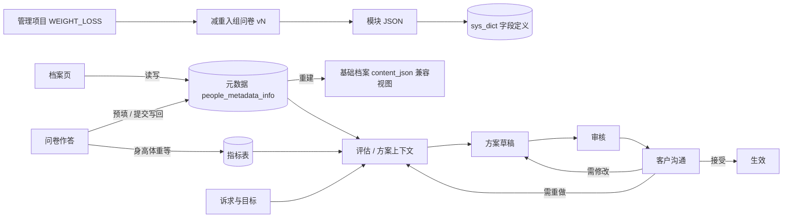
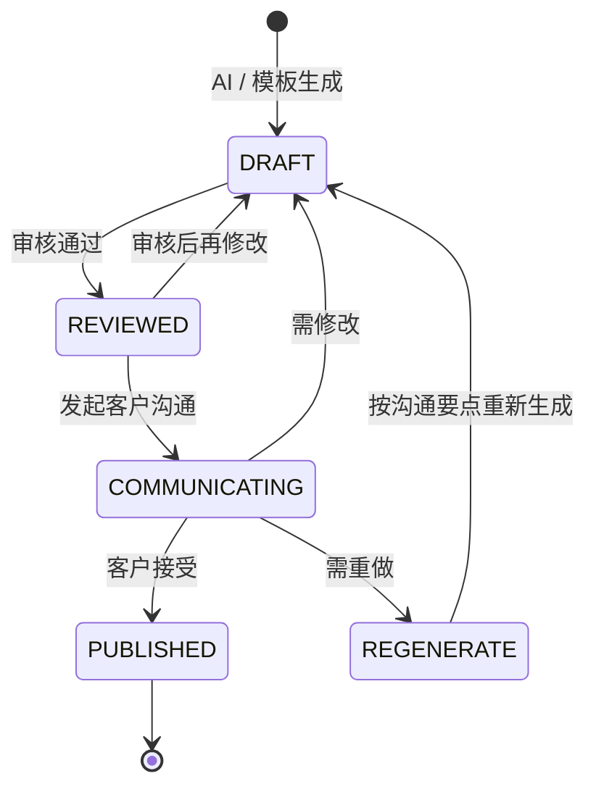

# 首诊与减重管理方案：重构产品与技术方案

| 项 | 内容 |
|---|---|
| 版本 | **v0.2**（三轮 Grill 后定稿，待字段表评审） |
| 日期 | 2026-10-30 |
| 状态 | 设计定稿；逐字段表待营养师评审后开工 |
| 输入 | 一线健管师 / 营养师访谈整理的《入组随访信息收集字段清单》；拍板 D1–D4；Grill Q1–Q27 |
| 关联 | `随访-产品与技术方案.md`（`ONBOARDING`）、`患者档案-字典与元数据.md`、`疾病评估-重构产品与技术方案.md`（`InputField`）、`健康管理方案-重定位与生成理由.md`（R4 / R11 / R13 需修订）、`指南推荐条目库-产品与技术方案.md`、`阶段评估-产品与技术方案.md` |

---

## 0. 拍板

### 0.1 方向（D1–D4）

| # | 结论 |
|---|---|
| D1 | 定位不变：面向中小健康管理机构的 B 端系统，一阶段三个方向（减重、糖尿病、高血压）。**先做深减重**；糖尿病、高血压后续走同一路径，只换问卷模块、目标与方案内容，设计时预留扩展 |
| D2 | 不建「入组大表」。新增**问卷体系**：问卷由**模块**组成，模块可跨问卷复用，问卷与模块都有**版本** |
| D3 | 方案生成后须**审核 → 向客户解释沟通 → 按沟通结果修改或重做**，再生效 |
| D4 | C 端本期不做，先把 B 端完善 |

### 0.2 Grill 结论

| # | 问题 | 结论 |
|---|---|---|
| Q1 | 减重项目入组门槛 | 不设门槛。BMI < 24：目标改为「改善体成分 / 维持」；BMI < 18.5：不设减重目标，提示转介 |
| Q2 | 谁审核方案 | 新增**营养师** `NUTRITIONIST` 角色；健管师、营养师均可审核；营养师可见敏感字段 |
| Q3 | 多项目时方案 | 一份综合方案（同一时间至多 1 份生效方案不变） |
| Q4 | 档案编号 | **不新增**档案编号，沿用现有档案 id |
| Q5 | 问卷升版后旧作答 | 旧作答保留不动；新版新增的题在客户页标「待补」 |
| Q6 | 沟通环节能否关闭 | 不能关闭；客户在场时可一键记录「当面沟通 · 已接受」 |
| Q7 | 风险标签 | **本期不做**风险标签表；高亮与追问规则写在问卷定义里（§5.4） |
| Q8 | 生成方案的前置条件 | 参加减重项目的客户，首诊问卷提交后才能生成减重方案；未参加项目的客户不受影响 |
| Q9 | 存量客户 | 不自动迁移；存量客户需要时由健管师发起首诊问卷 |
| Q10 | 问卷定义放哪 | 模块、问卷定义放代码仓库 classpath JSON（字段定义见 Q22） |
| Q11 | 风险等级 | 不手动打低 / 中 / 高；评估引擎结果可改写，须填理由 |
| Q12 | 新字段存哪 | 存 `people_metadata_info` |
| Q13 | 档案页与问卷 | 相同字段**结构一致**，都拆到元数据表；问卷打开时从元数据预填、可修改；提交时同步回元数据，问卷保留提交快照，元数据记录当前值来源 |
| Q14 | 首诊流程 | 入组 / 首诊随访流程不变，仍生成首诊任务；**完成任务的方式 = 提交首诊问卷**；问卷 UI 重做 |
| Q15 / Q26 | 填写体验 | 全屏工作台，默认快速模式（详见 §7） |
| Q16 | 必收项 | 8 项：姓名、性别、出生日期、手机号、身高、体重、核心诉求、隐私授权 |
| Q17 | 高亮规则放哪 | 写在模块 JSON 的题目上 |
| Q18 / Q27 | `InputField` 迁移 | **本期一次迁完**：评估问卷也跑在新问卷体系上；完成标志是删掉 `InputField` 枚举与 `assessment_questionnaire_submission` 表（§4.6 闭环清单） |
| Q19 | 逐字段表 | 先由研发起草，产品与营养师评审后再开工 |
| Q20 | 字段值以谁为准 | **以元数据为准**；基础档案 `content_json` 退化为由元数据重建的兼容视图 |
| Q21 | 字段编码 | 统一用元数据编码（`basic.diet.appetite` 风格），不另起短编码 |
| Q22 | 字段定义放哪 | 字段的类型、选项、单位、范围放 `sys_dict`（代码种子）；问卷 JSON 只引用字段编码 |
| Q23 | 指标写回 | 预填最近一次测量值；只有本次新填或改过的值才新增指标记录 |
| Q24 | 来源粒度 | 每个字段记录来源类型、来源单据 id、操作人、时间；历史沿用字段修订表 |
| Q25 | 首诊与项目衔接 | 首诊问卷顶部选管理项目（默认减重），选定时创建入组（入组中），提交后变为管理中 |
| Q26 补充 | 话术 | 研发先起草每个模块的沟通话术，营养师审定 |

---

## 1. 目标与范围

### 1.1 要解决的问题

1. 首诊（入组随访）只能内嵌编辑现有档案，**采集不到减重服务需要的信息**：减重史、体重变化趋势、饮食行为细项、进食障碍与身材焦虑、减重预期、可投入时间、执行支持系统等。
2. **健康诉求与目标没有落点**，方案生成只能靠健管师在「给 AI 说明」里临时写。
3. 减重相关的高风险信息（孕期 / 哺乳期、进食障碍史、运动禁忌）**没有提示**，只能靠人记得。
4. 方案只有「草稿 → 发布」，**缺少审核与客户沟通环节**。
5. 同一信息在档案页、评估问卷、首诊里各问一遍，字段定义各写一份（档案 JSON、`InputField`、页面常量）。

### 1.2 本期范围

- 管理项目与入组：减重管理先上
- **字段统一**：元数据成为字段值的唯一来源；档案页、首诊问卷、评估问卷共用字段编码与字段定义
- 问卷体系：模块 + 问卷 + 版本 + 作答快照；减重入组问卷 v1
- 首诊工作台（新 UI），首诊任务以提交问卷完成
- 评估问卷迁到新问卷体系，删除 `InputField`
- 健康诉求与目标
- 减重方案：问卷与目标进入生成、`goals` 块、高风险答案接入安全校验
- 方案审核与沟通闭环；营养师角色

### 1.3 非目标

- C 端问卷填写、C 端方案确认（D4）
- 风险标签表（Q7，后续再议）
- 问卷可视化编辑器 / 机构自定义问卷
- 糖尿病、高血压问卷内容（只预留扩展点）
- 心理评估结论：进食障碍、情绪问题**只做识别与转介**
- 存量客户自动补首诊（Q9）

---

## 2. 核心概念

| 概念 | 一句话 | 新 / 改 |
|---|---|---|
| 管理项目 Program | 客户参加的服务线：`WEIGHT_LOSS`（本期）、`DIABETES`、`HYPERTENSION`（后续）；决定用哪份入组问卷、哪类目标、哪套方案 | 新（代码注册） |
| 入组 Enrollment | 客户在某机构加入某项目的一次登记 | 新表 |
| 字段 Field | 一个元数据编码 = 一个字段；定义在 `sys_dict`，值在元数据表 | 由档案 JSON 字段 + `InputField` 合并 |
| 模块 Module | 一组字段 + 题面 + 显示条件 + 必收级别 + 高亮规则 + 话术，带版本 | 新（JSON） |
| 问卷 Questionnaire | 按项目组合模块，带版本，如「减重入组问卷 v1」「评估补充问卷」 | 新（JSON） |
| 作答 Response | 一次填写；草稿可续填，提交后写回元数据并保留快照 | 新表 |
| 诉求与目标 Goal | 核心诉求 + 结构化目标 + 偏好与限制 | 新表 |
| 方案沟通 | 随访类型 `PLAN_COMMUNICATION`，记录沟通结果与修改要点 | 新随访类型 |



---

## 3. 管理项目与入组

### 3.1 项目注册（代码内注册）

| 项目 | 入组问卷 | 目标类型 | 默认方案类型 |
|---|---|---|---|
| `WEIGHT_LOSS` 减重管理 | `WL_INTAKE` | 体重、腰围、体脂率 | 减重管理方案 |
| `DIABETES`（后续） | `DM_INTAKE` | HbA1c、空腹 / 餐后血糖、体重 | 糖尿病管理方案 |
| `HYPERTENSION`（后续） | `HTN_INTAKE` | 血压、体重、限盐 | 高血压管理方案 |

- 一个客户可同时参加多个项目；方案仍是一份综合方案（Q3）。
- 不设入组门槛（Q1），目标模式按 BMI 决定，见 §8.2。

### 3.2 `people_program_enrollment`

| 字段 | 说明 |
|---|---|
| `id` / `tenant_id` / `org_id` / `people_id` | 客户标识沿用现有档案 id，不另设档案编号（Q4） |
| `program_code` | `WEIGHT_LOSS` / … |
| `status` | `ONBOARDING` 入组中 → `ACTIVE` 管理中 → `CLOSED` 已结案 / `WITHDRAWN` 已退出 |
| `enrolled_at` / `onboarded_at` / `closed_at` | 选定项目 / 首诊问卷提交 / 结案 |
| `owner_staff_id` | 负责健管师 |
| `intake_response_id` | 首诊作答 |
| `close_reason` | 结案 / 退出原因 |

同一机构、同一客户、同一项目至多一条未结束的入组（唯一约束按 `status IN (ONBOARDING, ACTIVE)` 在服务层校验）。

---

## 4. 字段与元数据（Q12 / Q13 / Q20–Q24）

### 4.1 以元数据为准

现状：基础档案 `content_json` 是唯一来源，保存时由 `MetadataSyncService` 平铺投影到 `people_metadata_info`，**元数据只写不读**。

改为：

| | 现状 | 改后 |
|---|---|---|
| 字段值的唯一来源 | `content_json` | `people_metadata_info`（每字段一行） |
| 档案页保存 | 写 JSON → 投影元数据 | 按字段 diff 写元数据 → 重建 JSON |
| 问卷提交 | 无（首诊内嵌档案编辑） | 按字段写元数据 → 重建 JSON |
| C 端生活方式修改 | 写 JSON | 写元数据 → 重建 JSON（接口不变） |
| 现有读 `content_json` 的代码（评估、方案上下文、C 端） | — | **不改**，读兼容视图；后续逐步改为读元数据 |

- 统一写入口：`PeopleFieldService.write(peopleId, Map<code, value>, FieldWriteSource)`。同一事务内：校验（按字段定义）→ 写元数据 → 记修订 → 重建 `content_json` 并 `version + 1` → 发档案变更事件（评估重算、方案上下文失效沿用现有事件）。
- 档案页仍按整页提交，服务端转成字段 diff 后走同一入口；乐观锁沿用档案 `version`。
- 只存在元数据、档案 JSON 中没有位置的新字段（减重史、心理、偏好等）不进兼容视图；档案页按字段定义渲染这些字段（§4.3）。
- 病种档案（`disease.{code}.{field}`）同样走统一入口；病种档案 JSON 也退化为兼容视图。

### 4.2 字段编码（Q21）

一套编码，即元数据编码：

| 前缀 | 存放 | 示例 |
|---|---|---|
| `profile.*` | `people_profile` 列（姓名、性别、出生日期、手机号等），写入口按编码路由到列 | `profile.gender`、`profile.birthday` |
| `basic.*` | 元数据（基础档案类，含新增字段） | `basic.diet.appetite`、`basic.weightHistory.maxWeightKg`、`basic.psych.emotionalEating` |
| `disease.{code}.*` | 元数据（病种档案类；病种编码沿用小写） | `disease.hypertension.highestSystolic` |
| `metric.*` | 指标表（时间序列），不进元数据 | `metric.WEIGHT`、`metric.WAIST` |
| `lab.*` | 检验报告（检验项编码沿用 `labItemCode`），只读不出题 | `lab.HBA1C`、`lab.UA` |
| `allergy.*` / `medication.*` | 现有过敏、用药表 | `allergy.food`、`medication.current` |
| `goal.*` | `people_health_goal` | `goal.primaryAppeal` |
| `consent.*` | `people_consent` | `consent.sensitiveHealth` |

- 原 `InputField` 的每个字段映射到上表一个编码；原 `FACT` 类（`people_assessment_fact`）并入 `basic.*` 元数据，该表随 `InputField` 一起删除。
- 编码一经发布不改名；废弃只标记，不复用。

### 4.3 字段定义（Q22）

字段定义放 `sys_dict` 的 `FIELD` / `OPTION`（平台租户，代码种子写入，沿用 `DictSeedRunner`）：

| 属性 | 说明 |
|---|---|
| `code` | 元数据编码 |
| `label` | 默认题面 / 档案页标签 |
| `valueType` | NUMBER / ENUM / MULTI / BOOL / TEXT / DATE / TIME |
| `optionsRef` | 选项字典 `parentCode`（与档案页现用的选项字典同一份） |
| `unit` / `min` / `max` / `precision` | |
| `sensitive` | 敏感健康信息（病史、心理、进食障碍、孕哺）：按角色可见（§11） |
| `writeTarget` | 由前缀推出，不单独配 |

档案页的**新字段区块**与首诊问卷用同一个前端字段渲染组件（`FieldInput`），保证「结构一致」；档案页现有手写区块保留布局，只把选项与校验改为读字段定义。

### 4.4 来源记录（Q24）

`people_metadata_info` 加列：

| 列 | 说明 |
|---|---|
| `source_biz_code`（已有） | `INTAKE_QUESTIONNAIRE` 首诊问卷 / `ASSESSMENT_QUESTIONNAIRE` 评估问卷 / `ARCHIVE_PAGE` 档案页 / `C_LIFESTYLE` C 端 / `SYSTEM` 系统计算 / `LEGACY_ARCHIVE` 存量投影 |
| `source_client_code`（已有） | `B_WORKSPACE` / `C_APP` / `SYSTEM` |
| `source_ref_id`（新） | 来源单据，如作答 id |
| `updated_by_type` / `updated_by_id`（新） | `STAFF` / `PEOPLE` / `SYSTEM` + id |
| `gmt_modified`（已有） | 来源时间 |

历史变更沿用 `field_revision_batch` / `field_revision_item`：一次写入一个批次，`biz_type` 记来源，`biz_key` 记来源单据 id，`field_path` 记元数据编码。

### 4.5 指标类字段（Q23）

- 打开问卷时取各指标最近一次记录预填，并显示测量日期（如「72.5 kg · 10 天前」）。
- 提交时只有本次新填或改过的值才新增指标记录，`source = INTAKE`（首诊基线）；未改的预填值不重复写。
- BMI、腰臀比由前端实时算、后端复算，不入库为指标。
- 首诊基线 = 入组后首次 `source = INTAKE` 的记录；随访「较基线」与阶段评估以此为对照。
- `MetricTypeEnum` 新增 `HIP`、`BODY_FAT`；静息心率复用 `HEART_RATE`。

### 4.6 `InputField` 迁移闭环清单（Q18 / Q27）

本期必须全部完成，**最后两项完成即为闭环**：

| # | 事项 | 完成判定 |
|---|---|---|
| M1 | `InputField` 每个字段映射到元数据编码，写进 `sys_dict` 种子 | 映射表单测：每个枚举值都有编码与字段定义 |
| M2 | 评估引擎声明所需字段改用编码（`Set<String>`），取值走统一读取器（元数据 / 指标 / 过敏 / 用药） | 引擎单测全过 |
| M3 | 评估「缺什么问什么」改为生成动态问卷（问卷 `ASSESSMENT_SUPPLEMENT`），作答进 `questionnaire_response` | B 端评估页补填可用 |
| M4 | `assessment_questionnaire_request.fields_json` 改存编码；存量请求做一次编码转换 | 迁移脚本 + 单测 |
| M5 | `assessment_questionnaire_submission` 存量数据迁入 `questionnaire_response`（`status = SUBMITTED`，快照照搬） | 迁移脚本核对条数 |
| M6 | `people_assessment_fact` 存量迁入元数据（`source_biz_code = ASSESSMENT_QUESTIONNAIRE`） | 迁移脚本核对条数 |
| M7 | 删除 `assessment_questionnaire_submission`、`people_assessment_fact` 两张表及代码 | `schema.sql` 无此表；编译通过 |
| M8 | **删除 `InputField` 枚举** | 编译通过即证明无残留引用 |

---

## 5. 问卷体系

### 5.1 三层结构

```text
字段（sys_dict，元数据编码，长期稳定）
  └─ 模块 Module（code + version；题目、显示条件、必收级别、高亮、话术）
       └─ 问卷 Questionnaire（code + version；所属项目、模块顺序、模式）
```

- 复用单位是模块；答案按字段编码存，不同问卷、版本问到同一字段可直接沿用。
- 已发布版本不可变；改题 = 新版本。

### 5.2 定义文件（Q10）

`health-core/src/main/resources/questionnaires/`：

```text
modules/BODY_MEASURE.v1.json
modules/WL_WEIGHT_HISTORY.v1.json
...
questionnaires/WL_INTAKE.v1.json
questionnaires/ASSESSMENT_SUPPLEMENT.v1.json
```

启动时加载并校验（与指南条目库同一套方式）：引用的字段编码必须存在于字段定义；显示条件引用的字段必须在同一问卷内；同一 code + version 不得重复。校验失败启动报错。

### 5.3 模块定义

```json
{
  "code": "WL_RISK_SCREEN",
  "version": 1,
  "title": "减重风险筛查",
  "script": "接下来几个问题是为了让方案更安全，不舒服的可以不回答。",
  "items": [
    {
      "field": "basic.psych.eatingDisorderHistory",
      "label": "以前有没有出现过暴食、催吐，或者长时间刻意不吃饭的情况？",
      "level": "FIRST_VISIT",
      "highlight": {
        "when": { "in": ["YES", "UNSURE"] },
        "severity": "REFER",
        "followUp": "不追问细节；记录是否曾寻求专业帮助。",
        "planEffect": "不设热量缺口；称重改为每周；方案中提示转介"
      }
    },
    {
      "field": "basic.psych.soughtHelp",
      "level": "LATER",
      "showIf": { "field": "basic.psych.eatingDisorderHistory", "in": ["YES", "UNSURE"] }
    }
  ]
}
```

| 属性 | 说明 |
|---|---|
| `level` | `REQUIRED` 必收（缺了不能提交）/ `FIRST_VISIT` 首诊建议收（未答提交前提示）/ `LATER` 可后补 / `STAFF` 健管师补录 |
| `showIf` | 显示条件：`eq` / `in` / `gte` / `lte`，可 `all` / `any` 组合；常用：性别 = 女才显示孕哺 |
| `highlight`（Q17） | 命中条件、级别（`CAUTION` 谨慎 / `REFER` 建议转介 / `BLOCK` 不得设减重目标）、追问话术、对方案的影响说明 |
| `script` | 模块话术（研发起草，营养师审定） |

高亮命中结果写入作答快照 `highlights_json`，并作为事实进入方案上下文（§9.3），不另建风险标签表（Q7）。

### 5.4 减重入组问卷 v1：模块

| 模块 | 复用性 | 内容 |
|---|---|---|
| `BASIC_PROFILE` 基础信息 | 通用 | 姓名、性别、出生日期、手机号、微信号、职业、婚姻、作息类型 |
| `BODY_MEASURE` 体测 | 通用 | 身高、体重、腰围、臀围、体脂率、静息心率、血压；BMI、腰臀比自动算 |
| `WOMEN_HEALTH` 女性健康 | 通用（女性显示） | 月经 / 围绝经期状态、备孕 / 孕期 / 哺乳期 |
| `MEDICAL_HISTORY` 病史与用药 | 通用 | 慢性病（补脂肪肝、高尿酸、PCOS、睡眠呼吸暂停、甲状腺疾病）、在用药物、减重药 / 保健品、近两年手术住院、最不舒服的症状、运动禁忌 / 医生限制、运动损伤与关节问题 |
| `ALLERGY_DIET_RESTRICTION` 过敏与忌口 | 通用 | 食物过敏、不耐受（写回过敏表）、饮食忌口 |
| `FAMILY_HISTORY` 家族史 | 通用 | 直系亲属病史 |
| `DIET_BEHAVIOR` 饮食行为 | 通用 | 三餐规律、早餐、外卖、零食夜宵、含糖饮料、主食、蔬果、烹饪方式、进食速度、饮水、口味、是否记录过饮食、谁做饭 / 是否独居 |
| `EXERCISE_BEHAVIOR` 运动行为 | 通用 | 频率、类型、力量训练经验、步数 / 久坐、可运动时段、场所与器械 |
| `SLEEP_SUBSTANCE` 睡眠与烟酒 | 通用 | 睡眠时长、入睡 / 起床时间、睡眠质量、熬夜、吸烟、饮酒、日常活动量 |
| `PSYCH_BASE` 心理与情绪 | 通用 | 压力水平、压力影响饮食、情绪性进食、改变意愿、家人支持、是否愿意记录 |
| `WL_WEIGHT_HISTORY` 减重史 | 减重专属 | 是否减过重、最高 / 最低体重、最大减重幅度、近 3–6 个月趋势、既往失败原因 |
| `WL_RISK_SCREEN` 减重风险筛查 | 减重专属 | 进食障碍史、身材满意度、身材焦虑、是否曾寻求专业帮助、减重速度预期 |
| `GOALS_PREFERENCE` 诉求与目标 | 通用（目标类型按项目） | 核心诉求、是否医生建议、具体目标、期望跟进方式、可投入时间、经济与时间限制 |
| `STAFF_NOTE` 健管师补充 | 通用（仅 B 端） | 沟通方式、重点跟进事项、转介建议、备注 |
| `CONSENT` 隐私授权 | 通用 | 敏感个人信息单独同意；B 端代录记授权方式（口头 / 书面 / 电子） |

- 必收 8 项（Q16）：姓名、性别、出生日期、手机号、身高、体重、核心诉求、隐私授权。
- 首诊建议收的高风险 5 类：孕哺、过敏 / 不耐受、慢性病与用药、运动禁忌、进食障碍史。
- 逐字段编码、题面、选项、必收级别、显示条件、高亮规则见 `docs/首诊问卷/WL_INTAKE-v1-字段表.csv`（评审中）；模块话术见 `模块话术.csv`；`InputField` 映射见 `InputField-迁移映射表.csv`。
- 字段表 v1 共 128 行：必收 8 项（另有沟通方式、管理项目两个作答属性），首诊建议收 28 项，其余可后补；快速模式按性别与显示条件过滤后约 30 题。

### 5.5 作答 `questionnaire_response`

| 字段 | 说明 |
|---|---|
| `id` / `tenant_id` / `org_id` / `people_id` | |
| `questionnaire_code` / `questionnaire_version` | |
| `purpose` | `INTAKE` 首诊 / `SUPPLEMENT` 首诊后补填 / `ASSESSMENT` 评估补充 |
| `enrollment_id` / `followup_record_id` / `request_id` | 关联入组、首诊随访、评估问卷请求 |
| `status` | `DRAFT` 可续填 / `SUBMITTED` / `VOID` |
| `prefill_json` | 打开时的预填值及来源（用于提交时判断「本次改了什么」） |
| `answers_json` | `{ code: value }`，草稿自动保存即更新 |
| `snapshot_json` | 提交时的完整快照：答案 + 题面 + 问卷版本（Q13） |
| `changes_json` | 本次相对预填的变更（旧值 → 新值） |
| `highlights_json` | 命中的高亮规则 |
| `completeness_json` | 各级别已答 / 应答数 |
| `filled_by_type` / `filled_by_id` / `channel` | 代填人；沟通方式（电话 / 微信 / 门店） |
| `submitted_at` | |

- 同一首诊随访只有一份 `DRAFT`；重复打开即续填。
- 草稿阶段**不写元数据**；提交时才通过统一写入口写回，`source_ref_id = 作答 id`。
- 提交时若某字段的元数据在打开后被他人改过（元数据 `gmt_modified` 晚于 `prefill_json` 记录），在汇总页列为冲突，由健管师选择保留哪个值。

### 5.6 问卷升版（Q5）

- 已提交的作答不动。
- 新版本新增的题，在客户页首诊卡片显示「N 项待补」；点击打开 `SUPPLEMENT` 作答，只显示待补题与可后补题，已有答案预填。

### 5.7 糖尿病 / 高血压怎么接

新增专属模块（如 `DM_HISTORY`、`HTN_HISTORY`），组成 `DM_INTAKE` / `HTN_INTAKE`，复用全部通用模块；已参加减重的客户再入组时，通用字段已有值，**只需补专属模块**。

---

## 6. 首诊流程与任务（Q14 / Q25 / Q8）

| 步骤 | 动作 | 结果 |
|---|---|---|
| 1 开首诊 | 客户加入机构时自动开 `ONBOARDING` 随访与工作台任务（**现有逻辑不变**，含 7 天补偿） | 首诊任务 |
| 2 进入工作台 | 从任务或随访点「开始首诊」 | 创建 / 续开作答草稿 |
| 3 选项目 | 工作台顶部选管理项目（默认减重管理） | 创建入组 `ONBOARDING`；按项目加载问卷 |
| 4 填写 | 按模块填，自动保存，可中途离开 | 草稿 |
| 5 提交 | 必收齐全 + 汇总确认 + 授权 | 写回元数据 / 指标 / 过敏 / 用药 / 目标 / 授权；触发评估重算 |
| 6 完成 | 随访自动办结（结果记「首诊完成」，关联作答）；任务关单；入组 → `ACTIVE` | 跳到评估结果，提供「生成首版方案」 |

- 原 `ONBOARDING` 随访内嵌的档案编辑区块移除；`FollowupContentValidator` 对 `ONBOARDING` 改为校验「已关联已提交的首诊作答」。
- 不参加任何项目也可以完成首诊（项目选「暂不加入」）：只加载通用模块，不建入组。
- 生成方案门槛（Q8）：客户有 `WEIGHT_LOSS` 入组时，入组须为 `ACTIVE` 才能生成减重方案；否则提示「先完成首诊」并给入口。
- 存量客户（Q9）：不自动补；健管师可在客户页手动发起首诊。

---

## 7. 首诊工作台体验（Q15 / Q26）

### 7.1 布局

全屏页面 `/workspace/patients/:id/intake`，不用弹窗。

| 区域 | 内容 |
|---|---|
| 顶栏 | 客户姓名、项目选择、模式切换（快速 / 完整）、进度「必收 6/8 · 高风险 3/5 · 整体 42%」、保存状态「已保存 · 刚刚」、「提交」 |
| 左栏 | 模块导航；每个模块的状态点：红 = 必收未填、橙 = 高风险未问、绿 = 完成、灰 = 未开始；点击跳转 |
| 中栏 | 当前模块表单，顶部显示模块话术 |
| 右栏 | 客户速览（BMI / 腰臀比实时计算、已有档案摘要、在用药、过敏）；高亮命中时显示追问卡片 |

### 7.2 填写

- **默认快速模式**：只显示 `REQUIRED` + `FIRST_VISIT`，约 25–30 题，一次电话可完成；一键切到完整模式显示全部。
- 单选 / 多选用按钮组，不用下拉；数字框带单位、合理范围校验（超范围黄字提示，不拦截，可确认）。
- 键盘 Tab 顺序录入；按钮组支持数字键选择。
- 显示条件题在原位展开 / 收起；收起后已填值保留在草稿，提交时不写回。
- **预填可见**：从元数据带出的值灰底，旁注来源与时间（「档案页 · 3 个月前」「评估问卷 · 张三 · 10 天前」）；本次改过的值黄底，可一键恢复原值。
- **高亮**：命中时该题红 / 橙边框，右栏弹出追问卡片（追问话术 + 对方案的影响）；未询问的高风险题在左栏持续标橙。
- 自动保存：停止输入 2 秒后保存草稿；离开页面前保存；网络失败时顶栏提示并重试。

### 7.3 提交前汇总

一页确认：

1. 必收缺项（有缺项时「提交」不可点，可点击跳转）；
2. 未询问的高风险题（可提交，需勾选「已知晓」）；
3. 本次修改的已有值：「旧值 → 新值」对照，附原来源；
4. 冲突项（打开后被他人修改的字段）：逐项选保留哪个值；
5. 命中的高亮汇总；
6. 隐私授权方式确认。

点「提交并完成首诊」→ 写回 → 随访办结 → 跳评估结果页。

---

## 8. 健康诉求与目标

### 8.1 `people_health_goal`

| 字段 | 说明 |
|---|---|
| `enrollment_id` | 跟入组走；同一项目一份当前目标，改动留历史（修订表） |
| `primary_appeal` | 核心诉求：减脂 / 增肌 / 改善睡眠 / 控制血糖 / 改善肠胃 / 单纯咨询 / 其他 |
| `doctor_advised` | 是否医生建议减重 |
| `appeal_text` | 客户原话 |
| `goal_mode` | `LOSS` 减重 / `BODY_COMPOSITION` 改善体成分 / `MAINTAIN` 维持 |
| `goals_json` | `[{ metric: WEIGHT, baseline: 78, target: 73, unit: kg, deadline: 2027-01-31 }]` |
| `preferences_json` | 跟进方式与频率、每天可运动时间、饮食可调整程度、经济与时间限制（可运动时段、场所、谁做饭属于生活方式，存 `basic.*`，跨项目复用） |
| `source` / `source_ref_id` | 首诊问卷 / 健管师修改；作答 id |

### 8.2 目标模式与校验（Q1）

| 条件 | 目标模式 | 校验 |
|---|---|---|
| BMI ≥ 24 | 默认 `LOSS` | 平均速度 > 约 1 kg / 周：WARN |
| 18.5 ≤ BMI < 24 | 默认 `BODY_COMPOSITION`，可选 `MAINTAIN`；设体重下降目标时 WARN | 目标 BMI < 18.5：ERROR |
| BMI < 18.5 | 不设减重目标；提示转介 | 设减重目标：ERROR |
| 命中 `BLOCK` 高亮（如孕期 / 哺乳期） | 不设减重目标 | 设减重目标：ERROR |

---

## 9. 减重管理方案

### 9.1 方案类型（修订 R4 / R11 / R13）

- `OBESITY` 展示名改为「**减重管理方案**」；参加减重项目即默认此类型，**不再要求档案确诊肥胖**。
- 病种标签仍只来自档案确诊，只管安全与监测；方案叙事由「项目 + 核心诉求 + 目标模式」决定。
- 未参加项目的客户，自动推荐逻辑不变。

### 9.2 生成输入

| 输入 | 用途 |
|---|---|
| 首诊作答摘要（按模块） | 饮食、运动、作息个性化 |
| 诉求与目标 | 方案目标、节奏、叙事 |
| 偏好与限制 | 任务时段、运动类型与场所、饮食可操作性 |
| 高亮命中 | 安全约束与转介提示 |
| 减重史 | 避免重复失败方式；体重循环时节奏更保守 |
| 评估结果（含人工改写及理由，Q11） | 安全与监测 |

### 9.3 高亮接入安全校验

高亮命中作为事实进入方案上下文，复用指南条目库的适用 / 禁忌条件与 `GUIDELINE_SAFETY_VIOLATION`：

- 条目条件新增：`pregnantOrLactating`、`eatingDisorderRisk`、`exerciseRestricted`、`highlights`（命中的高亮 code）；
- 新增量化指标：`ENERGY_DEFICIT_KCAL`、`WEIGHT_LOSS_RATE_KG_PER_WEEK`、`WEIGH_FREQUENCY`；
- `BLOCK` → SAFETY 条目 ERROR，不能发布；`CAUTION` / `REFER` → WARN 并在方案中写明。

### 9.4 方案结构（schema V7）

```json
"goals": {
  "mode": "LOSS",
  "items": [{ "metric": "WEIGHT", "baseline": 78, "target": 73, "unit": "kg", "deadline": "2027-01-31" }],
  "phase": "LOSS",
  "pace": "每周约 0.5 kg",
  "refs": ["WL.RATE"]
}
```

- `phase`：`LOSS` / `PLATEAU` / `MAINTAIN`；
- 称重频次默认每日，进食障碍或身材焦虑命中时改为每周；腰围每两周；
- 指南条目库补减重条目（《中国超重/肥胖医学营养治疗指南》《肥胖症诊疗指南（2024 年版）》《中国人群身体活动指南》），待临床顾问审定。

---

## 10. 方案审核与沟通闭环（D3 / Q2 / Q6）

### 10.1 状态



- **审核**：健管师或营养师（Q2）逐块确认（目标 / 运动 / 饮食 / 执行），处理完全部 ERROR、确认 WARN；记录审核人与时间。
- **沟通**：随访类型 `PLAN_COMMUNICATION`，关联本次草稿；记录沟通方式、客户反馈、结果（接受 / 需修改 / 需重做）、修改要点。
- **当面沟通**（Q6）：审核后一键「当面沟通 · 已接受」，自动补一条沟通记录并发布；沟通环节不可关闭。
- **需修改**：修改要点带入「AI 修订」说明，也可人工改；**需重做**：修改要点 + 原诉求重新生成，原草稿留档。
- **生效**：客户接受后发布并生成打卡任务；C 端上线前不推送。
- 方案详情显示沟通历史：第几轮、谁沟通、客户说了什么、改了什么。
- 现有 `publish` 加门槛：有审核记录，且最近一次沟通结果为「接受」。

---

## 11. 角色与权限（Q2）

| 角色 | 首诊填写 | 敏感字段 | 方案审核 | 方案沟通 / 发布 |
|---|---|---|---|---|
| `CARE_MANAGER` 健管师 | ✓ | ✓（负责客户） | ✓ | ✓ |
| `NUTRITIONIST` 营养师（新） | ✓ | ✓ | ✓ | ✓ |
| `DOCTOR` 医生 | 只读 | ✓ | — | — |
| `TENANT_OPERATOR` 运营 | — | ✗（显示「已采集」） | — | — |
| `TENANT_ADMIN` | 只读 | ✗ | — | — |

`NUTRITIONIST` 加入 `StaffRoleEnum`，可由租户管理员分配。敏感字段按字段定义的 `sensitive` 在接口层脱敏。

---

## 12. 数据模型变更汇总

| 类型 | 对象 | 变更 |
|---|---|---|
| 新表 | `people_program_enrollment` | 入组 |
| 新表 | `questionnaire_response` | 作答（含快照） |
| 新表 | `people_health_goal` | 诉求与目标 |
| 新表 | `people_consent` | 敏感信息授权 |
| 改 | `people_metadata_info` | 成为字段值唯一来源；加 `source_ref_id`、`updated_by_type`、`updated_by_id` |
| 改 | 基础 / 病种档案 `content_json` | 退化为元数据重建的兼容视图 |
| 改 | `people_profile` | `wechat_id`、`work_schedule` |
| 改 | `sys_dict` 种子 | 新字段与选项；`InputField` 字段映射 |
| 改 | `MetricTypeEnum` | `HIP`、`BODY_FAT` |
| 改 | 选项字典 | `presentIllness` 新增 `PREDIABETES`、`PCOS`、`OSA`；`basic.exercise.type` 由文本改多选 |
| 改 | `StaffRoleEnum` | `NUTRITIONIST` |
| 改 | 随访 | `ONBOARDING` 以首诊作答完成；新增 `PLAN_COMMUNICATION` |
| 改 | 方案 | schema V7 `goals`；状态加审核 / 沟通 |
| 改 | `assessment_questionnaire_request` | `fields_json` 改存编码 |
| 删 | `assessment_questionnaire_submission`、`people_assessment_fact`、`InputField` | 见 §4.6 |
| 新资源 | `questionnaires/**/*.json` | 模块与问卷定义 |

---

## 13. 与既有文档的修订

| 文档 | 修订 |
|---|---|
| `患者档案-字典与元数据.md` | 元数据成为唯一来源；`content_json` 为兼容视图；来源列；统一写入口 |
| `健康管理方案-重定位与生成理由.md` | R11：减重方案不再要求确诊肥胖；`OBESITY` 展示名改「减重管理方案」 |
| `随访-产品与技术方案.md` | `ONBOARDING` 以首诊作答完成；新增 `PLAN_COMMUNICATION` |
| `疾病评估-重构产品与技术方案.md` | `InputField` 删除，改用字段编码；评估补充问卷走新问卷体系 |
| `指南推荐条目库-产品与技术方案.md` | 条件与量化指标扩展（§9.3）；补减重条目 |
| `阶段评估-产品与技术方案.md` | 以方案 `goals` 与首诊基线为对照 |

---

## 14. 实施顺序

| 步 | 内容 | 依赖 |
|---|---|---|
| S0 | 字段表（Excel）评审定稿 | — |
| S1 | 字段统一：`sys_dict` 种子、统一写入口、元数据为准 + 兼容视图重建、来源列、存量投影补 `LEGACY_ARCHIVE` 来源 | S0 |
| S2 | 问卷体系：模块 / 问卷 JSON 加载校验、`questionnaire_response`、预填 / 保存 / 提交写回 | S1 |
| S3 | 评估迁移 M1–M8（删除 `InputField`） | S2 |
| S4 | 入组、诉求与目标、授权；`ONBOARDING` 改为作答完成；营养师角色 | S2 |
| S5 | 首诊工作台前端；档案页新字段区块用 `FieldInput` | S2、S4 |
| S6 | 减重方案：生成输入、`goals`、高亮接安全校验、减重指南条目、生成门槛 | S4 |
| S7 | 审核与沟通闭环 | S6 |

每步结束：后端全量单测、前端 `npm run build`（含敏感词与类型检查）通过。

---

## 15. 后续再议

- 风险标签表（Q7 暂缓）：若高亮需要跨问卷长期追踪、解除留痕，再建表
- C 端问卷与方案确认（D4）
- 退组 / 结案流程细节、阶段评估接入
- 机构自定义问卷
